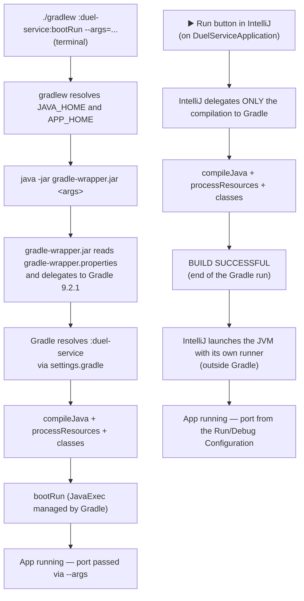

# Running locally: `./gradlew bootRun` vs IntelliJ IDEA's Run button

Files covered:

- [`gradlew`](../gradlew)
- [`gradle/wrapper/gradle-wrapper.properties`](../gradle/wrapper/gradle-wrapper.properties)
- [`settings.gradle`](../settings.gradle)
- `duel-service/build.gradle` (applies equally to `wizard-service` and `inventory-service`)

This document expands on step 3 of [`README.md`](README.md) ("Local phase: run each service"): it explains, step by step, what really happens when you run `./gradlew :duel-service:bootRun --args="--server.port=8082"`, and why running the same service from IntelliJ IDEA's ▶️ Run button produces a different log (only the `:duel-service:classes` task).

## 1. Step by step: `./gradlew :duel-service:bootRun --args="--server.port=8082"`

1. **The shell runs `gradlew`.** It is not a Gradle binary: it is a POSIX script generated by Gradle that only acts as a launcher (see [`01_gradle_wrapper.md`](01_gradle_wrapper.md)).
2. **`gradlew` resolves `APP_HOME` and locates a JDK** (`JAVA_HOME` or `java` on the `PATH`); if it finds none, it fails with an explanatory message.
3. **`gradlew` builds a `java` command and forwards the arguments as-is**, without interpreting them:
   ```sh
   java -Dorg.gradle.appname=gradlew -jar gradle/wrapper/gradle-wrapper.jar \
        :duel-service:bootRun --args="--server.port=8082"
   ```
4. **`gradle-wrapper.jar` reads `gradle-wrapper.properties`**, confirms that the Gradle 9.2.1 distribution is downloaded/cached in `~/.gradle/wrapper/dists` (or downloads it if missing) and hands control to that real Gradle installation, with the same arguments.
5. **Gradle resolves `:duel-service`** as a subproject path, using the topology declared in `settings.gradle`.
6. **Gradle applies the configured plugins** in the root `build.gradle` (common to the three modules) and in `duel-service/build.gradle` (Java + Spring Boot). The Spring Boot plugin is the one that registers the `bootRun` task.
7. **Gradle builds the task graph.** `bootRun` depends on `classes`, so it first runs `compileJava` + `processResources` + `classes` (compile and prepare the classpath).
8. **Gradle runs `bootRun`**: it launches a `JavaExec` process managed by Gradle itself, which starts `DuelServiceApplication`'s `main()`, brings up the Spring context and the embedded server, listening on the port given by `--args="--server.port=8082"`.
9. The process stays in the foreground, with the Spring Boot startup log mixed into the same console that shows the progress of the Gradle tasks.

## 2. Step by step: IntelliJ IDEA's ▶️ Run button (what the example showed)

When the same service is run from the Run button on the main class (instead of typing the command above), the observed log was:

```
> Task :duel-service:compileJava UP-TO-DATE
> Task :duel-service:processResources UP-TO-DATE
> Task :duel-service:classes UP-TO-DATE
BUILD SUCCESSFUL in 7s
```

1. **IntelliJ starts its own Gradle daemon** (visible as "Starting Gradle Daemon..." in the log) and delegates only the **compilation** to it.
2. **IntelliJ invokes only the `:duel-service:classes` task**, not `bootRun`. `classes` groups `compileJava` + `processResources`: it compiles the code and copies the resources, without running tests, Checkstyle, Spotless or JaCoCo.
3. Gradle finishes with `BUILD SUCCESSFUL` — that is the complete block pasted as the example. The Gradle run **ends there**.
4. **IntelliJ takes the already compiled classpath and launches the application's JVM by itself**, with its own runner (not through Gradle's `bootRun` task). This happens outside Gradle's build panel, in the IDE's "Run" tab — which is why it does not appear in the pasted log.
5. The end result (the app up, listening on the port configured in the IDE's Run/Debug Configuration) is equivalent to `bootRun`'s, but it got there by a different, lighter path.

## 3. Comparison diagram



## 4. Summary

| | `./gradlew bootRun` | IntelliJ's Run button (build via Gradle, run via IDE) |
|---|---|---|
| Gradle tasks executed | `classes` → `bootRun` | Only `classes` |
| Who starts the app's JVM | Gradle itself (`JavaExec`) | IntelliJ, with its native runner |
| Where the Spring Boot log appears | Same panel as the Gradle tasks | A "Run" tab separate from the build panel |
| How the port is passed | `--args="--server.port=..."` | Program arguments / VM options of the Run/Debug Configuration |
| End result | App running | App running (equivalent, different path) |

See also: [`01_gradle_wrapper.md`](01_gradle_wrapper.md), [`README.md`](README.md#3-local-phase-run-each-service).
