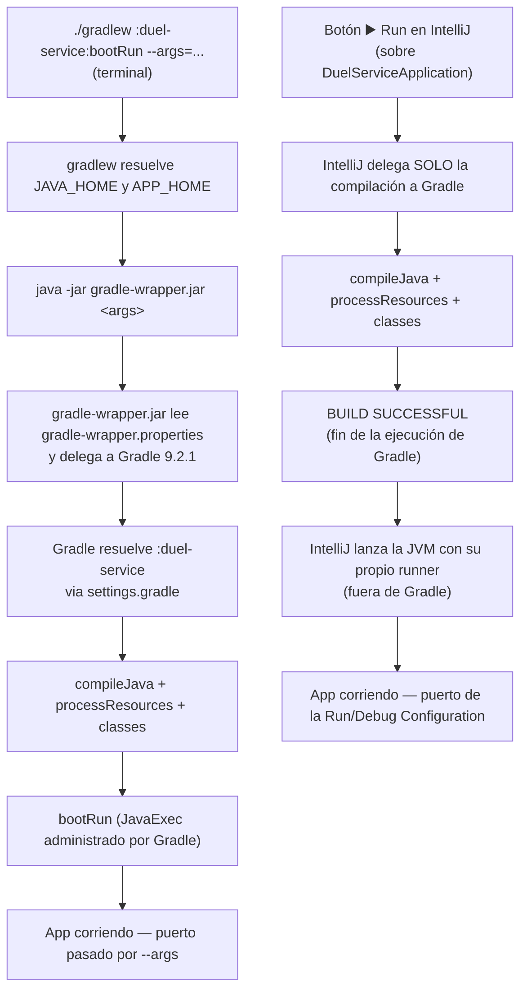

# Ejecución local: `./gradlew bootRun` vs botón Run de IntelliJ IDEA

Archivos cubiertos:

- [`gradlew`](../gradlew)
- [`gradle/wrapper/gradle-wrapper.properties`](../gradle/wrapper/gradle-wrapper.properties)
- [`settings.gradle`](../settings.gradle)
- `duel-service/build.gradle` (aplica igual a `wizard-service` e `inventory-service`)

Este documento amplía el paso 3 del [`README.md`](README.md) («Fase local: ejecutar cada servicio»): explica, paso a paso, qué pasa realmente cuando se ejecuta `./gradlew :duel-service:bootRun --args="--server.port=8082"`, y por qué correr el mismo servicio desde el botón ▶️ Run de IntelliJ IDEA produce un log distinto (solo la task `:duel-service:classes`).

## 1. Paso a paso: `./gradlew :duel-service:bootRun --args="--server.port=8082"`

1. **El shell ejecuta `gradlew`.** No es un binario de Gradle: es un script POSIX generado por Gradle que solo actúa como lanzador (ver [`01_gradle_wrapper.md`](01_gradle_wrapper.md)).
2. **`gradlew` resuelve `APP_HOME` y localiza un JDK** (`JAVA_HOME` o `java` del `PATH`); si no encuentra ninguno, falla con un mensaje explicativo.
3. **`gradlew` arma un comando `java` y le reenvía los argumentos tal cual**, sin interpretarlos:
   ```sh
   java -Dorg.gradle.appname=gradlew -jar gradle/wrapper/gradle-wrapper.jar \
        :duel-service:bootRun --args="--server.port=8082"
   ```
4. **`gradle-wrapper.jar` lee `gradle-wrapper.properties`**, confirma que la distribución Gradle 9.2.1 está descargada/cacheada en `~/.gradle/wrapper/dists` (o la descarga si falta) y le entrega el control a esa instalación real de Gradle, con los mismos argumentos.
5. **Gradle resuelve `:duel-service`** como ruta de subproyecto, usando la topología declarada en `settings.gradle`.
6. **Gradle aplica los plugins configurados** en el `build.gradle` raíz (comunes a los tres módulos) y en `duel-service/build.gradle` (Java + Spring Boot). El plugin de Spring Boot es quien registra la task `bootRun`.
7. **Gradle arma el grafo de tareas.** `bootRun` depende de `classes`, así que primero ejecuta `compileJava` + `processResources` + `classes` (compilar y preparar el classpath).
8. **Gradle ejecuta `bootRun`**: lanza un proceso `JavaExec` administrado por el propio Gradle, que arranca el `main()` de `DuelServiceApplication`, levanta el contexto de Spring y el servidor embebido, escuchando en el puerto indicado por `--args="--server.port=8082"`.
9. El proceso queda en foreground, con el log de arranque de Spring Boot mezclado en la misma consola donde se ve el progreso de las tasks de Gradle.

## 2. Paso a paso: botón ▶️ Run en IntelliJ IDEA (lo que se vio en el ejemplo)

Cuando se ejecuta el mismo servicio desde el botón Run sobre la clase principal (en vez de escribir el comando anterior), el log observado fue:

```
> Task :duel-service:compileJava UP-TO-DATE
> Task :duel-service:processResources UP-TO-DATE
> Task :duel-service:classes UP-TO-DATE
BUILD SUCCESSFUL in 7s
```

1. **IntelliJ arranca su propio daemon de Gradle** (visible como "Starting Gradle Daemon..." en el log) para delegarle únicamente la **compilación**.
2. **IntelliJ invoca solo la task `:duel-service:classes`**, no `bootRun`. `classes` agrupa `compileJava` + `processResources`: compila el código y copia los recursos, sin correr tests, sin Checkstyle, sin Spotless y sin JaCoCo.
3. Gradle termina con `BUILD SUCCESSFUL` — ese es el bloque completo que se pegó como ejemplo. La ejecución de Gradle **termina ahí**.
4. **IntelliJ toma el classpath ya compilado y lanza la JVM de la aplicación por su cuenta**, con su propio runner (no a través de la task `bootRun` de Gradle). Esto ocurre fuera del panel de build de Gradle, en la pestaña "Run" del IDE — por eso no aparece en el log pegado.
5. El resultado final (la app arriba, escuchando en el puerto configurado en la Run/Debug Configuration del IDE) es equivalente al de `bootRun`, pero llegó por un camino distinto y más liviano.

## 3. Diagrama comparativo



## 4. Resumen

| | `./gradlew bootRun` | Botón Run de IntelliJ (build vía Gradle, run vía IDE) |
|---|---|---|
| Tasks de Gradle ejecutadas | `classes` → `bootRun` | Solo `classes` |
| Quién arranca la JVM de la app | El propio Gradle (`JavaExec`) | IntelliJ, con su runner nativo |
| Dónde se ve el log de Spring Boot | Mismo panel que las tasks de Gradle | Pestaña "Run" separada del panel de build |
| Cómo se pasa el puerto | `--args="--server.port=..."` | Program arguments / VM options de la Run/Debug Configuration |
| Resultado final | App corriendo | App corriendo (equivalente, camino distinto) |

Ver también: [`01_gradle_wrapper.md`](01_gradle_wrapper.md), [`README.md`](README.md#3-fase-local-ejecutar-cada-servicio).
