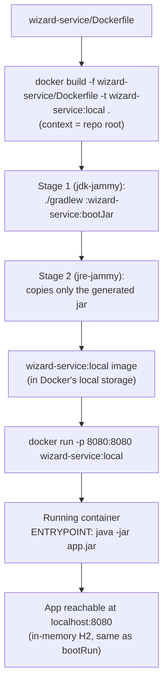

# What a container image is and how to run it locally

Files covered:

- [`wizard-service/Dockerfile`](../wizard-service/Dockerfile)

This document complements [`07_wizard_service.md`](07_wizard_service.md): it explains the concept of a "container image" from scratch and details, step by step, how to build it and run it on the local machine using the `wizard-service` `Dockerfile`. It does not cover the deployment flow to GKE (that is in [`README.md`](README.md#5-deployment-phase-gke) and in [`../GKE_GCP_DEPLOYMENT/`](../GKE_GCP_DEPLOYMENT/)) — here the scope is strictly **local**.

## 1. What a container image is

An **image** is an immutable, self-contained package that includes everything needed to run an application: already compiled code, the runtime (in this case the JRE), libraries and configuration — but **not** a running process. It is built in stacked **layers** (each `Dockerfile` instruction adds a layer), and those layers are cached: if a layer did not change between builds, Docker reuses it instead of rebuilding it.

A **container** is a *running instance* of an image: the live process, with its own filesystem (a disposable writable layer on top of the image), its own isolated network and its own resources. The same image can start multiple independent containers.

Quick analogy: the image is like a class, the container is like an instance of that class.

| | Image | Container |
|---|---|---|
| Nature | Static, immutable template | Running process |
| Created with | `docker build` | `docker run` |
| How many per image | — | Many, each one independent |
| Persists when stopped | Yes (stays on disk) | Destroyed unless a volume is used |

## 2. What the `wizard-service` `Dockerfile` produces

It is a **multi-stage** build (two `FROM`s, see [`wizard-service/Dockerfile`](../wizard-service/Dockerfile)):

1. **`build` stage** (`eclipse-temurin:17-jdk-jammy`): copies the whole repo (it needs the wrapper and the three modules because it is a Gradle multi-project build) and runs `./gradlew :wizard-service:bootJar` to produce the executable jar.
2. **Final stage** (`eclipse-temurin:17-jre-jammy`): copies **only** the resulting jar from the previous stage, discarding the JDK, Gradle and the source code. The result is a lightweight final image, ready to run with `java -jar app.jar`.

As explained in [`07_wizard_service.md`](07_wizard_service.md), this `Dockerfile` is **educational**: it manually replicates what Cloud Native Buildpacks does (the actual mechanism used to deploy to GKE), and `inventory-service` and `duel-service` have an equivalent one (see [`08_inventory_service.md`](08_inventory_service.md) and [`09_duel_service.md`](09_duel_service.md)).

## 3. Step by step: build and run the image locally

### 3.1. Build the image (`docker build`)

```bash
docker build -f wizard-service/Dockerfile -t wizard-service:local .
```

- `-f wizard-service/Dockerfile`: tells Docker **which** Dockerfile to use (it is not at the root).
- `-t wizard-service:local`: gives the resulting image a name (`wizard-service`) and a tag (`local`), so it can be referenced later.
- **The final `.` is the build context, and it must be the repo root** — not `wizard-service/`. The `Dockerfile` itself points this out in its opening comment: since it is a Gradle multi-module project, the `build` stage needs to see `gradlew`, `settings.gradle` and the three service folders, all of which hang off the root.

What happens internally when you run this: Docker builds the `build` stage in a temporary container (compiling with Gradle inside), then builds the final stage by copying only the jar, and discards the temporary container from the first stage. When it finishes, the `wizard-service:local` image is stored in Docker's local storage (visible with `docker images`).

### 3.2. Run a container from the image (`docker run`)

```bash
docker run -p 8080:8080 wizard-service:local
```

- `-p 8080:8080`: publishes the container's port 8080 (the one the `Dockerfile` declares with `EXPOSE 8080` and that Spring Boot listens on by default) on the host's port 8080. Format: `-p <host_port>:<container_port>`.
- `wizard-service:local`: the image built in the previous step.

The container runs `ENTRYPOINT ["java", "-jar", "app.jar"]`, brings up the Spring Boot context with its in-memory H2 database (just like running `bootRun` locally, see [`10_bootrun_vs_ide_execution.md`](10_bootrun_vs_ide_execution.md)), and listens on `localhost:8080`.

### 3.3. Check that it responds

With the container running (in another terminal):

```bash
curl http://localhost:8080/api/wizards
```

Or use the repo's Postman collection (`Hogwarts_API.postman_collection.json`) pointing to `localhost:8080`.

### 3.4. Stop and clean up

```bash
# Ctrl+C if you ran docker run in the foreground, or:
docker ps                     # see the container ID/name
docker stop <container_id>    # stop it

docker rmi wizard-service:local   # delete the image if it is no longer needed
```

## 4. Local flow diagram



## 5. Notes

- This flow is **purely local**: it does not publish the image to any registry or connect it to GCP. That is what section 4.a of [`README.md`](README.md#4-packaging-phase-two-separate-processes) covers (Cloud Native Buildpacks + Artifact Registry), which is the actual mechanism used to deploy.
- `inventory-service` and `duel-service` follow the same path (same `docker build`/`docker run`, changing the module name and the `-f`), with their own `Dockerfile`s — see [`08_inventory_service.md`](08_inventory_service.md) and [`09_duel_service.md`](09_duel_service.md).
- The `:local` tag is only for testing on your machine. To publish to Artifact Registry, the tag is the service's semantic version (from its `gradle.properties`), see `GKE_GCP_DEPLOYMENT/03_artifact_registry_and_builds.md` §4.

See also: [`07_wizard_service.md`](07_wizard_service.md), [`10_bootrun_vs_ide_execution.md`](10_bootrun_vs_ide_execution.md).
