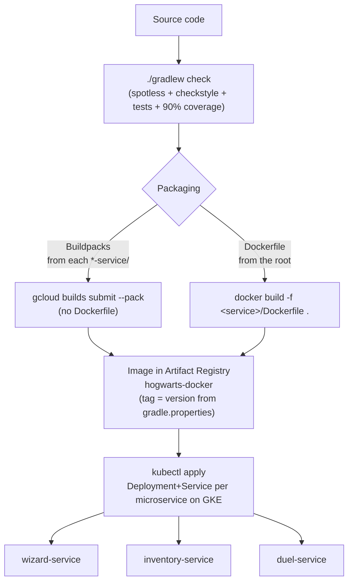

# Build and deployment documentation — hogwarts-backend

This is the base file: it explains how the project's build/deploy files and folders interact with each other, and in what order the full pipeline runs — from building locally to deploying each microservice to the cloud. The details of each individual file are in the numbered documents listed at the end.

> **Cloud deployment scope**: this documentation covers packaging into a container image; the actual deployment target is **GKE**, documented in [`../GKE_GCP_DEPLOYMENT/`](../GKE_GCP_DEPLOYMENT/). The Kubernetes manifests are documented there as infrastructure files outside the repo (they are not added to the source code).

## 1. Overview

`hogwarts-backend` is a **multi-module** Gradle project: a root `build.gradle`/`settings.gradle` that defines common rules (Java 17, Checkstyle, Spotless, JaCoCo) and three independent modules, each a Spring Boot application that can be deployed separately:

| Module | Local port | API base path |
|---|---|---|
| `wizard-service` | 8080 | `/api/wizards` |
| `inventory-service` | 8081 | `/api/inventory/{wands,potions,brooms}` |
| `duel-service` | 8082 | `/api/duels` |

The full flow has two major phases, in this order:

1. **Build and run locally** (always first — it is the quality gate before packaging anything).
2. **Package into a container image and deploy to GKE** (GCP).

## 2. Local phase: build and check quality

Everything goes through the [Gradle Wrapper](01_gradle_wrapper.md), which reads [`settings.gradle`](03_settings_gradle.md) (module topology) and [`build.gradle`](02_root_build_gradle.md) (common rules: Java 17, [Checkstyle](04_checkstyle.md), Spotless, JaCoCo).

```bash
# Full quality gate: formatting + checkstyle + tests + coverage ≥ 90%
./gradlew check

# Only run the tests of the three modules
./gradlew testAll
```

`./gradlew check` is the command that **must pass before** generating any deployment image — it guarantees that the code meets the formatting (Spotless), documentation/style (Checkstyle) and minimum coverage (90% of lines, `jacocoRootCoverageVerification` gate) rules defined in the root `build.gradle`.

## 3. Local phase: run each service

Since no `application.properties` sets `server.port`, each service is started by passing the port explicitly (see the root [`../README.md`](../README.md)):

```bash
./gradlew :wizard-service:bootRun --args="--server.port=8080"
./gradlew :inventory-service:bootRun --args="--server.port=8081"
./gradlew :duel-service:bootRun --args="--server.port=8082"
```

At this point the three services run locally, each with its own in-memory H2 database, ready to be tested with the repo's Postman collection (`Hogwarts_API.postman_collection.json`).

## 4. Packaging phase: two separate processes

From here there are **two independent ways** to turn the code into a container image ready to deploy. The project documents and actually uses the first one; the second exists as an educational `Dockerfile` in each service.

### 4.a. Cloud Native Buildpacks (the actual flow used in this repo)

Documented in detail in [`../GKE_GCP_DEPLOYMENT/03_artifact_registry_and_builds.md`](../GKE_GCP_DEPLOYMENT/03_artifact_registry_and_builds.md). It requires no `Dockerfile` or `project.toml` in the repo — Cloud Build automatically detects that it is a Gradle/Java project and builds the image.

Key point: **it runs from inside each service's folder**, not from the root, because each module has its own `build.gradle` and buildpacks needs to see an "isolated" Gradle project. That is why each service's `build.gradle` is self-contained and does not use the root's version catalog (see [`02_root_build_gradle.md`](02_root_build_gradle.md#version-catalog-gradlelibsversionstoml)).

The example publishes without a tag (`:latest`) for simplicity. To publish for real, the image is tagged with the service's **semantic version**, read from its `gradle.properties` (see section 5):

```bash
export PROJECT_ID="hogwarts-dev-123"
export REGION="us-central1"
export AR_REPO="hogwarts-docker"
export WIZARD_IMAGE="$REGION-docker.pkg.dev/$PROJECT_ID/$AR_REPO/wizard-service"

export WIZARD_VERSION=$(grep '^version=' wizard-service/gradle.properties | cut -d= -f2)

cd wizard-service
gcloud builds submit --pack image="$WIZARD_IMAGE:$WIZARD_VERSION"
cd ..
```

It is repeated the same way for `inventory-service` and `duel-service`, changing the folder and the image name (see [`08_inventory_service.md`](08_inventory_service.md), [`09_duel_service.md`](09_duel_service.md)).

### 4.b. Manual Dockerfile (educational use)

Documented in [`07_wizard_service.md`](07_wizard_service.md). It is a multi-stage build (`eclipse-temurin:17-jdk-jammy` to compile → `eclipse-temurin:17-jre-jammy` for the runtime) that manually replicates what Buildpacks does behind the scenes. Key point, the opposite of the previous one: **it runs from the repo root**, because it needs to see the wrapper and the root `settings.gradle`/`build.gradle` to resolve the multi-module build:

```bash
docker build -f wizard-service/Dockerfile -t wizard-service:local .
docker run -p 8080:8080 wizard-service:local
```

`inventory-service` and `duel-service` have their own `Dockerfile` with the same pattern, changing only the target module (see [`08_inventory_service.md`](08_inventory_service.md) and [`09_duel_service.md`](09_duel_service.md)).

### 4.c. Comparison

| | Buildpacks (`gcloud builds submit --pack`) | Dockerfile (`docker build`) |
|---|---|---|
| Configuration file in the repo | None | One `Dockerfile` per service |
| Working directory | Inside each `*-service/` | Repo root |
| Where it compiles | Cloud Build managed infrastructure | Locally, on the Docker daemon |
| Who decides the base image / layers | The Java/Gradle buildpack (Google Cloud Buildpacks) | The `Dockerfile` itself, explicit and auditable |
| Use in this project | Actual deployment flow to GKE | Reference/learning only |

## 5. Deployment phase: GKE

Documented in detail in [`../GKE_GCP_DEPLOYMENT/04_gke_microservices.md`](../GKE_GCP_DEPLOYMENT/04_gke_microservices.md). Once the image is published to Artifact Registry (step 4), it is deployed as an independent Kubernetes `Deployment` + `Service` per microservice:

```bash
kubectl apply -f wizard-service.yaml
```

Relevant notes:
- The `Deployment` manifest sets `containerPort: 8080`; Spring Boot listens on `8080` by default, so normally **nothing needs to change** in the code to match — this is also what the `EXPOSE 8080` of the `Dockerfile`s documents.
- The image repository is `hogwarts-docker` in Artifact Registry, with URIs like `REGION-docker.pkg.dev/PROJECT_ID/hogwarts-docker/<service>:<version>`.
- **Image versioning**: each service has its own semantic version (`MAJOR.MINOR.PATCH`) in its own `gradle.properties`, independent of the others. That version is the image tag, and the GKE `Deployment` references that tag, never `:latest`. Rules, tags and the release flow are in [`../GKE_GCP_DEPLOYMENT/03_artifact_registry_and_builds.md`](../GKE_GCP_DEPLOYMENT/03_artifact_registry_and_builds.md) §4.
- Reusable environment variables for the whole flow are centralized in [`../GKE_GCP_DEPLOYMENT/env-vars.sh`](../GKE_GCP_DEPLOYMENT/env-vars.sh).
- The full GCP guide (account, project, Cloud SQL, security with Identity Platform, Secret Manager, observability, production checklist) lives in [`../GKE_GCP_DEPLOYMENT/`](../GKE_GCP_DEPLOYMENT/) — this documentation does not duplicate it; it only references the build/deploy steps that directly involve the files listed in section 7.

## 6. Full flow diagram



## 7. Index of documented files

| File | Content |
|---|---|
| [`01_gradle_wrapper.md`](01_gradle_wrapper.md) | `gradlew`, `gradlew.bat`, `gradle-wrapper.jar`, `gradle-wrapper.properties` |
| [`02_root_build_gradle.md`](02_root_build_gradle.md) | Root `build.gradle`, `gradle/libs.versions.toml`, per-service version |
| [`03_settings_gradle.md`](03_settings_gradle.md) | `settings.gradle` |
| [`04_checkstyle.md`](04_checkstyle.md) | `config/checkstyle/checkstyle.xml`, `config/checkstyle/suppressions.xml` |
| [`05_hogwarts_iml.md`](05_hogwarts_iml.md) | `hogwarts.iml` |
| [`06_generated_directories.md`](06_generated_directories.md) | `/build`, `/.gradle` |
| [`07_wizard_service.md`](07_wizard_service.md) | `wizard-service/build.gradle`, `wizard-service/gradle.properties`, `wizard-service/Dockerfile` |
| [`08_inventory_service.md`](08_inventory_service.md) | `inventory-service/build.gradle`, `inventory-service/gradle.properties`, `inventory-service/Dockerfile` |
| [`09_duel_service.md`](09_duel_service.md) | `duel-service/build.gradle`, `duel-service/gradle.properties`, `duel-service/Dockerfile` |
| [`10_bootrun_vs_ide_execution.md`](10_bootrun_vs_ide_execution.md) | `gradlew`, `gradle-wrapper.properties`, `settings.gradle` — `bootRun` vs IntelliJ's Run button |
| [`11_local_container_image.md`](11_local_container_image.md) | `wizard-service/Dockerfile` — what a container image is and how to build/run it locally |
