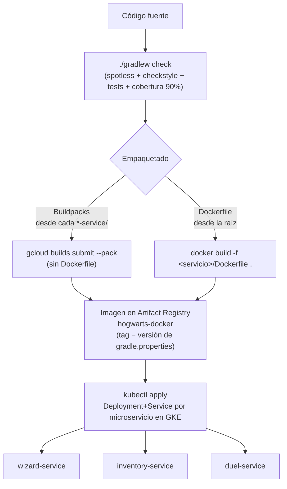

# Documentación de compilación y despliegue — hogwarts-backend

Este es el archivo base: explica cómo interactúan entre sí los archivos y carpetas de build/deploy del proyecto, y en qué orden se ejecuta el pipeline completo — desde compilar en local hasta desplegar cada microservicio en la nube. Los detalles de cada archivo individual están en los documentos numerados listados al final.

> **Alcance de despliegue cloud**: esta documentación cubre el empaquetado en imagen de contenedor; el destino real de despliegue es **GKE**, documentado en [`../GKE_GCP_DEPLOYMENT/`](../GKE_GCP_DEPLOYMENT/). Los manifiestos de Kubernetes se documentan ahí como archivos de infraestructura fuera del repo (no se agregan al código fuente).

## 1. Panorama general

`hogwarts-backend` es un proyecto Gradle **multi-módulo**: un `build.gradle`/`settings.gradle` raíz que define reglas comunes (Java 17, Checkstyle, Spotless, JaCoCo) y tres módulos independientes, cada uno una aplicación Spring Boot desplegable por separado:

| Módulo | Puerto local | Base path API |
|---|---|---|
| `wizard-service` | 8080 | `/api/wizards` |
| `inventory-service` | 8081 | `/api/inventory/{wands,potions,brooms}` |
| `duel-service` | 8082 | `/api/duels` |

El flujo completo tiene dos grandes fases, en este orden:

1. **Compilar y ejecutar en local** (siempre primero — es el gate de calidad antes de empaquetar nada).
2. **Empaquetar en imagen de contenedor y desplegar a GKE** (GCP).

## 2. Fase local: compilar y verificar calidad

Todo pasa por el [Gradle Wrapper](01_gradle_wrapper.md), que lee [`settings.gradle`](03_settings_gradle.md) (topología de módulos) y [`build.gradle`](02_root_build_gradle.md) (reglas comunes: Java 17, [Checkstyle](04_checkstyle.md), Spotless, JaCoCo).

```bash
# Quality gate completo: formato + checkstyle + tests + cobertura ≥ 90%
./gradlew check

# Solo correr los tests de los tres módulos
./gradlew testAll
```

`./gradlew check` es el comando que **debe pasar antes** de generar cualquier imagen de despliegue — es la garantía de que el código cumple las reglas de formateo (Spotless), documentación/estilo (Checkstyle) y cobertura mínima (90% de líneas, gate `jacocoRootCoverageVerification`) definidas en el `build.gradle` raíz.

## 3. Fase local: ejecutar cada servicio

Como ningún `application.properties` fija `server.port`, cada servicio se levanta pasando el puerto explícitamente (ver [`../README.md`](../README.md) raíz):

```bash
./gradlew :wizard-service:bootRun --args="--server.port=8080"
./gradlew :inventory-service:bootRun --args="--server.port=8081"
./gradlew :duel-service:bootRun --args="--server.port=8082"
```

En este punto los tres servicios corren en local, cada uno con su base H2 en memoria, listos para probarse con la colección Postman del repo (`Hogwarts_API.postman_collection.json`).

## 4. Fase de empaquetado: dos procesos separados

A partir de aquí hay **dos formas independientes** de convertir el código en una imagen de contenedor lista para desplegar. El proyecto documenta y usa realmente la primera; la segunda existe como `Dockerfile` educativo en cada servicio.

### 4.a. Cloud Native Buildpacks (flujo real usado en este repo)

Documentado en detalle en [`../GKE_GCP_DEPLOYMENT/03_artifact_registry_and_builds.md`](../GKE_GCP_DEPLOYMENT/03_artifact_registry_and_builds.md). No requiere ningún `Dockerfile` ni `project.toml` en el repo — Cloud Build detecta automáticamente que es un proyecto Gradle/Java y construye la imagen.

Punto clave: **se ejecuta desde dentro de la carpeta de cada servicio**, no desde la raíz, porque cada módulo tiene su propio `build.gradle` y buildpacks necesita ver un proyecto Gradle "aislado". Por eso el `build.gradle` de cada servicio es autocontenido y no usa el catálogo de versiones del root (ver [`02_root_build_gradle.md`](02_root_build_gradle.md#catálogo-de-versiones-gradlelibsversionstoml)).

El ejemplo publica sin tag (`:latest`) para simplificar. Para publicar de verdad, la imagen lleva como tag la **versión semántica** del servicio, leída de su `gradle.properties` (ver la sección 5):

```bash
export PROJECT_ID="hogwarts-dev-123"
export REGION="us-central1"
export AR_REPO="hogwarts-docker"
export WIZARD_IMAGE="$REGION-docker.pkg.dev/$PROJECT_ID/$AR_REPO/wizard-service"

export WIZARD_VERSION=$(grep '^version=' wizard-service/gradle.properties | cut -d= -f2)

cd wizard-service
gcloud builds submit --pack image="$WIZARD_IMAGE:$WIZARD_VERSION"
cd ..
```

Se repite igual para `inventory-service` y `duel-service`, cambiando la carpeta y el nombre de imagen (ver [`08_inventory_service.md`](08_inventory_service.md), [`09_duel_service.md`](09_duel_service.md)).

### 4.b. Dockerfile manual (uso educativo)

Documentado en [`07_wizard_service.md`](07_wizard_service.md). Es un build multi-stage (`eclipse-temurin:17-jdk-jammy` para compilar → `eclipse-temurin:17-jre-jammy` para runtime) que replica manualmente lo que Buildpacks hace por detrás. Punto clave, opuesto al anterior: **se ejecuta desde la raíz del repo**, porque necesita ver el wrapper y el `settings.gradle`/`build.gradle` raíz para resolver el build multi-módulo:

```bash
docker build -f wizard-service/Dockerfile -t wizard-service:local .
docker run -p 8080:8080 wizard-service:local
```

`inventory-service` y `duel-service` tienen su propio `Dockerfile` con el mismo patrón, cambiando solo el módulo objetivo (ver [`08_inventory_service.md`](08_inventory_service.md) y [`09_duel_service.md`](09_duel_service.md)).

### 4.c. Comparación

| | Buildpacks (`gcloud builds submit --pack`) | Dockerfile (`docker build`) |
|---|---|---|
| Archivo de configuración en el repo | Ninguno | `Dockerfile` por servicio |
| Directorio de ejecución | Dentro de cada `*-service/` | Raíz del repo |
| Dónde compila | Infraestructura administrada de Cloud Build | Localmente, en el daemon de Docker |
| Quién decide la imagen base / capas | El buildpack de Java/Gradle (Google Cloud Buildpacks) | El propio `Dockerfile`, explícito y auditable |
| Uso en este proyecto | Flujo real de despliegue a GKE | Solo referencia/aprendizaje |

## 5. Fase de despliegue: GKE

Documentado en detalle en [`../GKE_GCP_DEPLOYMENT/04_gke_microservices.md`](../GKE_GCP_DEPLOYMENT/04_gke_microservices.md). Una vez publicada la imagen en Artifact Registry (paso 4), se despliega como un `Deployment` + `Service` de Kubernetes independiente por microservicio:

```bash
kubectl apply -f wizard-service.yaml
```

Notas relevantes:
- El manifiesto `Deployment` fija `containerPort: 8080`; Spring Boot escucha en `8080` por defecto, por lo que normalmente **no hace falta cambiar nada** en el código para que coincida — esto también es lo que documenta el `EXPOSE 8080` de los `Dockerfile`.
- El repositorio de imágenes es `hogwarts-docker` en Artifact Registry, con URIs del tipo `REGION-docker.pkg.dev/PROJECT_ID/hogwarts-docker/<service>:<versión>`.
- **Versionado de imágenes**: cada servicio tiene su versión semántica (`MAJOR.MINOR.PATCH`) en su propio `gradle.properties`, independiente de los demás. Esa versión es el tag de la imagen, y el `Deployment` de GKE referencia ese tag, nunca `:latest`. Reglas, tags y flujo de release en [`../GKE_GCP_DEPLOYMENT/03_artifact_registry_and_builds.md`](../GKE_GCP_DEPLOYMENT/03_artifact_registry_and_builds.md) §4.
- Variables de entorno reutilizables para todo el flujo están centralizadas en [`../GKE_GCP_DEPLOYMENT/env-vars.sh`](../GKE_GCP_DEPLOYMENT/env-vars.sh).
- La guía completa de GCP (cuenta, proyecto, Cloud SQL, seguridad con Identity Platform, Secret Manager, observabilidad, checklist de producción) vive en [`../GKE_GCP_DEPLOYMENT/`](../GKE_GCP_DEPLOYMENT/) — esta documentación no la duplica, solo referencia los pasos de build/deploy que involucran directamente los archivos listados en la sección 6.

## 6. Diagrama del flujo completo



## 7. Índice de archivos documentados

| Archivo | Contenido |
|---|---|
| [`01_gradle_wrapper.md`](01_gradle_wrapper.md) | `gradlew`, `gradlew.bat`, `gradle-wrapper.jar`, `gradle-wrapper.properties` |
| [`02_root_build_gradle.md`](02_root_build_gradle.md) | `build.gradle` raíz, `gradle/libs.versions.toml`, versión por servicio |
| [`03_settings_gradle.md`](03_settings_gradle.md) | `settings.gradle` |
| [`04_checkstyle.md`](04_checkstyle.md) | `config/checkstyle/checkstyle.xml`, `config/checkstyle/suppressions.xml` |
| [`05_hogwarts_iml.md`](05_hogwarts_iml.md) | `hogwarts.iml` |
| [`06_generated_directories.md`](06_generated_directories.md) | `/build`, `/.gradle` |
| [`07_wizard_service.md`](07_wizard_service.md) | `wizard-service/build.gradle`, `wizard-service/gradle.properties`, `wizard-service/Dockerfile` |
| [`08_inventory_service.md`](08_inventory_service.md) | `inventory-service/build.gradle`, `inventory-service/gradle.properties`, `inventory-service/Dockerfile` |
| [`09_duel_service.md`](09_duel_service.md) | `duel-service/build.gradle`, `duel-service/gradle.properties`, `duel-service/Dockerfile` |
| [`10_bootrun_vs_ide_execution.md`](10_bootrun_vs_ide_execution.md) | `gradlew`, `gradle-wrapper.properties`, `settings.gradle` — comparación `bootRun` vs botón Run de IntelliJ |
| [`11_local_container_image.md`](11_local_container_image.md) | `wizard-service/Dockerfile` — qué es una imagen de contenedor y cómo construirla/correrla en local |
