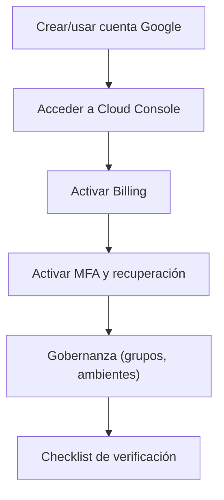

## 01 — Creación de cuenta GCP

### Objetivo

Crear una cuenta de Google Cloud lista para trabajar con GKE, Cloud SQL, Artifact Registry, Secret Manager e Identity Platform, con una configuración base de seguridad (MFA) y billing activo.

### Alcance (importante)

- Esta guía solo describe pasos en GCP (consola).
- No modifica código del repositorio.

### Resumen visual del flujo

---

## 1) Crear cuenta de Google (si no tienes)

1. Crea una cuenta Google estándar (Gmail) o usa una cuenta corporativa Google Workspace.
2. Asegúrate de poder recibir emails (verificación y alertas de billing/seguridad).

---

## 2) Acceder a Google Cloud Console

1. Entra a Google Cloud Console (busca “Google Cloud Console”).
2. Inicia sesión con la cuenta que usarás para administrar el proyecto.

---

## 3) Activar Billing (imprescindible)

GKE/Cloud SQL/Artifact Registry requieren billing activo en el proyecto.

### 3.1 Si es una cuenta nueva (free trial)

1. Activa el Free Trial si aplica.
2. Completa método de pago (tarjeta).
3. Confirma la región/país correctos para facturación.

### 3.2 Si es una organización/empresa

1. Confirma que existe una “Billing Account” disponible.
2. Solicita acceso al equipo financiero/administrador si no la ves.

---

## 4) Activar seguridad de la cuenta (muy recomendado)

### 4.1 Activar MFA (2FA)

1. Ve a la configuración de seguridad de tu cuenta Google.
2. Activa “Verificación en dos pasos”.
3. Configura al menos 2 métodos:
   - App authenticator (TOTP)
   - Llave de seguridad (si tu organización la usa) o SMS como fallback

### 4.2 Recuperación

1. Configura email y teléfono de recuperación.
2. Guarda “backup codes” en un lugar seguro.

---

## 5) Recomendaciones de gobernanza (si aplica)

Si trabajas en contexto corporativo (Workspace/Organization):

- Preferir identidades corporativas (no cuentas personales).
- Definir un grupo “admins” (Google Groups) y asignar roles al grupo, no a usuarios individuales.
- Separar ambientes por proyecto (dev/stg/prod) desde el inicio si el objetivo es producción.

---

## 6) Verificación (checklist)

- Puedes entrar a Cloud Console sin errores.
- Tienes billing activo o acceso a una Billing Account.
- Tu cuenta tiene MFA habilitado.

