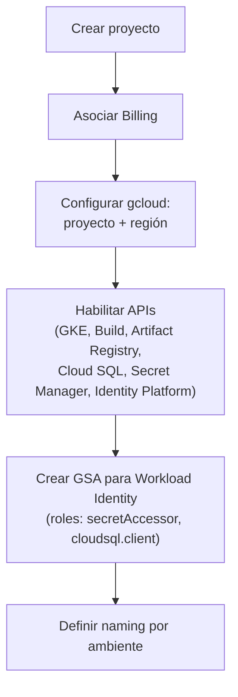

## 02 — Creación de proyecto en GCP

### Objetivo

Crear un proyecto GCP para desplegar los microservicios del repo, dejando habilitadas las APIs necesarias y una configuración base consistente (región, naming, service accounts).

### Alcance (importante)

- Esta guía solo describe pasos en GCP y comandos `gcloud`.
- No modifica código del repositorio.

### Resumen visual



---

## 0) Convenciones y variables

Define valores (ejemplos):

- `PROJECT_ID`: `hogwarts-dev-123`
- `PROJECT_NAME`: `hogwarts-backend-dev`
- `REGION`: `us-central1` (elige una región cercana a tus usuarios)
- `LOCATION_ARTIFACT_REGISTRY`: normalmente igual a `REGION`

En terminal (recomendado):

```bash
export PROJECT_ID="hogwarts-dev-123"
export REGION="us-central1"
```

---

## 1) Crear proyecto (Consola)

1. En Cloud Console, abre el selector de proyecto (arriba).
2. Click “New Project”.
3. Completa:
   - Name: `PROJECT_NAME`
   - Project ID: `PROJECT_ID` (si está disponible; si no, ajusta)
4. Si aplica, selecciona “Organization” y “Location” correctos.
5. Crea el proyecto.

### Verificación

- En el selector de proyecto ya aparece el nuevo proyecto.

---

## 2) Asociar Billing al proyecto (Consola)

1. Ve a Billing.
2. Selecciona “Manage billing accounts”.
3. En “My projects” o “Projects linked”, vincula tu proyecto a una Billing Account.

### Verificación

- En el proyecto, en Billing, debe decir “Billing account: <...> (Active)”.

---

## 3) Configurar `gcloud` para el proyecto

### 3.1 Seleccionar proyecto

```bash
gcloud config set project "$PROJECT_ID"
```

Verifica:

```bash
gcloud config get-value project
```

### 3.2 Configurar región por defecto (GKE/Compute)

```bash
gcloud config set compute/region "$REGION"
```

Verifica:

```bash
gcloud config get-value compute/region
```

---

## 4) Habilitar APIs necesarias

Habilita APIs mínimas para este camino (GKE + Cloud Build + Artifact Registry + Cloud SQL + Secret Manager + Identity Platform).

```bash
gcloud services enable \
  container.googleapis.com \
  artifactregistry.googleapis.com \
  cloudbuild.googleapis.com \
  secretmanager.googleapis.com \
  sqladmin.googleapis.com \
  iam.googleapis.com \
  identitytoolkit.googleapis.com \
  serviceusage.googleapis.com
```

Opcionales (muy útiles en práctica):

```bash
gcloud services enable \
  logging.googleapis.com \
  monitoring.googleapis.com \
  cloudtrace.googleapis.com \
  clouderrorreporting.googleapis.com \
  apigateway.googleapis.com
```

### Verificación

Lista APIs habilitadas (puede tardar algunos segundos):

```bash
gcloud services list --enabled
```

---

## 5) Crear service accounts base (recomendado)

La idea es separar identidades:

- Un service account de Google (GSA) que los Pods usarán vía **Workload Identity** (por microservicio o uno común).
- Un service account para Cloud Build (si quieres separar permisos).

### 5.1 Service account para Workload Identity (ejemplo)

Este GSA será el que, más adelante (guía `04`), se asocie vía Workload Identity a las cuentas de servicio de Kubernetes (KSA) de cada Pod — así los Pods obtienen permisos de IAM sin usar claves estáticas.

```bash
gcloud iam service-accounts create hogwarts-gke-sa \
  --display-name="Hogwarts GKE workload SA"
```

Guarda email:

```bash
export GKE_SA="hogwarts-gke-sa@$PROJECT_ID.iam.gserviceaccount.com"
echo "$GKE_SA"
```

### 5.2 Permisos típicos del workload SA

Para este proyecto, normalmente necesitarás:

- Leer secretos (Secret Manager) para DB / configs
- Conectar a Cloud SQL (si usas Cloud SQL)

Asigna roles (mínimos recomendados):

```bash
gcloud projects add-iam-policy-binding "$PROJECT_ID" \
  --member="serviceAccount:$GKE_SA" \
  --role="roles/secretmanager.secretAccessor"

gcloud projects add-iam-policy-binding "$PROJECT_ID" \
  --member="serviceAccount:$GKE_SA" \
  --role="roles/cloudsql.client"
```

### Verificación

```bash
gcloud iam service-accounts list
```

---

## 6) Decisión importante: naming y separación por ambientes

Recomendación simple:

- Un proyecto por ambiente: `hogwarts-dev`, `hogwarts-stg`, `hogwarts-prod`
- Nombres consistentes de `Deployment`/`Service` en GKE:
  - `wizard-service`
  - `inventory-service`
  - `duel-service`

Esto simplifica permisos, billing, y despliegues.

