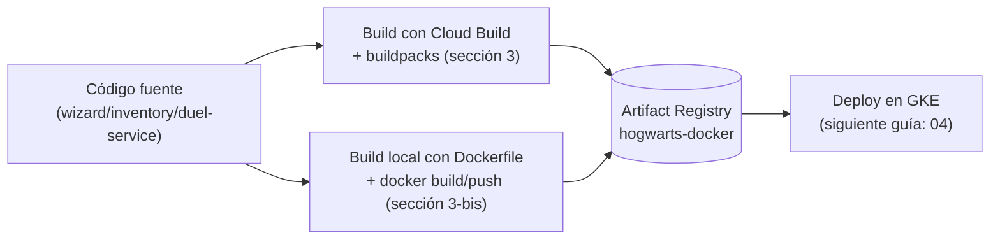

## 03 — Artifact Registry y builds (imágenes por microservicio)

### Objetivo

Crear un repositorio Docker en **Artifact Registry** y construir imágenes de contenedor para cada microservicio, usando **Cloud Build + buildpacks** (sin necesidad de escribir `Dockerfile`, sección 3) o, como alternativa, **`Dockerfile` + build/push manual con Docker** (sección 3-bis).

### Alcance (importante)

- Esta guía describe comandos y configuración en GCP.
- **No agrega** `cloudbuild.yaml` al repo (solo documentación). `wizard-service/Dockerfile`, `inventory-service/Dockerfile` y `duel-service/Dockerfile` ya existen en el repo con fines educativos, siguiendo el mismo patrón (ver sección 3-bis).
- Donde aplique, se ejecutan comandos desde subdirectorios del repo.

### Resumen visual del flujo



| Camino | Requiere Dockerfile | Dónde corre el build | Cuándo usarlo |
|---|---|---|---|
| Buildpacks (sección 3, recomendado) | No | Remoto, en Cloud Build | Caso general, sin control fino sobre la imagen |
| Dockerfile manual (sección 3-bis) | Sí | Local (`docker build`) | Necesitas control explícito de capas/paquetes |

---

## ¿Qué es Artifact Registry? ¿Qué es Docker?

**Docker** es una herramienta que empaqueta una aplicación junto con todo lo que necesita para correr (runtime, librerías, configuración) en una unidad portable llamada **imagen de contenedor**. Una imagen se ejecuta como **contenedor**: un proceso aislado que corre igual en tu máquina, en Cloud Build o en un nodo de GKE. En esta guía, Docker (o buildpacks, que hacen un trabajo equivalente sin `Dockerfile`) es lo que convierte el código fuente de cada microservicio en una imagen.

**Artifact Registry** es el servicio de GCP donde se almacenan y versionan esas imágenes (y otros tipos de paquetes) una vez construidas, de forma privada para el proyecto. Es el "registro" intermedio entre el build (sección 3) y el deploy en GKE (guía 04): GKE no lee tu código fuente ni tu máquina local, **extrae las imágenes desde Artifact Registry**.

### Formatos soportados por Artifact Registry

Un mismo repositorio de Artifact Registry se crea con un `--repository-format` fijo (no se mezclan formatos). Los más relevantes:

- **`docker`**: el usado en esta guía; almacena imágenes de contenedor Docker/OCI, direccionables como `LOCATION-docker.pkg.dev/PROJECT_ID/REPO/IMAGE`.
- **`maven`**: repositorio de artefactos Java (`.jar`/`.pom`), útil si quisieras publicar librerías internas en lugar de (o además de) imágenes.
- **`npm`**: paquetes de Node.js, equivalente privado de npmjs.com.

Existen otros formatos (Python/pip, Go, APT, YUM, etc.), pero para esta guía solo nos interesa `docker`, que es el que creamos en el paso 1.

---

## 0) Variables y convención de nombres

Recomendación:

- Repositorio Artifact Registry: `hogwarts-docker`
- Imágenes:
  - `wizard-service`
  - `inventory-service`
  - `duel-service`

Define variables:

```bash
export PROJECT_ID="hogwarts-dev-123"
export REGION="us-central1"
export AR_REPO="hogwarts-docker"
```

---

## 1) Crear repositorio Docker en Artifact Registry

Crea el repositorio:

```bash
gcloud artifacts repositories create "$AR_REPO" \
  --repository-format=docker \
  --location="$REGION" \
  --description="Docker images for hogwarts microservices"
```

Verifica:

```bash
gcloud artifacts repositories list --location="$REGION"
```

Recomendado: activa los tags inmutables para que un tag de versión publicado no pueda sobrescribirse (ver sección 4.5).

---

## 2) Definir URIs de imágenes

Artifact Registry para Docker usa este formato:

`LOCATION-docker.pkg.dev/PROJECT_ID/REPO/IMAGE`

Ejemplo:

```bash
export WIZARD_IMAGE="$REGION-docker.pkg.dev/$PROJECT_ID/$AR_REPO/wizard-service"
export INVENTORY_IMAGE="$REGION-docker.pkg.dev/$PROJECT_ID/$AR_REPO/inventory-service"
export DUEL_IMAGE="$REGION-docker.pkg.dev/$PROJECT_ID/$AR_REPO/duel-service"
```

Estas variables son la URI **sin tag**. Para simplificar, los comandos de las secciones 3 y 3-bis las usan así, lo que publica `:latest`. Para publicar una versión real, agrega el tag semántico como se indica en la sección 4.

---

## 3) Build remoto con Cloud Build + buildpacks (recomendado)

### 3.1 Por qué buildpacks aquí

- Te permiten construir imágenes desde el código fuente sin Dockerfile.
- Cloud Build ejecuta la compilación en infraestructura administrada.

### 3.2 Importante: este repo es multi-módulo

Cada microservicio vive en su propia carpeta con `build.gradle`.

Por lo tanto, el enfoque más simple es:

- Ejecutar el build desde cada subdirectorio:
  - `wizard-service/`
  - `inventory-service/`
  - `duel-service/`

Así Cloud Build “ve” un proyecto Gradle aislado y buildpacks lo detecta correctamente.

### 3.3 Build de `wizard-service`

Desde la raíz del repo, entra al módulo:

```bash
cd wizard-service
```

Ejecuta build remoto con buildpacks:

```bash
gcloud builds submit --pack image="$WIZARD_IMAGE"
```

Verifica que se publicó la imagen:

```bash
gcloud artifacts docker images list "$REGION-docker.pkg.dev/$PROJECT_ID/$AR_REPO"
```

### 3.4 Build de `inventory-service`

```bash
cd ../inventory-service
gcloud builds submit --pack image="$INVENTORY_IMAGE"
gcloud artifacts docker images list "$REGION-docker.pkg.dev/$PROJECT_ID/$AR_REPO"
```

### 3.5 Build de `duel-service`

```bash
cd ../duel-service
gcloud builds submit --pack image="$DUEL_IMAGE"
gcloud artifacts docker images list "$REGION-docker.pkg.dev/$PROJECT_ID/$AR_REPO"
```

### 3.6 Volver a la raíz

```bash
cd ..
```

---

## 3-bis) Build con `Dockerfile` + publicación manual (alternativa a buildpacks)

### 3-bis.1 Cuándo usar esta opción

- Buildpacks (sección 3) es la vía más simple y la recomendada por defecto.
- Usa `Dockerfile` en cambio si necesitas control explícito sobre la imagen base, capas, paquetes de sistema adicionales, o si buildpacks no detecta correctamente el proyecto.
- Esta vía requiere Docker instalado y corriendo en tu máquina local.

### 3-bis.2 Autenticar Docker contra Artifact Registry

Una sola vez por máquina:

```bash
gcloud auth configure-docker "$REGION-docker.pkg.dev"
```

### 3-bis.3 Build y push de `wizard-service`

Este módulo ya tiene un `Dockerfile` real en el repo (`wizard-service/Dockerfile`), documentado en `DOCUMENTACION_BUILD_DEPLOY/11_imagen_de_contenedor_local.md`. El build context debe ser la **raíz del repo** (no `wizard-service/`), porque es un build multi-módulo Gradle y la etapa de compilación necesita el wrapper y los tres módulos:

```bash
docker build -f wizard-service/Dockerfile -t "$WIZARD_IMAGE" .
docker push "$WIZARD_IMAGE"
```

Verifica que se publicó:

```bash
gcloud artifacts docker images list "$REGION-docker.pkg.dev/$PROJECT_ID/$AR_REPO"
```

### 3-bis.4 Build y push de `inventory-service` y `duel-service`

Estos dos módulos **ya tienen su propio `Dockerfile`** en el repo (`inventory-service/Dockerfile` y `duel-service/Dockerfile`), siguiendo el mismo patrón que `wizard-service/Dockerfile` (ver referencia conceptual en `DOCUMENTACION_BUILD_DEPLOY/08_inventory_service.md` y `DOCUMENTACION_BUILD_DEPLOY/09_duel_service.md`), cambiando solo el módulo del `bootJar` y la ruta del jar copiado en la etapa de runtime.

El build y push es análogo al de `wizard-service`:

```bash
docker build -f inventory-service/Dockerfile -t "$INVENTORY_IMAGE" .
docker push "$INVENTORY_IMAGE"

docker build -f duel-service/Dockerfile -t "$DUEL_IMAGE" .
docker push "$DUEL_IMAGE"
```

### 3-bis.5 Nota sobre arquitectura (Apple Silicon / ARM)

Los nodos de GKE en GCP corren sobre `linux/amd64`. Si construyes desde una Mac con chip Apple Silicon, `docker build` puede generar por defecto una imagen `arm64` que no corre en GCP. Fuerza la arquitectura correcta con `buildx`:

```bash
docker buildx build --platform linux/amd64 -f wizard-service/Dockerfile -t "$WIZARD_IMAGE" --push .
```

(`--push` publica directamente sin necesitar un `docker push` separado.)

---

## 4) Tags/versionado de imágenes: versionado semántico

### 4.1 Qué es un tag y por qué importa

Un **tag** es el sufijo después de `:` en la URI de una imagen (ej. `wizard-service:1.4.0`). Identifica una versión concreta del contenido de la imagen dentro del mismo repositorio/nombre.

En los comandos de las secciones 3 y 3-bis, si no se especifica tag explícito, tanto `gcloud builds submit --pack image="$WIZARD_IMAGE"` como `docker build -t "$WIZARD_IMAGE" .` publican (o sobrescriben) el tag implícito **`:latest`**. Esto es cómodo para probar, pero es riesgoso para operar en real:

- `:latest` es mutable: cada build nuevo lo pisa, así que no puedes saber qué código corre en un Pod de GKE con solo ver `:latest`.
- Si necesitas volver atrás (rollback) a una versión anterior, con `:latest` no hay forma de referenciarla: ya fue sobrescrita.
- El manifiesto de Kubernetes (guía 04) referencia una imagen por su URI completa; si siempre usas `:latest`, Kubernetes puede no detectar que hay una imagen nueva y no redeployar (dependiendo de la política de `imagePullPolicy`).

Por eso este proyecto usa **versionado semántico** para los tags de las imágenes.

### 4.2 Versionado semántico por microservicio

El formato es `MAJOR.MINOR.PATCH` (especificación completa en [semver.org](https://semver.org/lang/es/)). Cada microservicio tiene **su propia versión**, independiente de los demás: `wizard-service:1.4.0` puede convivir en el clúster con `duel-service:0.7.2`. Solo se publica una versión nueva del servicio que cambió.

| Parte | Se incrementa cuando… | Ejemplos en este proyecto |
|---|---|---|
| `MAJOR` | Hay un cambio **incompatible** en el contrato de la API: quien consume el servicio tiene que adaptarse | Renombrar o quitar un campo de un DTO, cambiar la ruta o el método de un endpoint, volver obligatorio un campo que era opcional, cambiar el significado de un código de estado |
| `MINOR` | Se agrega funcionalidad **compatible** con la versión anterior | Un endpoint nuevo, un campo opcional nuevo en una respuesta, un filtro nuevo en un listado |
| `PATCH` | Se corrige algo **sin cambiar el contrato** | Arreglar un bug, ajustar una validación interna, mejorar el rendimiento, actualizar una dependencia |

Reglas:

- Al incrementar una parte, las de la derecha vuelven a `0`: `1.4.2` → `1.5.0` (MINOR) → `2.0.0` (MAJOR).
- Mientras un servicio esté en `0.y.z` (desarrollo inicial), su API no se considera estable y un cambio incompatible puede ir en `MINOR`. Pasa a `1.0.0` cuando el contrato se estabiliza, por ejemplo cuando otro servicio o un cliente externo empieza a depender de él.
- Los servicios se llaman entre sí (ver guía `08_interaccion_entre_microservicios_validacion_ids.md`). Un `MAJOR` en `wizard-service` obliga a revisar a sus consumidores (`inventory-service`, `duel-service`) antes de desplegarlo.

### 4.3 Dónde vive la versión: `gradle.properties` de cada servicio

La **única fuente de verdad** de la versión es el `gradle.properties` de cada módulo:

```properties
# wizard-service/gradle.properties
version=1.4.0
```

Ese mismo valor da nombre al jar (`wizard-service-1.4.0.jar`) y es el tag de la imagen. No escribas la versión a mano en los comandos: léela del archivo (ejecutar desde la raíz del repo):

```bash
export WIZARD_VERSION=$(grep '^version=' wizard-service/gradle.properties | cut -d= -f2)
export INVENTORY_VERSION=$(grep '^version=' inventory-service/gradle.properties | cut -d= -f2)
export DUEL_VERSION=$(grep '^version=' duel-service/gradle.properties | cut -d= -f2)
```

Si un módulo no tuviera `gradle.properties`, heredaría la versión del `build.gradle` raíz. Para publicar imágenes, cada servicio debe tener el suyo.

Entre releases, la versión lleva el sufijo `-SNAPSHOT` (ej. `1.5.0-SNAPSHOT`): indica que es código en desarrollo hacia la próxima versión, todavía no publicada.

### 4.4 Qué tags lleva cada imagen

| Tag | Ejemplo | Cuándo se publica | Para qué sirve |
|---|---|---|---|
| `MAJOR.MINOR.PATCH` | `1.4.0` | En cada release | Es el tag que referencia GKE |
| Git SHA corto | `a1b2c3d` | En cada release, sobre la misma imagen | Trazabilidad: de la imagen al commit exacto |
| `MAJOR.MINOR.PATCH-SNAPSHOT.<sha>` | `1.5.0-SNAPSHOT.a1b2c3d` | Builds de desarrollo, para probar antes del release | Probar en un entorno de dev sin "gastar" un número de versión |

Reglas:

- **Sin prefijo `v`** en el tag de imagen: el tag es exactamente el `version` de `gradle.properties` (`1.4.0`, no `v1.4.0`). El prefijo `v` se usa solo en los tags de git (sección 4.6).
- **Un tag de versión nunca se reutiliza.** Si `1.4.0` salió con un bug, se corrige y se publica `1.4.1`; no se vuelve a publicar `1.4.0`.
- **No se publica `-SNAPSHOT` solo** (ej. `1.5.0-SNAPSHOT`), porque cada build lo pisaría y se pierde la trazabilidad. Los builds de desarrollo siempre llevan el SHA.
- **No se publica `latest`.** Con las etiquetas inmutables de la sección 4.5 tampoco se podría moverlo.
- Los tags de Docker no admiten `+`, así que la "metadata de build" de semver (`1.4.0+a1b2c3d`) no es válida como tag. Por eso el SHA va como tag aparte, o separado por `.` en los builds de desarrollo.

### 4.5 Hacer los tags inmutables en Artifact Registry

Para que nadie pueda sobrescribir un tag ya publicado (ni por error), activa los tags inmutables en el repositorio:

```bash
gcloud artifacts repositories update "$AR_REPO" \
  --location="$REGION" \
  --immutable-tags
```

Verifica:

```bash
gcloud artifacts repositories describe "$AR_REPO" \
  --location="$REGION" \
  --format='value(dockerConfig.immutableTags)'
```

Debe responder `True`. A partir de ahí, intentar publicar de nuevo `wizard-service:1.4.0` falla, que es justo lo que se busca. Los comandos sin tag de las secciones 3 y 3-bis (que publican `:latest`) también fallan desde el segundo intento: úsalos solo para la primera prueba, o agrega siempre un tag como se indica en la sección 4.7.

### 4.6 Flujo de release de un servicio

Ejemplo: publicar `wizard-service` `1.4.0`, partiendo de `version=1.4.0-SNAPSHOT`.

1. **Decidir el número.** Revisa qué cambió desde el último release con la tabla de la sección 4.2. Si el cambio resulta ser `MAJOR` o `MINOR` y el SNAPSHOT no lo refleja, ajusta el número.

2. **Fijar la versión.** En `wizard-service/gradle.properties`, quita el sufijo: `version=1.4.0`. Comprueba que todo pasa y haz commit:

   ```bash
   ./gradlew :wizard-service:check
   git commit -am "release: wizard-service 1.4.0"
   ```

3. **Crear el tag de git.** Como es un monorepo, el tag lleva el nombre del servicio; un `v1.4.0` a secas no diría de cuál se trata:

   ```bash
   git tag -a wizard-service/v1.4.0 -m "wizard-service 1.4.0"
   git push origin main wizard-service/v1.4.0
   ```

4. **Construir y publicar la imagen** con los tags de la sección 4.7.

5. **Desplegar** la versión nueva en GKE (guía `04_microservicios_gke.md` §9):

   ```bash
   kubectl set image deployment/wizard-service wizard-service="$WIZARD_IMAGE:$WIZARD_VERSION"
   kubectl rollout status deployment/wizard-service
   ```

6. **Abrir el siguiente ciclo.** Vuelve a poner `-SNAPSHOT` con la próxima versión prevista (normalmente el siguiente `PATCH`) y haz commit:

   ```bash
   # wizard-service/gradle.properties → version=1.4.1-SNAPSHOT
   git commit -am "chore: wizard-service 1.4.1-SNAPSHOT"
   ```

### 4.7 Build y push con los tags

Prepara las variables (desde la raíz del repo). El build tiene que salir de un árbol de trabajo limpio; si no, el SHA no describiría el código que realmente va en la imagen:

```bash
test -z "$(git status --porcelain)" || echo "ATENCIÓN: hay cambios sin commitear; el SHA no representa el código de la imagen"

export GIT_SHA=$(git rev-parse --short HEAD)
export WIZARD_VERSION=$(grep '^version=' wizard-service/gradle.properties | cut -d= -f2)

[[ "$WIZARD_VERSION" == *-SNAPSHOT ]] && echo "ATENCIÓN: $WIZARD_VERSION es SNAPSHOT; usa el build de desarrollo, no el de release"
```

**Release vía buildpacks (sección 3).** `gcloud builds submit --pack` publica un solo tag por build; el tag del SHA se agrega después sobre la misma imagen:

```bash
cd wizard-service
gcloud builds submit --pack image="$WIZARD_IMAGE:$WIZARD_VERSION"
cd ..
gcloud artifacts docker tags add "$WIZARD_IMAGE:$WIZARD_VERSION" "$WIZARD_IMAGE:$GIT_SHA"
```

**Release vía Dockerfile (sección 3-bis).** `buildx` publica los dos tags en un solo paso (y fuerza `linux/amd64`, ver sección 3-bis.5):

```bash
docker buildx build --platform linux/amd64 \
  -f wizard-service/Dockerfile \
  -t "$WIZARD_IMAGE:$WIZARD_VERSION" \
  -t "$WIZARD_IMAGE:$GIT_SHA" \
  --push .
```

**Build de desarrollo (versión `-SNAPSHOT`).** Un solo tag, con el SHA incluido:

```bash
# Ej.: wizard-service:1.5.0-SNAPSHOT.a1b2c3d
cd wizard-service
gcloud builds submit --pack image="$WIZARD_IMAGE:$WIZARD_VERSION.$GIT_SHA"
cd ..
```

Para `inventory-service` y `duel-service` es el mismo patrón, con `$INVENTORY_IMAGE`/`$INVENTORY_VERSION` y `$DUEL_IMAGE`/`$DUEL_VERSION`. Publica solo los servicios que tienen un release nuevo.

Verifica los tags publicados de una imagen:

```bash
gcloud artifacts docker tags list "$WIZARD_IMAGE"
```

### 4.8 Ver qué versión corre y hacer rollback

Qué imagen (y por lo tanto qué versión) usa el `Deployment`:

```bash
kubectl get deployment wizard-service \
  -o jsonpath='{.spec.template.spec.containers[0].image}{"\n"}'
```

Volver a una versión anterior es apuntar el `Deployment` a su tag, que sigue existiendo en Artifact Registry:

```bash
kubectl set image deployment/wizard-service wizard-service="$WIZARD_IMAGE:1.3.2"
kubectl rollout status deployment/wizard-service
```

Para volver justo a la revisión anterior, también sirve `kubectl rollout undo deployment/wizard-service`.

### 4.9 Si más adelante se automatiza

Este flujo es manual a propósito. Si más adelante se agrega un trigger de Cloud Build, lo natural es dispararlo con el **push de un tag de git** con el patrón del servicio (ej. `^wizard-service/v.*$`). El trigger expone `$TAG_NAME` y `$SHORT_SHA`, que reemplazan a `git tag` y `git rev-parse` de los pasos anteriores. Conviene que el pipeline compruebe que la versión del tag de git coincide con la de `gradle.properties` antes de publicar.

---

## 5) Troubleshooting típico

### 5.1 “API not enabled”

Habilita APIs:

```bash
gcloud services enable cloudbuild.googleapis.com artifactregistry.googleapis.com
```

### 5.2 “Permission denied” al hacer build o publicar imagen

Asegúrate de:

- Estar en el proyecto correcto (`gcloud config get-value project`)
- Tener permisos para Cloud Build y Artifact Registry

### 5.3 Buildpacks no detecta Java/Gradle

Confirma que estás ejecutando `gcloud builds submit` **dentro del módulo** (ej. `wizard-service/`) donde existe `build.gradle` del servicio.

