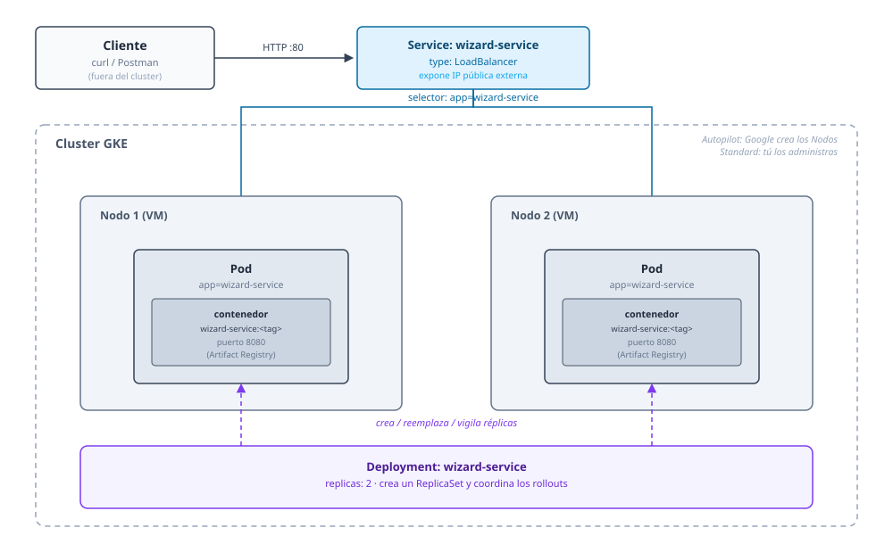

## 04 — Microservicios en GKE (deploy, ejecución y pruebas)

### Objetivo

Desplegar los 3 microservicios (`wizard-service`, `inventory-service`, `duel-service`) en **Google Kubernetes Engine (GKE)**, usando imágenes publicadas en **Artifact Registry**, y validar que las APIs funcionan (smoke tests con `curl` y/o Postman).

### Alcance (importante)

- Esta guía describe pasos en GCP + comandos `gcloud` y `kubectl`.
- No modifica el código del repositorio.
- Los manifiestos Kubernetes (`Deployment`, `Service`) se crean **fuera del repo**, en un directorio de trabajo local (ej. `~/hogwarts-gcp/k8s`), como archivos de configuración de infraestructura, no como parte del código fuente.
- Asume que ya construiste y publicaste imágenes en Artifact Registry (ver `03_artifact_registry_y_builds.md`).

### Los 3 microservicios a desplegar

| Servicio | Imagen (Artifact Registry) | Puerto contenedor | Manifiesto |
|---|---|---|---|
| `wizard-service` | `.../wizard-service` | 8080 | sección 4 |
| `inventory-service` | `.../inventory-service` | 8080 | sección 5 |
| `duel-service` | `.../duel-service` | 8080 | sección 6 |

---

## 0) Variables base

```bash
export PROJECT_ID="hogwarts-dev-123"
export REGION="us-central1"
export ZONE="us-central1-a"
export AR_REPO="hogwarts-docker"

export CLUSTER_NAME="hogwarts-cluster-gke"

export WIZARD_IMAGE="$REGION-docker.pkg.dev/$PROJECT_ID/$AR_REPO/wizard-service"
export INVENTORY_IMAGE="$REGION-docker.pkg.dev/$PROJECT_ID/$AR_REPO/inventory-service"
export DUEL_IMAGE="$REGION-docker.pkg.dev/$PROJECT_ID/$AR_REPO/duel-service"

# Versión a desplegar de cada servicio (tag semántico, ver guía 03 §4).
# Ejecutar DESDE LA RAÍZ DEL REPO, antes del `cd` de abajo:
export WIZARD_VERSION=$(grep '^version=' wizard-service/gradle.properties | cut -d= -f2)
export INVENTORY_VERSION=$(grep '^version=' inventory-service/gradle.properties | cut -d= -f2)
export DUEL_VERSION=$(grep '^version=' duel-service/gradle.properties | cut -d= -f2)

mkdir -p ~/hogwarts-gcp/k8s
cd ~/hogwarts-gcp/k8s
```

Los manifiestos de abajo referencian cada imagen con su tag de versión (ej. `wizard-service:1.4.0`), nunca `:latest`. Esa versión tiene que estar publicada en Artifact Registry (guía 03 §4.7) y no puede ser `-SNAPSHOT`: si `gradle.properties` está en un SNAPSHOT, exporta a mano la última versión publicada (ej. `export WIZARD_VERSION=1.4.0`).

Si creaste el service account para Workload Identity (recomendado, ver guía `02`), lo usaremos más adelante:

```bash
export GKE_SA="hogwarts-gke-sa@$PROJECT_ID.iam.gserviceaccount.com"
```

---

## 1) Conceptos GKE que necesitas

Antes de crear nada, conviene tener claro cómo se relacionan las piezas que vas a usar en esta guía. De "más infraestructura" a "más aplicación", la jerarquía es:

**Cluster → Nodos → Pods → Deployment → Service**

- **Cluster**: es el conjunto completo que administras como una unidad — agrupa un *control plane* (el "cerebro" que Google gestiona por ti: API de Kubernetes, scheduler, etcd, etc.) y uno o más **nodos** donde realmente corren tus contenedores. Cuando ejecutas `gcloud container clusters create-auto`, estás creando este conjunto.
- **Nodo**: es una máquina virtual (una VM de Compute Engine por debajo) que forma parte del cluster y tiene capacidad de CPU/memoria para alojar Pods. En **Standard** tú decides cuántos nodos y de qué tipo (`--num-nodes`, `--machine-type`); en **Autopilot** Google los crea y dimensiona automáticamente según lo que tus Pods pidan en `resources.requests`, y nunca interactúas con ellos directamente.
- **Pod**: es la unidad más pequeña que se puede desplegar en Kubernetes. Contiene uno o más contenedores (en nuestro caso, siempre uno: el contenedor de cada microservicio) que comparten red e IP interna. Los Pods son efímeros — si uno se cae, no se "repara", se reemplaza por uno nuevo.
- **Deployment**: es el objeto que tú declaras (en el YAML) y que le dice a Kubernetes "quiero `N` réplicas de este Pod, corriendo esta imagen, siempre así". El Deployment crea y vigila un **ReplicaSet**, que es quien efectivamente mantiene el número de Pods vivos y coordina los *rollouts* (actualizaciones progresivas) cuando cambias la imagen. Por eso `kubectl rollout status deployment/...` y `kubectl set image deployment/...` operan sobre el Deployment, no sobre los Pods directamente.
- **Service**: los Pods se crean y destruyen constantemente (cada uno con su propia IP interna, que cambia), así que no te conectas a un Pod directamente. El **Service** agrupa a todos los Pods que coinciden con una etiqueta (`selector: app: wizard-service`) y les da una identidad de red estable. Esta guía usa el tipo `LoadBalancer`, que además le asigna una **IP pública externa** para las pruebas iniciales. (Otros tipos, como `ClusterIP`, solo son accesibles dentro del cluster — se usan en la guía `08` para la comunicación interna entre microservicios, y se mencionan también en la sección [10](#10-endurecimiento-mínimo-recomendación) como endurecimiento).
- GKE tiene dos modos principales para administrar los nodos:
  - **Autopilot**: Google administra nodos, escalado y parcheo. Pagas por Pod (por lo que reserva cada Pod en `resources.requests`), no por VM. Más simple y recomendado para empezar.
  - **Standard**: tú administras el *node pool* (tamaño, tipo de máquina, cuántos nodos). Más control, más trabajo operativo.
  - Esta guía usa **Autopilot** por defecto; se incluyen notas para Standard donde aplica.
- Spring Boot escucha en el puerto `8080` por defecto. En el Deployment, `containerPort: 8080` declara ese puerto en el Pod; en el Service, `targetPort: 8080` apunta al mismo puerto del Pod mientras `port: 80` es el puerto que queda expuesto externamente (por eso las URLs de este doc no incluyen `:80`).

El diagrama siguiente resume estas relaciones:



*Lectura del diagrama: el cliente llama al **Service** (flecha gris, `HTTP :80`); el Service enruta ese tráfico (flechas azules, `selector: app=...`) hacia los **Pods**, que corren dentro de los **Nodos** agrupados en el **Cluster**. Por separado, el **Deployment** declara y vigila esas réplicas de Pods (flechas violeta punteadas) — no participa en el tráfico de red, solo en su ciclo de vida.*

---

## 2) Habilitar APIs y crear el cluster

Esta sección da de alta el servicio de GKE en el proyecto y crea el **Cluster** del que habla la sección anterior — es decir, provisiona el control plane y (en modo Standard) los nodos que van a alojar los Pods. Después de este paso, `kubectl` necesita saber a cuál cluster conectarse y con qué credenciales, y conviene confirmar que la conexión realmente funciona antes de seguir.

### 2.1 Habilitar la API de GKE

Las APIs de GCP están desactivadas por defecto en un proyecto nuevo; sin este paso, cualquier comando `gcloud container ...` fallaría con un error de permisos/API no habilitada. Es un paso único por proyecto (si ya la habilitaste antes, este comando es un no-op seguro).

```bash
gcloud services enable container.googleapis.com
```

### 2.2 Crear el cluster (Autopilot, recomendado)

Este es el comando que efectivamente crea el Cluster: GCP aprovisiona el control plane administrado y, en Autopilot, deja la gestión de nodos totalmente en manos de Google (se irán creando/ajustando según los Pods que despliegues más adelante, no hay nodos "vacíos" esperando).

```bash
gcloud container clusters create-auto "$CLUSTER_NAME" \
  --region="$REGION" \
  --project="$PROJECT_ID"
```

Nota: crear un cluster Autopilot puede tardar varios minutos.

### 2.2-bis Alternativa: cluster Standard

Mismo objetivo (crear el Cluster), pero aquí tú defines explícitamente el *node pool*: cuántas VMs (`--num-nodes`) y de qué tamaño (`--machine-type`) arrancan de entrada. Usa esto solo si necesitas ese control explícito sobre nodos (omite este paso si ya creaste el Autopilot de arriba — no puedes tener ambos con el mismo `$CLUSTER_NAME`).

```bash
gcloud container clusters create "$CLUSTER_NAME" \
  --zone="$ZONE" \
  --num-nodes=2 \
  --machine-type=e2-small \
  --project="$PROJECT_ID"
```

### 2.3 Obtener credenciales de `kubectl`

Crear el cluster no configura automáticamente tu `kubectl` local. Este comando descarga el endpoint y las credenciales del cluster y los guarda en `~/.kube/config`, para que los comandos `kubectl` de las siguientes secciones sepan a qué cluster apuntar (en vez de fallar o apuntar a otro contexto que tengas configurado).

**Prerrequisito: `kubectl` y `gke-gcloud-auth-plugin`**

Si ya instalaste `kubectl` y `gke-gcloud-auth-plugin` siguiendo la guía `00` (sección 2.2), este paso debería funcionar sin problemas. Si no, y ves el error:

```
CRITICAL: ACTION REQUIRED: gke-gcloud-auth-plugin, which is needed for continued use of kubectl, was not found or is not executable.
```

El `kubeconfig entry generated for ...` que aparece después **sí se generó igual** — el error es solo una advertencia de que ese kubeconfig no va a poder autenticarse todavía. Instala el plugin como se indica en `00_prerequisitos_locales_y_herramientas.md` y luego vuelve a ejecutar `get-credentials` para regenerar el kubeconfig:

```bash
gcloud container clusters get-credentials "$CLUSTER_NAME" --region="$REGION" --project="$PROJECT_ID"
```

(Si usaste el cluster Standard con `--zone`, reemplaza `--region` por `--zone` en el comando anterior.)

### 2.4 Verificar acceso al cluster

Un chequeo rápido de que 2.2 y 2.3 funcionaron antes de invertir tiempo en los despliegues: `get nodes` confirma que hay nodos disponibles y accesibles (en Autopilot pueden tardar un poco en aparecer tras la creación), y `cluster-info` confirma que `kubectl` está hablando con el cluster correcto.

```bash
kubectl get nodes
kubectl cluster-info
```

---

## 3) Permitir que GKE lea imágenes de Artifact Registry

Si el cluster y el repositorio de Artifact Registry están en el mismo proyecto, normalmente no necesitas configuración adicional: los nodos de GKE usan la cuenta de servicio de Compute Engine, que ya tiene acceso de lectura.

Si usas un service account dedicado para los Pods (Workload Identity) o Artifact Registry está en otro proyecto, concede el rol de lector:

```bash
gcloud artifacts repositories add-iam-policy-binding "$AR_REPO" \
  --location="$REGION" \
  --member="serviceAccount:$GKE_SA" \
  --role="roles/artifactregistry.reader"
```

---

## 4) Deploy de `wizard-service`

### 4.1 Manifiesto `Deployment` + `Service`

Crea el archivo `wizard-service.yaml`:

```bash
cat > wizard-service.yaml <<EOF
apiVersion: apps/v1
kind: Deployment
metadata:
  name: wizard-service
  labels:
    app: wizard-service
spec:
  replicas: 2
  selector:
    matchLabels:
      app: wizard-service
  template:
    metadata:
      labels:
        app: wizard-service
    spec:
      containers:
        - name: wizard-service
          image: $WIZARD_IMAGE:$WIZARD_VERSION
          ports:
            - containerPort: 8080
          env:
            - name: PORT
              value: "8080"
          readinessProbe:
            httpGet:
              path: /actuator/health
              port: 8080
            initialDelaySeconds: 20
            periodSeconds: 10
          resources:
            requests:
              cpu: "250m"
              memory: "512Mi"
            limits:
              cpu: "500m"
              memory: "1Gi"
---
apiVersion: v1
kind: Service
metadata:
  name: wizard-service
spec:
  type: LoadBalancer
  selector:
    app: wizard-service
  ports:
    - port: 80
      targetPort: 8080
EOF
```

Notas:

- Ajusta o quita `readinessProbe` si el microservicio no expone Actuator (`/actuator/health`).
- `resources` son valores de ejemplo; ajústalos según el consumo real del servicio.

### 4.2 Aplicar el manifiesto

```bash
kubectl apply -f wizard-service.yaml
```

### 4.3 Verificar el rollout

```bash
kubectl rollout status deployment/wizard-service
kubectl get pods -l app=wizard-service
```

### 4.4 Obtener la IP externa del servicio

La asignación de IP externa puede tardar 1-2 minutos:

```bash
kubectl get service wizard-service --watch
```

Cuando `EXTERNAL-IP` deje de decir `<pending>`, sal con `Ctrl+C` y guarda la URL:

```bash
export WIZARD_URL="http://$(kubectl get service wizard-service -o jsonpath='{.status.loadBalancer.ingress[0].ip}')"
echo "$WIZARD_URL"
```

### 4.5 Smoke tests con `curl`

Listar wizards (paginado):

```bash
curl -sS "$WIZARD_URL/api/wizards?page=0&size=20&sort=id,desc"
```

Crear wizard:

```bash
curl -sS -X POST "$WIZARD_URL/api/wizards" \
  -H "Content-Type: application/json" \
  -d '{"name":"Harry Potter","house":"Gryffindor"}'
```

Obtener por id (ejemplo `1`):

```bash
curl -sS "$WIZARD_URL/api/wizards/1"
```

---

## 5) Deploy de `inventory-service`

### 5.1 Manifiesto

```bash
cat > inventory-service.yaml <<EOF
apiVersion: apps/v1
kind: Deployment
metadata:
  name: inventory-service
  labels:
    app: inventory-service
spec:
  replicas: 2
  selector:
    matchLabels:
      app: inventory-service
  template:
    metadata:
      labels:
        app: inventory-service
    spec:
      containers:
        - name: inventory-service
          image: $INVENTORY_IMAGE:$INVENTORY_VERSION
          ports:
            - containerPort: 8080
          env:
            - name: PORT
              value: "8080"
          readinessProbe:
            httpGet:
              path: /actuator/health
              port: 8080
            initialDelaySeconds: 20
            periodSeconds: 10
          resources:
            requests:
              cpu: "250m"
              memory: "512Mi"
            limits:
              cpu: "500m"
              memory: "1Gi"
---
apiVersion: v1
kind: Service
metadata:
  name: inventory-service
spec:
  type: LoadBalancer
  selector:
    app: inventory-service
  ports:
    - port: 80
      targetPort: 8080
EOF
```

### 5.2 Aplicar y verificar

```bash
kubectl apply -f inventory-service.yaml
kubectl rollout status deployment/inventory-service
```

### 5.3 Obtener URL

```bash
kubectl get service inventory-service --watch
```

```bash
export INVENTORY_URL="http://$(kubectl get service inventory-service -o jsonpath='{.status.loadBalancer.ingress[0].ip}')"
echo "$INVENTORY_URL"
```

### 5.4 Smoke tests

Crear wand:

```bash
curl -sS -X POST "$INVENTORY_URL/api/inventory/wands" \
  -H "Content-Type: application/json" \
  -d '{"wood":"Holly","core":"Phoenix feather","length":11.0,"description":"Example wand"}'
```

Listar wands:

```bash
curl -sS "$INVENTORY_URL/api/inventory/wands?page=0&size=20&sort=id,desc"
```

Asignar wand a wizard (ejemplo wand `1` → wizard `1`):

```bash
curl -sS -X POST "$INVENTORY_URL/api/inventory/wands/1/assign" \
  -H "Content-Type: application/json" \
  -d '{"wizardId":1}'
```

---

## 6) Deploy de `duel-service`

### 6.1 Manifiesto

```bash
cat > duel-service.yaml <<EOF
apiVersion: apps/v1
kind: Deployment
metadata:
  name: duel-service
  labels:
    app: duel-service
spec:
  replicas: 2
  selector:
    matchLabels:
      app: duel-service
  template:
    metadata:
      labels:
        app: duel-service
    spec:
      containers:
        - name: duel-service
          image: $DUEL_IMAGE:$DUEL_VERSION
          ports:
            - containerPort: 8080
          env:
            - name: PORT
              value: "8080"
          readinessProbe:
            httpGet:
              path: /actuator/health
              port: 8080
            initialDelaySeconds: 20
            periodSeconds: 10
          resources:
            requests:
              cpu: "250m"
              memory: "512Mi"
            limits:
              cpu: "500m"
              memory: "1Gi"
---
apiVersion: v1
kind: Service
metadata:
  name: duel-service
spec:
  type: LoadBalancer
  selector:
    app: duel-service
  ports:
    - port: 80
      targetPort: 8080
EOF
```

### 6.2 Aplicar y verificar

```bash
kubectl apply -f duel-service.yaml
kubectl rollout status deployment/duel-service
```

### 6.3 Obtener URL

```bash
kubectl get service duel-service --watch
```

```bash
export DUEL_URL="http://$(kubectl get service duel-service -o jsonpath='{.status.loadBalancer.ingress[0].ip}')"
echo "$DUEL_URL"
```

### 6.4 Smoke tests

Crear duelo:

```bash
curl -sS -X POST "$DUEL_URL/api/duels" \
  -H "Content-Type: application/json" \
  -d '{"attackerId":1,"defenderId":2}'
```

Obtener duelo:

```bash
curl -sS "$DUEL_URL/api/duels/1"
```

---

## 7) Pruebas con Postman (recomendado)

1. Importa `Hogwarts_API.postman_collection.json`.
2. Define variables de entorno:
   - `wizardBaseUrl` = `WIZARD_URL`
   - `inventoryBaseUrl` = `INVENTORY_URL`
   - `duelBaseUrl` = `DUEL_URL`
3. Ejecuta requests en orden:
   - Create Wizard / List Wizards
   - Create Wand / Assign Wand
   - Create Duel / Get Duel

---

## 8) Logs y verificación desde Cloud Console / `kubectl`

Ver estado general:

```bash
kubectl get deployments
kubectl get pods
kubectl get services
```

Ver logs de un Pod (reemplaza `<pod-name>` por el nombre real, ej. `wizard-service-xxxxxxxxxx-yyyyy`):

```bash
kubectl get pods -l app=wizard-service
kubectl logs <pod-name>
```

Seguir logs en vivo:

```bash
kubectl logs -f <pod-name>
```

También puedes ver logs agregados en Cloud Console → Logging → filtrando por `resource.type="k8s_container"` y `resource.labels.cluster_name="$CLUSTER_NAME"`, o en Cloud Console → Kubernetes Engine → Workloads → (servicio) → Logs.

---

## 9) Actualizar una imagen ya desplegada

Cuando publiques una versión nueva de la imagen (flujo de release en `03_artifact_registry_y_builds.md` §4.6), apunta el `Deployment` a su tag semántico:

```bash
export WIZARD_VERSION=1.4.0   # la versión recién publicada
kubectl set image deployment/wizard-service wizard-service="$WIZARD_IMAGE:$WIZARD_VERSION"
kubectl rollout status deployment/wizard-service
```

Como cada versión tiene su propio tag, el cambio de tag es lo que dispara el rollout: no hace falta `kubectl rollout restart`. Para volver a una versión anterior, usa el mismo comando con el tag anterior (ver guía 03 §4.8).

`kubectl set image` cambia el `Deployment` en el clúster, pero no tu `wizard-service.yaml` local. Si más adelante vuelves a aplicar ese archivo, regenera el manifiesto con la versión actual para no volver a una imagen vieja sin querer.

Repite lo mismo (con el nombre y la versión correspondientes) para `inventory-service` y `duel-service`.

---

## 10) Endurecimiento mínimo (recomendación)

Cuando ya verificaste que funcionan:

- Reemplazar los `Service` de tipo `LoadBalancer` (uno por microservicio, cada uno con IP pública propia) por:
  - Un único `Ingress` (con Ingress Controller de GKE) que exponga las rutas necesarias, o
  - `Service` de tipo `ClusterIP` + API Gateway al frente (ver guía `09_segurizacion_apis_identity_platform.md`).
- Definir `NetworkPolicy` para restringir qué Pods pueden hablar entre sí.
- Usar **Workload Identity** para que cada Pod tenga el mínimo de permisos IAM necesarios, en vez de la cuenta de servicio default de los nodos.
- Configurar `HorizontalPodAutoscaler` por microservicio si esperas carga variable.
- Definir `requests`/`limits` de CPU y memoria ajustados a mediciones reales (no los valores de ejemplo de esta guía).

---

## 11) Eliminar recursos (para no seguir pagando)

Si esta guía fue solo para pruebas, elimina los recursos cuando termines:

```bash
kubectl delete -f wizard-service.yaml
kubectl delete -f inventory-service.yaml
kubectl delete -f duel-service.yaml

gcloud container clusters delete "$CLUSTER_NAME" --region="$REGION" --project="$PROJECT_ID"
```

**Importante**: eliminar el cluster borra todos los workloads que corren en él; asegúrate de no necesitarlos antes de ejecutar el comando anterior.
