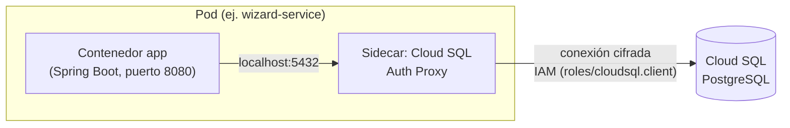

## 06 — Base de datos en GCP (Cloud SQL PostgreSQL)

### Objetivo

Crear una instancia **Cloud SQL for PostgreSQL** y definir cómo migrar los microservicios a usarla (configuración en GCP + ajustes que serían necesarios en la app), incluyendo verificación de conectividad y consideraciones de producción (backups, HA, seguridad).

### Alcance (importante)

- Esta guía describe pasos en GCP y configuración de los Pods de GKE.
- **No modifica el código** del repositorio.
- Los "ajustes en código" se describen como **instrucciones** para que tú los apliques si corresponde.

### Resumen visual: cómo se conecta cada Pod a Cloud SQL



---

## 0) Contexto del repo

Los microservicios usan `spring-boot-starter-data-jpa` y actualmente incluyen `runtimeOnly 'com.h2database:h2'`. No hay `spring.datasource.*` en `application.properties`, por lo que el datasource se asume por defecto (H2 in-memory en runtime).

Migrar a Cloud SQL implica:

- Provisionar Cloud SQL (PostgreSQL)
- Definir DB(s) y users
- Conectar los Pods de GKE a Cloud SQL (Cloud SQL Auth Proxy como sidecar)
- Configurar credenciales con Secret Manager
- (Recomendado) incorporar migraciones (Flyway/Liquibase) para esquema reproducible

---

## 1) Variables y decisiones

Define:

```bash
export PROJECT_ID="hogwarts-dev-123"
export REGION="us-central1"
export GKE_SA="hogwarts-gke-sa@$PROJECT_ID.iam.gserviceaccount.com"
```

### 1.1 Una instancia vs varias instancias

Opciones comunes:

- **Opción A (simple)**: 1 instancia Cloud SQL y **3 bases de datos** (una por microservicio)
  - `wizard_db`, `inventory_db`, `duel_db`
- **Opción B (aislamiento)**: 1 instancia por microservicio

Para un entorno dev/stg, normalmente **Opción A** es suficiente.

---

## 2) Crear instancia Cloud SQL (PostgreSQL)

### 2.1 Habilitar API (si no lo hiciste)

```bash
gcloud services enable sqladmin.googleapis.com
```

### 2.2 Crear instancia (ejemplo)

Elige:

- `INSTANCE_ID`: `hogwarts-postgres`
- Versión: PostgreSQL (elige una soportada por tu estándar)
- Región: idealmente la misma que el cluster GKE (`REGION`)

El costo de Cloud SQL depende principalmente de: `--tier` (vCPU/RAM), `--storage-size`, `--storage-type` y `--availability-type` (si hay standby en otra zona, el costo aproximadamente se duplica). A continuación, tres configuraciones de ejemplo según presupuesto — **son puntos de partida, no valores fijos**: ajusta según carga real y precios vigentes en tu región.

#### Opción básica (mínimo costo — dev/pruebas)

Machine type *shared-core* (vCPU compartida entre varias instancias del host), sin HA. Suficiente para desarrollo, demos o entornos que se prenden/apagan. **No recomendado para producción**: sin garantías de rendimiento consistente y sin resiliencia ante caída de zona.

```bash
export INSTANCE_ID="hogwarts-postgres"

gcloud sql instances create "$INSTANCE_ID" \
  --database-version=POSTGRES_15 \
  --region="$REGION" \
  --tier=db-f1-micro \
  --storage-size=10GB \
  --storage-type=HDD \
  --availability-type=ZONAL \
  --backup-start-time=03:00
```

#### Opción media (balance costo/rendimiento — staging o producción con tráfico bajo/medio)

Machine type *dedicated-core* (vCPU dedicada, rendimiento predecible), zonal (sin standby). Es el escalón razonable cuando la instancia ya sirve tráfico real pero no justifica el costo de HA todavía.

```bash
export INSTANCE_ID="hogwarts-postgres"

gcloud sql instances create "$INSTANCE_ID" \
  --database-version=POSTGRES_15 \
  --region="$REGION" \
  --tier=db-custom-2-8192 \
  --storage-size=50GB \
  --storage-type=SSD \
  --storage-auto-increase \
  --availability-type=ZONAL \
  --backup-start-time=03:00
```

#### Opción avanzada (producción crítica — presupuesto amplio)

Dedicated-core con más vCPU/RAM, SSD, **alta disponibilidad regional** (`--availability-type=REGIONAL`: mantiene una réplica standby en otra zona con failover automático — esto es lo que más impacta el costo) y point-in-time recovery habilitado para poder restaurar a cualquier momento dentro de la ventana de retención de logs de transacción.

```bash
export INSTANCE_ID="hogwarts-postgres"

gcloud sql instances create "$INSTANCE_ID" \
  --database-version=POSTGRES_15 \
  --region="$REGION" \
  --tier=db-custom-4-16384 \
  --storage-size=100GB \
  --storage-type=SSD \
  --storage-auto-increase \
  --availability-type=REGIONAL \
  --backup-start-time=03:00 \
  --enable-point-in-time-recovery
```

#### Comparación

| | Básica | Media | Avanzada |
|---|---|---|---|
| `--tier` | `db-f1-micro` (shared-core) | `db-custom-2-8192` (2 vCPU / 8 GB) | `db-custom-4-16384` (4 vCPU / 16 GB) |
| Storage | 10 GB HDD | 50 GB SSD + auto-increase | 100 GB SSD + auto-increase |
| Disponibilidad | Zonal (sin standby) | Zonal (sin standby) | **Regional** (standby + failover automático) |
| Point-in-time recovery | No | No (opcional) | Sí |
| **Precio estimado** | **~US$10–15/mes** | **~US$110–120/mes** | **~US$430–450/mes** |
| Uso recomendado | Dev/demos, entornos efímeros | Staging, prod con tráfico bajo/medio | Prod crítica, SLA de disponibilidad exigente |

**Cómo se calculó cada estimado** (edición Enterprise, `us-central1`, on-demand — sin descuentos por compromiso):

- **Básica**: `db-f1-micro` es shared-core y se cobra como tarifa fija (~US$8–10/mes) en vez de por vCPU/RAM, más 10 GB de HDD zonal (~US$0.12/GB-mes) ≈ US$1.2/mes. Total ≈ **US$10–15/mes**.
- **Media**: dedicated-core se cobra por recurso: ~US$0.0413/vCPU-hora y ~US$0.007/GB RAM-hora (≈ US$30/vCPU-mes y US$5/GB-mes). Para 2 vCPU + 8 GB → (2×30) + (8×5) ≈ US$100/mes de cómputo, más 50 GB SSD zonal (~US$0.22/GB-mes) ≈ US$11/mes. Total ≈ **US$110–120/mes**.
- **Avanzada**: mismos precios por recurso pero con `--availability-type=REGIONAL`, que **aproximadamente duplica el costo de cómputo** (paga la instancia principal + el standby en otra zona). Para 4 vCPU + 16 GB → (4×30 + 16×5) × 2 ≈ US$400/mes de cómputo, más 100 GB SSD con HA (~US$0.34/GB-mes) ≈ US$34/mes. Total ≈ **US$430–450/mes**.

⚠️ **Son estimados orientativos**, no una cotización: excluyen backups (almacenamiento de backups se cobra aparte), egress de red, Secret Manager, el costo del cluster GKE, y pueden variar por cambios de lista de precios de Google o por región. Para un número exacto usa la [calculadora oficial de GCP](https://cloud.google.com/products/calculator) o `gcloud sql instances describe`. Committed Use Discounts (compromiso de 1 o 3 años) pueden reducir el costo de cómputo entre 25% y 55%, pero no aplican a `db-f1-micro`.

Notas:

- Ajusta `--tier` según tu carga y presupuesto — estos son valores de ejemplo, no una recomendación de dimensionamiento formal.
- Configura backups desde el inicio (mínimo en ambientes no efímeros), independientemente de la opción elegida.
- `--availability-type=REGIONAL` es el cambio individual con mayor impacto en costo; evalúa si el SLA del proyecto realmente lo requiere antes de habilitarlo.
- Es posible migrar de una opción a otra más adelante (`gcloud sql instances patch`), aunque cambiar `--tier` o `--availability-type` implica un reinicio breve de la instancia.

#### ¿Hay una opción gratuita?

**No existe un "always free" permanente para Cloud SQL** (a diferencia de otros servicios de GCP como Compute Engine `e2-micro`, 5 GB de Cloud Storage o el free tier de BigQuery/Firestore). Sí existen dos formas de probarlo sin costo, ambas **temporales**:

- **Free trial instance de Cloud SQL**: una instancia gratis por **30 días** (con 90 días adicionales de gracia sin costo si no se actualiza, antes de programarse su eliminación). Viene con una configuración fija — Enterprise Plus, N2 de **8 vCPU / 64 GB RAM**, 100 GB de storage — es decir, **más potente que cualquiera de las tres opciones de arriba**, pero pensada solo para evaluar la herramienta: una instancia por proyecto, sin SLA, sin backups completos (solo uno final al eliminarla), sin réplicas de lectura, sin poder modificar la configuración ni escalar, y requiere tener un método de pago habilitado en el proyecto (aunque no se cobra mientras dure la prueba). ([Guía oficial](https://docs.cloud.google.com/sql/docs/postgres/free-trial-instance))
- **Crédito de bienvenida de GCP**: cuentas nuevas reciben US$300 de crédito válidos por 90 días, utilizable en Cloud SQL (y en cualquier otro servicio) — es crédito general de la cuenta, no algo específico de Cloud SQL, y se agota como cualquier gasto normal.

Para desarrollo local sin ningún costo y sin límite de tiempo, la alternativa dentro del alcance de este repo es la que ya usa el proyecto: **H2 en memoria** (ver sección "0) Contexto del repo" más arriba) o correr Postgres en un contenedor Docker local — ninguna de las dos pasa por Cloud SQL ni por GCP.

### 2.3 Verificar instancia

```bash
gcloud sql instances describe "$INSTANCE_ID"
```

---

## 3) Crear bases de datos y usuarios

### 3.1 Crear bases de datos (una por servicio)

```bash
gcloud sql databases create wizard_db --instance="$INSTANCE_ID"
gcloud sql databases create inventory_db --instance="$INSTANCE_ID"
gcloud sql databases create duel_db --instance="$INSTANCE_ID"
```

Verifica:

```bash
gcloud sql databases list --instance="$INSTANCE_ID"
```

### 3.2 Crear usuarios

Recomendación: un usuario por servicio.

```bash
gcloud sql users create wizard_user --instance="$INSTANCE_ID" --password="$WIZARD_DB_PASSWORD"
gcloud sql users create inventory_user --instance="$INSTANCE_ID" --password="$INVENTORY_DB_PASSWORD"
gcloud sql users create duel_user --instance="$INSTANCE_ID" --password="$DUEL_DB_PASSWORD"
```

**Importante**: en vez de escribir passwords en la terminal, en entornos reales usa Secret Manager (ver guía `05`) y procedimientos de rotación.

---

## 4) Conexión desde GKE a Cloud SQL (Cloud SQL Auth Proxy como sidecar)

En GKE, el patrón estándar para conectar a Cloud SQL es correr el **Cloud SQL Auth Proxy** como un contenedor adicional (sidecar) dentro del mismo Pod que la app. El proxy abre un socket local (`127.0.0.1:5432`) que la app usa como si fuera un Postgres local; el proxy se encarga de la conexión cifrada y autenticada contra Cloud SQL.

### 4.1 Obtener `INSTANCE_CONNECTION_NAME`

Es el identificador que usa el proxy para asociarse a la instancia de Cloud SQL.

```bash
export INSTANCE_CONNECTION_NAME="$(gcloud sql instances describe "$INSTANCE_ID" --format='value(connectionName)')"
echo "$INSTANCE_CONNECTION_NAME"
```

### 4.2 Conceder permisos de conexión al service account de Workload Identity

El GSA que usan los Pods debe tener `roles/cloudsql.client`:

```bash
gcloud projects add-iam-policy-binding "$PROJECT_ID" \
  --member="serviceAccount:$GKE_SA" \
  --role="roles/cloudsql.client"
```

### 4.3 Agregar el sidecar al manifiesto de cada `Deployment`

En el `Deployment` de cada microservicio (ver guía `04`), agrega un segundo contenedor junto al de la app:

```yaml
containers:
  - name: wizard-service
    image: REGION-docker.pkg.dev/PROJECT_ID/hogwarts-docker/wizard-service:VERSION
    # ...contenedor de la app, sin cambios...
  - name: cloud-sql-proxy
    image: gcr.io/cloud-sql-connectors/cloud-sql-proxy:2.x
    args:
      - "--structured-logs"
      - "--port=5432"
      - "$(INSTANCE_CONNECTION_NAME)"
    env:
      - name: INSTANCE_CONNECTION_NAME
        value: "hogwarts-dev-123:us-central1:hogwarts-postgres"
    securityContext:
      runAsNonRoot: true
```

El Pod debe usar una `ServiceAccount` de Kubernetes asociada vía Workload Identity a `$GKE_SA`, igual que para Secret Manager (guía `05`). La app apunta su `spring.datasource.url` a `jdbc:postgresql://127.0.0.1:5432/<DB_NAME>` (ajuste de configuración, no de código — ver sección 6).

Repite el mismo patrón de sidecar para `inventory-service` y `duel-service`.

---

## 5) Secret Manager: guardar credenciales DB

Guarda (por microservicio):

- DB name
- user
- password
- (si aplica) URL/propiedades de conexión

Ejemplo (conceptual; ver guía `05` para comandos exactos):

- `wizard-db-name` = `wizard_db`
- `wizard-db-user` = `wizard_user`
- `wizard-db-password` = `...`

Luego inyéctalas en el Pod con el Secret Manager CSI driver o un `Secret` de Kubernetes (ver guía `05`, sección 4).

---

## 6) Ajustes necesarios en la aplicación (solo instrucciones, sin modificar este repo)

Para que Spring Boot use Postgres en vez de H2, típicamente necesitas:

### 6.1 Cambiar driver runtime

- Remover H2 del runtime y usar el driver de Postgres.

### 6.2 Configurar datasource

Dependiendo del enfoque, hay 2 formas comunes:

#### Enfoque A (recomendado en GKE): TCP al sidecar Cloud SQL Auth Proxy

- JDBC URL del tipo `jdbc:postgresql://127.0.0.1:5432/<DB_NAME>` (el proxy sidecar de la sección 4 escucha ahí).
- No requiere configurar socket factory en la app ni VPC Access: el proxy ya maneja la conexión cifrada/autenticada contra Cloud SQL.
- Usuario y password se proveen via env/secrets (ver guía `05`).

#### Enfoque B (alternativo): Cloud SQL Java Connector (socket factory en la app)

- Usar JDBC URL del tipo `jdbc:postgresql:///<DB_NAME>` con el socket factory de Cloud SQL para Postgres embebido en la app (sin sidecar).
- Requiere agregar la dependencia del conector al proyecto y proveer `INSTANCE_CONNECTION_NAME`, usuario y password via env/secrets.
- Tiene sentido si prefieres no correr un sidecar por Pod; es más acoplamiento de código a cambio de un contenedor menos.

### 6.3 Migraciones (recomendado)

En producción no se recomienda depender de `spring.jpa.hibernate.ddl-auto=create`.

Opciones:

- Flyway
- Liquibase

Con el objetivo de:

- recrear la DB desde cero por scripts versionados
- controlar índices/constraints
- evitar divergencia entre ambientes

---

## 7) Verificación de conectividad (práctica)

### 7.1 Verifica que el sidecar del proxy esté corriendo

```bash
kubectl get pod <wizard-pod-name> -o jsonpath='{.status.containerStatuses[*].name}'
```

Deberías ver tanto `wizard-service` como `cloud-sql-proxy` en estado `Running`.

### 7.2 Verifica logs de arranque

Si la app intenta conectar a DB al iniciar, verás errores claros (auth/URL/timeout) en los logs de cualquiera de los dos contenedores del Pod:

```bash
kubectl logs <wizard-pod-name> -c wizard-service --tail=100
kubectl logs <wizard-pod-name> -c cloud-sql-proxy --tail=100
```

---

## 8) Recomendaciones de producción (resumen)

- **Backups** habilitados y probados (restore).
- **Alta disponibilidad** (HA) en entornos productivos (si el presupuesto lo permite).
- **Rotación de credenciales**.
- Preferir **private IP** cuando operes en entorno con requisitos estrictos (implica VPC Access y más configuración).

