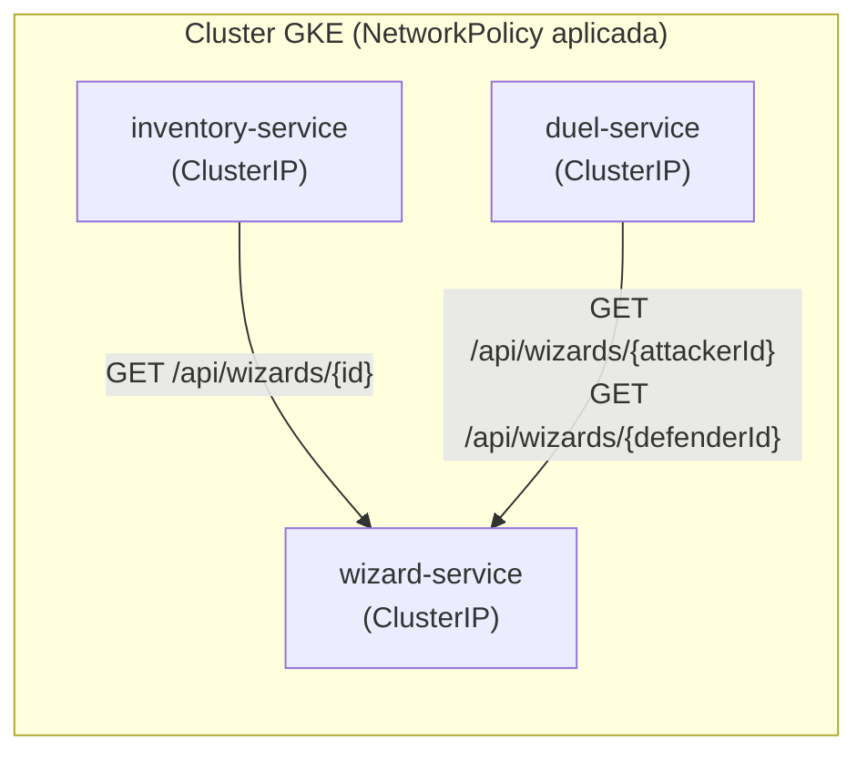

## 08 — Interacción entre microservicios y validación de IDs

### Objetivo

Definir un camino claro para:

1. Configurar **comunicación entre microservicios** desplegados en GKE.
2. Implementar (a nivel de diseño e instrucciones) validaciones del tipo: "si llega un `wizardId` a `inventory-service`, debe verificarse contra `wizard-service`".

### Alcance (importante)

- Esta guía describe configuraciones en GCP/GKE y el enfoque recomendado.
- **No modifica el código** del repositorio.
- Donde se requieran cambios de aplicación, se describen como **instrucciones**.

### Resumen visual: llamadas internas y el límite de `NetworkPolicy`



| Caso | Quién llama | A quién | Qué valida |
|---|---|---|---|
| A | `inventory-service` | `wizard-service` | `wizardId` existe al asignar una wand |
| B | `duel-service` | `wizard-service` | `attackerId`/`defenderId` existen al crear un duelo |

---

## 0) Contexto del repo (IDs cross-service)

Casos relevantes en este repo:

- `inventory-service` tiene endpoint `POST /api/inventory/wands/{wandId}/assign` que recibe `wizardId`.
  - Hoy asigna el ID sin validar existencia del wizard.
- `duel-service` recibe `attackerId` y `defenderId` (wizards).
  - Hoy valida que no sean iguales, pero no valida existencia real del wizard.
- Existe `X-Correlation-Id` como header estándar (filtro `CorrelationIdFilter` en cada servicio).

---

## 1) Estrategias de comunicación entre microservicios en GKE

### Estrategia A (recomendada): `Service` tipo `ClusterIP` + `NetworkPolicy`

- Cada microservicio se expone dentro del cluster con un `Service` tipo `ClusterIP` (no público; ver guía `04`, sección 10 "Endurecimiento mínimo"). Solo es alcanzable vía DNS interno (`http://wizard-service.default.svc.cluster.local`) desde dentro del cluster.
- Una `NetworkPolicy` por microservicio restringe explícitamente qué Pods (identificados por label) pueden abrir conexión hacia él — por ejemplo, solo `inventory-service` y `duel-service` pueden llamar a `wizard-service`; nada más.
- No hay tokens que generar ni IAM que gestionar por llamada: el control de acceso vive a nivel de red (capa 3/4), igual que un firewall interno.

Pros:
- Simple de operar, sin gestión de tokens por request.
- `NetworkPolicy` es nativa de Kubernetes, sin dependencias externas.

Contras:
- Es control a nivel de red, no de identidad: cualquier Pod permitido por la policy puede llamar sin autenticarse a nivel de aplicación.

### Estrategia B (endurecimiento opcional, avanzado): autenticación a nivel de aplicación

Si además de restringir por red quieres que cada llamada esté autenticada (defensa en profundidad), hay dos caminos, ambos fuera del alcance base de esta guía:

- **JWT de servicio a servicio**: el llamador obtiene/firma un JWT (reusando, por ejemplo, el JWKS de Identity Platform de la guía `09`) y el servicio destino lo valida con Spring Security Resource Server.
- **mTLS entre Pods**: vía un service mesh (Anthos Service Mesh / Istio) combinado con Workload Identity, cifra y autentica el tráfico pod-a-pod automáticamente, sin cambios de código.

Ambas requieren más infraestructura/código que la Estrategia A; úsalas solo si el perímetro de red no es suficiente para tus requisitos de seguridad.

---

## 2) Configuración recomendada en GKE (Estrategia A)

### 2.1 Verificar que cada microservicio tenga su `Service` `ClusterIP`

Siguiendo la guía `04`, cada microservicio debe tener un `Service`. Para comunicación interna, el tipo recomendado es `ClusterIP` (no `LoadBalancer`):

```yaml
apiVersion: v1
kind: Service
metadata:
  name: wizard-service
spec:
  type: ClusterIP
  selector:
    app: wizard-service
  ports:
    - port: 80
      targetPort: 8080
```

Repite el patrón para `inventory-service` y `duel-service`.

### 2.2 Etiquetar los Pods para que `NetworkPolicy` pueda identificarlos

En el `Deployment` de cada microservicio, asegúrate de que el Pod tenga una label `app: <nombre-servicio>` (ya debería existir desde la guía `04`, porque el `Service` la usa como `selector`).

### 2.3 Restringir el tráfico entrante a `wizard-service` con `NetworkPolicy`

Solo permite tráfico desde Pods de `inventory-service` y `duel-service`:

```yaml
apiVersion: networking.k8s.io/v1
kind: NetworkPolicy
metadata:
  name: wizard-service-allow-internal
spec:
  podSelector:
    matchLabels:
      app: wizard-service
  policyTypes:
    - Ingress
  ingress:
    - from:
        - podSelector:
            matchLabels:
              app: inventory-service
        - podSelector:
            matchLabels:
              app: duel-service
      ports:
        - protocol: TCP
          port: 8080
```

```bash
kubectl apply -f wizard-service-networkpolicy.yaml
```

> Nota: el plugin de red del cluster debe soportar `NetworkPolicy` (GKE lo soporta de forma nativa si está habilitado al crear el cluster — Autopilot lo tiene habilitado por defecto).

---

## 3) Cómo descubrir las URLs internas de cada microservicio

A diferencia de una URL pública, el DNS interno de Kubernetes sigue un patrón predecible — no hace falta "descubrirlo" con un comando, se construye así:

```
http://<nombre-del-service>.<namespace>.svc.cluster.local
```

Ejemplo (namespace `default`):

```bash
export WIZARD_URL="http://wizard-service.default.svc.cluster.local"
export INVENTORY_URL="http://inventory-service.default.svc.cluster.local"
export DUEL_URL="http://duel-service.default.svc.cluster.local"
```

Recomendación: guardar la URL de cada dependencia como env var en el `Deployment` del servicio llamador (ver guía `04`):

```yaml
env:
  - name: WIZARD_SERVICE_URL
    value: "http://wizard-service.default.svc.cluster.local"
```

---

## 4) Pruebas manuales (verificar la `NetworkPolicy`)

### 4.1 Probar desde un Pod permitido (ej. `inventory-service`)

```bash
kubectl exec -it deploy/inventory-service -- curl -sS "$WIZARD_URL/api/wizards?page=0&size=20&sort=id,desc"
```

Debería responder normalmente: `inventory-service` está en la lista de Pods permitidos por la `NetworkPolicy` de `wizard-service`.

### 4.2 Probar desde un Pod de debug no permitido (para confirmar que la policy bloquea)

```bash
kubectl run debug-pod --rm -it --image=curlimages/curl -- curl -sS --max-time 5 "$WIZARD_URL/api/wizards/1"
```

Este Pod no tiene el label `app: inventory-service` ni `app: duel-service`, así que la conexión debería colgarse/fallar por timeout — confirmando que la `NetworkPolicy` está bloqueando correctamente el tráfico no autorizado.

---

## 5) Validación de IDs (instrucciones de implementación)

### Caso A: `inventory-service` valida `wizardId` al asignar wand

**Objetivo funcional**

Cuando se llama:

- `POST /api/inventory/wands/{wandId}/assign` con `{ "wizardId": 123 }`

El servicio debe:

1. Llamar a `wizard-service` para validar que el wizard existe.
2. Si no existe, retornar un error claro (ej. 404 o 400 según criterio).

**Endpoint disponible hoy para validar**

- `GET /api/wizards/{id}` en `wizard-service`

**Instrucciones (alto nivel)**

- En `inventory-service`, antes de persistir `assignedWizardId`:
  - Ejecutar una llamada HTTP a `GET {WIZARD_SERVICE_URL}/api/wizards/{wizardId}`
  - Manejar casos:
    - 200: wizard existe → continuar
    - 404: wizard no existe → retornar error al cliente
    - 401/403: problema IAM/tokens → error de configuración/infra
    - timeout: degradación/retry según política (ver resiliencia)

**Recomendaciones técnicas**

- Cliente HTTP: `RestClient`/`WebClient` (o `RestTemplate` si es legado).
- Timeouts explícitos.
- Propagar `X-Correlation-Id`:
  - si el request entrante trae `X-Correlation-Id`, reenviarlo al llamado interno.

### Caso B: `duel-service` valida `attackerId/defenderId`

**Objetivo funcional**

Al crear un duelo:

- `POST /api/duels` con `{ "attackerId": 1, "defenderId": 2 }`

El servicio debe:

1. Validar que ambos wizards existen en `wizard-service`.
2. Si alguno no existe, rechazar con error.

**Instrucciones (alto nivel)**

- Llamar 2 veces a `wizard-service`:
  - `GET /api/wizards/{attackerId}`
  - `GET /api/wizards/{defenderId}`
- En caso de 404, retornar error coherente.

---

## 6) Resiliencia recomendada (para llamadas internas)

Como mínimo:

- **Timeouts** (no dejar colgar requests)
- **Retry** solo en errores transitorios (5xx, timeouts), con backoff
- **Circuit breaker** (si crece el sistema)

**Importante**: evita retries ciegos en operaciones no idempotentes.

---

## 7) Troubleshooting típico

### 7.1 Timeout/conexión rechazada entre Pods

- Revisa que la `NetworkPolicy` del servicio destino incluya el label `app: <servicio-llamador>` en su lista de `from`.
- Revisa las `NetworkPolicy` aplicadas:

```bash
kubectl get networkpolicy
kubectl describe networkpolicy wizard-service-allow-internal
```

### 7.2 "Nombre no resuelve" (DNS interno)

- Confirma el namespace correcto en el DNS (`<service>.<namespace>.svc.cluster.local`).
- Verifica que el `Service` exista y tenga Pods `Ready` detrás:

```bash
kubectl get svc wizard-service
kubectl get endpoints wizard-service
```

### 7.3 Timeouts por carga

- Revisa `requests`/`limits` de CPU y memoria del `Deployment` destino, y si el `HorizontalPodAutoscaler` (si existe) está escalando a tiempo.

