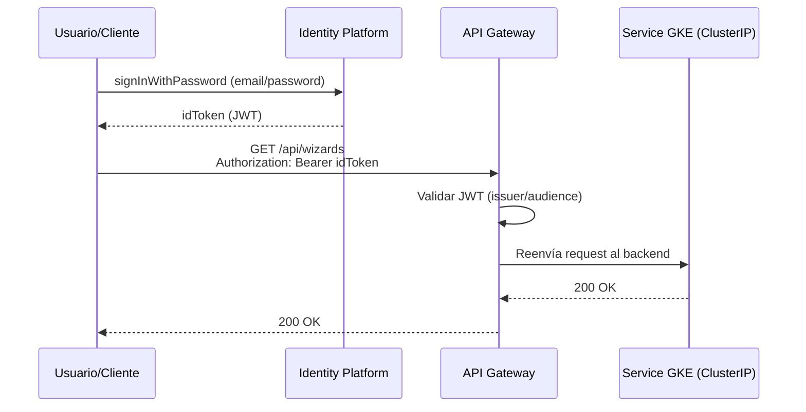

## 09 — Segurización de APIs con Identity Platform (login → token → APIs)

### Objetivo

Segurizar los endpoints de los microservicios para que:

1. El usuario inicie sesión y obtenga un **token** (JWT).
2. Con ese token, pueda llamar a las APIs.

### Alcance (importante)

- Esta guía describe configuración en GCP (Identity Platform + opcional API Gateway) y pruebas con `curl`.
- **No modifica el código** del repositorio.
- Donde se requiera validación del token en los microservicios, se describe como **instrucciones**.

---

## 1) Arquitectura recomendada (sin crear microservicio de auth)

Como elegiste **Identity Platform**, la recomendación para una solución limpia es:

- **Identity Platform**: gestiona usuarios y emite tokens (JWT).
- **API Gateway** (opcional pero recomendado): valida JWT en el borde y enruta a los Services de GKE.
- **GKE**: Services internos tipo `ClusterIP` (sin acceso público directo). Solo el gateway los invoca.

Alternativa:

- Sin API Gateway: cada microservicio valida JWT directamente (Spring Security Resource Server). También se documenta.

### Resumen visual: login → token → Gateway → backend



---

## 2) Habilitar y configurar Identity Platform

### 2.1 Habilitar API

```bash
export PROJECT_ID="hogwarts-dev-123"
gcloud config set project "$PROJECT_ID"

gcloud services enable identitytoolkit.googleapis.com
```

### 2.2 Activar Identity Platform en consola

1. En Cloud Console, busca “Identity Platform”.
2. Click “Enable Identity Platform” (si aplica).

### 2.3 Habilitar proveedor Email/Password

1. Identity Platform → Providers
2. Habilita **Email/Password**
3. Guarda cambios

---

## 3) Crear un usuario de prueba

Puedes hacerlo desde consola o vía API.

### 3.1 Desde consola (simple)

1. Identity Platform → Users
2. “Add user”
3. Define email y password

### 3.2 (Opcional) Vía API (Identity Toolkit)

Necesitas un **API key** del proyecto:

1. APIs & Services → Credentials
2. “Create credentials” → “API key”
3. Copia el valor como `API_KEY`

```bash
export API_KEY="TU_API_KEY"
```

Crear usuario (sign up):

```bash
curl -sS -X POST \
  "https://identitytoolkit.googleapis.com/v1/accounts:signUp?key=$API_KEY" \
  -H "Content-Type: application/json" \
  -d '{"email":"user@example.com","password":"Str0ngPass!","returnSecureToken":true}'
```

---

## 4) Login y obtención de token (idToken)

Identity Platform (email/password) permite obtener un JWT (`idToken`) usando:
`accounts:signInWithPassword`.

```bash
export API_KEY="TU_API_KEY"
export EMAIL="user@example.com"
export PASSWORD="Str0ngPass!"

export ID_TOKEN="$(
  curl -sS -X POST \
    "https://identitytoolkit.googleapis.com/v1/accounts:signInWithPassword?key=$API_KEY" \
    -H "Content-Type: application/json" \
    -d "{\"email\":\"$EMAIL\",\"password\":\"$PASSWORD\",\"returnSecureToken\":true}" \
  | python -c 'import sys, json; print(json.load(sys.stdin)["idToken"])'
)"

echo "$ID_TOKEN" | head -c 30 && echo "..."
```

> Nota: el comando usa Python solo para extraer `idToken`. Puedes usar `jq` si lo prefieres.

---

## 5) Opción recomendada: API Gateway validando JWT + backend GKE restringido

### 5.1 Qué logra esta opción

- El cliente solo ve 1 endpoint (Gateway).
- El gateway:
  - valida el JWT
  - enruta a los backends (Services de GKE)
- Los Services de GKE no reciben tráfico público directo: solo son alcanzables a través del Ingress/IP que usa el Gateway (ver sección 5.8).

### 5.2 Habilitar APIs de API Gateway

```bash
gcloud services enable \
  apigateway.googleapis.com \
  servicemanagement.googleapis.com \
  servicecontrol.googleapis.com
```

### 5.3 Obtener los endpoints de los backends en GKE

API Gateway necesita una dirección HTTPS alcanzable para cada backend. La forma recomendada en GKE es exponer un único `Ingress` (con IP externa estática) que enrute por path hacia cada `Service` interno — así el Gateway apunta a un solo host, y los Services individuales permanecen como `ClusterIP` (no expuestos directamente).

```bash
export REGION="us-central1"

gcloud compute addresses create hogwarts-ingress-ip --global
export INGRESS_IP="$(gcloud compute addresses describe hogwarts-ingress-ip --global --format='value(address)')"
echo "$INGRESS_IP"
```

Define el `Ingress` (fuera del repo, junto a los demás manifiestos de la guía `04`) enrutando por path a cada `Service`:

```yaml
apiVersion: networking.k8s.io/v1
kind: Ingress
metadata:
  name: hogwarts-ingress
  annotations:
    kubernetes.io/ingress.global-static-ip-name: hogwarts-ingress-ip
spec:
  rules:
    - http:
        paths:
          - path: /api/wizards*
            pathType: ImplementationSpecific
            backend:
              service:
                name: wizard-service
                port: { number: 80 }
          - path: /api/inventory/*
            pathType: ImplementationSpecific
            backend:
              service:
                name: inventory-service
                port: { number: 80 }
          - path: /api/duels*
            pathType: ImplementationSpecific
            backend:
              service:
                name: duel-service
                port: { number: 80 }
```

```bash
kubectl apply -f hogwarts-ingress.yaml
export BACKEND_URL="https://$INGRESS_IP"
```

> Usa `$BACKEND_URL` en el spec OpenAPI de la sección siguiente: como el `Ingress` ya enruta por path a cada microservicio, todas las operaciones apuntan al mismo host.

### 5.4 Crear especificación OpenAPI para el gateway (archivo externo)

Como este trabajo es solo documentación, crea este archivo **fuera del repo** (por ejemplo `~/hogwarts-gcp/openapi-hogwarts.yaml`).

Contenido base (ajusta `PROJECT_ID` y las URLs):

```yaml
swagger: "2.0"
info:
  title: "hogwarts-api"
  version: "1.0.0"

schemes:
  - https

produces:
  - application/json

# Seguridad: validar JWT emitido por Identity Platform/Firebase Secure Token.
securityDefinitions:
  firebase:
    authorizationUrl: ""
    flow: "implicit"
    type: "oauth2"
    x-google-issuer: "https://securetoken.google.com/PROJECT_ID"
    x-google-jwks_uri: "https://www.googleapis.com/service_accounts/v1/metadata/x509/securetoken@system.gserviceaccount.com"
    x-google-audiences: "PROJECT_ID"

security:
  - firebase: []

paths:
  /api/wizards:
    get:
      operationId: listWizards
      x-google-backend:
        address: BACKEND_URL
      responses:
        "200":
          description: "OK"
    post:
      operationId: createWizard
      x-google-backend:
        address: BACKEND_URL
      responses:
        "200":
          description: "OK"

  /api/wizards/{id}:
    get:
      operationId: getWizardById
      parameters:
        - name: id
          in: path
          required: true
          type: string
      x-google-backend:
        address: BACKEND_URL
      responses:
        "200":
          description: "OK"

  /api/wizards/attack:
    post:
      operationId: attack
      x-google-backend:
        address: BACKEND_URL
      responses:
        "200":
          description: "OK"

  /api/inventory/wands:
    get:
      operationId: listWands
      x-google-backend:
        address: BACKEND_URL
      responses:
        "200":
          description: "OK"
    post:
      operationId: createWand
      x-google-backend:
        address: BACKEND_URL
      responses:
        "200":
          description: "OK"

  /api/inventory/wands/{wandId}/assign:
    post:
      operationId: assignWand
      parameters:
        - name: wandId
          in: path
          required: true
          type: string
      x-google-backend:
        address: BACKEND_URL
      responses:
        "200":
          description: "OK"

  /api/inventory/potions:
    get:
      operationId: listPotions
      x-google-backend:
        address: BACKEND_URL
      responses:
        "200":
          description: "OK"
    post:
      operationId: createPotion
      x-google-backend:
        address: BACKEND_URL
      responses:
        "200":
          description: "OK"

  /api/inventory/brooms:
    get:
      operationId: listBrooms
      x-google-backend:
        address: BACKEND_URL
      responses:
        "200":
          description: "OK"
    post:
      operationId: createBroom
      x-google-backend:
        address: BACKEND_URL
      responses:
        "200":
          description: "OK"

  /api/duels:
    post:
      operationId: createDuel
      x-google-backend:
        address: BACKEND_URL
      responses:
        "200":
          description: "OK"

  /api/duels/{id}:
    get:
      operationId: getDuelById
      parameters:
        - name: id
          in: path
          required: true
          type: string
      x-google-backend:
        address: BACKEND_URL
      responses:
        "200":
          description: "OK"
```

Reemplaza placeholders:

- `PROJECT_ID` por tu Project ID real (dos lugares: issuer y audiences)
- `BACKEND_URL` por el valor real de `$BACKEND_URL` (la IP del `Ingress` de la sección 5.3)

Nota: como el `Ingress` ya enruta por path hacia el `Service` correcto dentro del cluster, todas las operaciones apuntan al mismo `BACKEND_URL` — el ruteo fino ocurre en GKE, no en el Gateway. No se usa `jwt_audience` porque el `Ingress` es un endpoint HTTPS regular, sin un mecanismo de identidad de invocación que negociar.

### 5.5 Crear recursos de API Gateway (CLI)

Define:

```bash
export API_ID="hogwarts-api"
export API_CONFIG_ID="hogwarts-api-config-v1"
export GATEWAY_ID="hogwarts-gateway"
export REGION="us-central1"
export OPENAPI_SPEC_PATH="$HOME/hogwarts-gcp/openapi-hogwarts.yaml"
```

Crear API:

```bash
gcloud api-gateway apis create "$API_ID"
```

Crear API config:

```bash
gcloud api-gateway api-configs create "$API_CONFIG_ID" \
  --api="$API_ID" \
  --openapi-spec="$OPENAPI_SPEC_PATH" \
  --project="$PROJECT_ID"
```

Crear gateway:

```bash
gcloud api-gateway gateways create "$GATEWAY_ID" \
  --api="$API_ID" \
  --api-config="$API_CONFIG_ID" \
  --location="$REGION"
```

### 5.6 Obtener URL del Gateway

```bash
gcloud api-gateway gateways describe "$GATEWAY_ID" \
  --location="$REGION" \
  --format="value(defaultHostname)"
```

Define:

```bash
export GATEWAY_HOSTNAME="$(gcloud api-gateway gateways describe "$GATEWAY_ID" --location="$REGION" --format="value(defaultHostname)")"
export GATEWAY_URL="https://$GATEWAY_HOSTNAME"
echo "$GATEWAY_URL"
```

### 5.7 Probar APIs a través del Gateway (con token)

Listar wizards:

```bash
curl -sS "$GATEWAY_URL/api/wizards?page=0&size=20&sort=id,desc" \
  -H "Authorization: Bearer $ID_TOKEN"
```

Si no envías token, deberías ver un error (401/403) del gateway.

### 5.8 Restringir el backend de GKE para que solo el Gateway lo alcance

GKE no ofrece un rol de IAM que autorice "quién puede invocar este backend" por invocación individual. En GKE, el control equivalente se logra a nivel de **red**, con una de estas dos opciones:

**Opción A (recomendada): `NetworkPolicy` + Ingress con IP reservada**

Como los `Service` quedan como `ClusterIP` (sección 5.3) y solo el `Ingress` los expone, el tráfico externo únicamente puede llegar a través de ese `Ingress`. Si además quieres que ningún otro Pod del cluster les hable directamente salvo lo necesario (ver guía `08`), combina con las `NetworkPolicy` de esa guía.

**Opción B (si usas Cloud Armor): restringir el `Ingress` a los rangos de IP de API Gateway**

Si quieres que *solo* el tráfico que pasa por API Gateway llegue al `Ingress` (y no cualquier cliente que descubra la IP del `Ingress`), agrega una política de Cloud Armor al `Ingress` que permita únicamente los rangos de salida documentados de API Gateway, y bloquee el resto.

> No hay un service account administrado de API Gateway que autorizar vía IAM sobre el backend — el control de acceso se hace a nivel de red/firewall, no de identidad de invocación.

---

## 6) Alternativa: validar JWT en cada microservicio (solo instrucciones)

Si no quieres API Gateway, cada microservicio debe validar el `Authorization: Bearer <JWT>`:

### 6.1 Instrucciones de alto nivel (Spring Security)

- Agregar dependencias:
  - `spring-boot-starter-security`
  - `spring-boot-starter-oauth2-resource-server`
- Configurar Resource Server JWT con:
  - issuer: `https://securetoken.google.com/PROJECT_ID`
  - JWKS: `https://www.googleapis.com/service_accounts/v1/metadata/x509/securetoken@system.gserviceaccount.com`
- Proteger rutas (por ejemplo todo `/api/**`) excepto health endpoints si los agregas.

### 6.2 Pruebas

- Sin token: 401/403
- Con token válido: 200

---

## 7) Separación de “user auth” vs “service-to-service auth”

No mezcles conceptos:

- **User auth (Identity Platform)**: para clientes externos (frontend, Postman, etc.).
- **Service-to-service (`ClusterIP` + `NetworkPolicy`)**: para llamadas internas entre microservicios (ver guía `08`).

Puedes tener ambos:

- Externamente: Gateway valida JWT de usuario.
- Internamente: servicios se llaman por DNS interno, restringidos por `NetworkPolicy` (sin exponer endpoints internos fuera del cluster).

