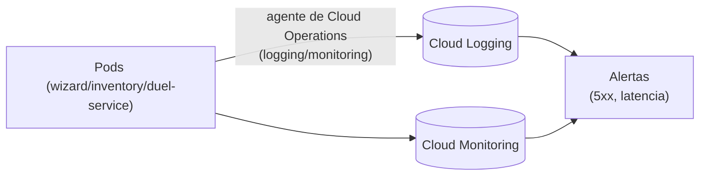

## 10 — Observabilidad (Logging, Monitoring y trazabilidad)

### Objetivo

Tener visibilidad operativa mínima para correr los microservicios en GKE:

- Logs por servicio (errores, latencia, requests)
- Métricas básicas (tráfico, errores, latencia)
- Alertas simples (errores, caídas)
- Trazabilidad por request (Correlation ID)

### Alcance (importante)

- Esta guía describe configuración en GCP y cómo consultar datos.
- No modifica código del repositorio.

### Resumen visual del flujo



---

## 1) Logging en GKE

GKE envía los logs de los contenedores a **Cloud Logging** automáticamente, mediante el agente de **Cloud Operations for GKE** (habilitado por defecto en Autopilot; en Standard se habilita con `--logging=SYSTEM,WORKLOAD` al crear el cluster, que es lo que hace `create-auto`/Autopilot de todas formas).

### 1.0 Variables rápidas

```bash
export REGION="us-central1"
export CLUSTER_NAME="hogwarts-cluster-gke"
```

### 1.1 Leer logs por CLI

```bash
kubectl logs deploy/wizard-service --tail=100
kubectl logs deploy/inventory-service --tail=100
kubectl logs deploy/duel-service --tail=100
```

### 1.2 Ver logs en consola (Logs Explorer)

1. Cloud Console → Logging → Logs Explorer
2. Filtra por `resource.type="k8s_container"` y `resource.labels.cluster_name="hogwarts-cluster-gke"`
3. Acota por `resource.labels.container_name="wizard-service"` (o el servicio que corresponda) y severidad (ERROR)

---

## 2) Correlation ID (trazabilidad por request)

Este repo ya incluye un filtro que:

- Lee el header `X-Correlation-Id` si existe, o lo genera.
- Lo retorna también en la respuesta.
- Lo pone en MDC con key `traceId`.

### 2.1 Cómo usarlo en pruebas

Genera un correlation id y pásalo en `curl` (usa la IP externa del `Service` de `wizard-service`, obtenida como en la guía `04`, sección 4.4):

```bash
export WIZARD_IP="$(kubectl get service wizard-service -o jsonpath='{.status.loadBalancer.ingress[0].ip}')"
export CID="$(uuidgen)"
curl -sS "http://$WIZARD_IP/api/wizards?page=0&size=20&sort=id,desc" \
  -H "X-Correlation-Id: $CID"
```

Luego busca ese `CID` en los logs.

### 2.2 Buenas prácticas

- Propagar `X-Correlation-Id` desde el cliente (Postman/Frontend).
- En llamadas internas (service-to-service), reenviar el mismo header.

---

## 3) Métricas en Cloud Monitoring

GKE expone métricas de infraestructura (CPU, memoria, reinicios) sin configuración extra, vía Cloud Operations for GKE. Las métricas a nivel HTTP (request count, latencias, 4xx/5xx) requieren una pieza adicional: el `Ingress`/Load Balancer (guía `09`) o **Google Cloud Managed Service for Prometheus** (recomendado si quieres métricas de aplicación más detalladas).

### 3.1 Métricas de infraestructura (sin configuración extra)

En Cloud Console:

1. Monitoring → Metrics Explorer
2. Resource type: "Kubernetes Container" (`k8s_container`)
3. Métricas útiles:
   - CPU/memory utilization por contenedor
   - Restart count
   - Pod/Node count

### 3.2 Métricas HTTP del Load Balancer (si expones vía `Ingress`)

Si usas el `Ingress` de la guía `09`, el Load Balancer administrado expone sus propias métricas:

1. Monitoring → Metrics Explorer
2. Resource type: "HTTP(S) Load Balancer Rule"
3. Métricas útiles: request count, latencias, response codes (4xx/5xx)

---

## 4) Alertas recomendadas (mínimas)

### 4.1 Alerta por errores 5xx

Crea una Policy:

- Signal: response code class 5xx del Load Balancer (`Ingress`), o un log-based metric sobre los logs del Pod (sección 5) si no usas `Ingress`
- Umbral (ejemplo):
  - "> 5 errores 5xx en 5 minutos"
- Notificación: email / Slack / PagerDuty (según tu entorno)

### 4.2 Alerta por latencia alta

Umbral (ejemplo):

- p95 latency > 2s durante 10 min

### 4.3 Alerta por caídas

Si usas un endpoint de health (si existe), puedes crear uptime checks.

> Este repo no documenta health endpoints específicos; si luego agregas Actuator, usa `/actuator/health` con seguridad adecuada.

---

## 5) Log-based metrics (opcional)

Si quieres métricas por patrones de logs (ej. “Wizard not found”):

1. Logging → Logs Explorer
2. Define un filtro (texto o jsonPayload)
3. “Create metric” → Counter
4. Usa esa métrica en alertas

---

## 6) Buenas prácticas de operación en GKE

- **`requests`/`limits` de CPU y memoria**: ajustar según el perfil de la app para evitar OOM y throttling; en Autopilot determinan directamente el costo del Pod.
- **`HorizontalPodAutoscaler`**: escala réplicas según CPU/memoria u otra métrica si la carga es variable.
- **Liveness/Readiness probes**: para que Kubernetes detecte Pods no saludables y no les enrute tráfico (readiness) o los reinicie (liveness).
- **`PodDisruptionBudget`**: evita que demasiados Pods caigan a la vez durante mantenimiento/upgrades del cluster.
- **Timeouts**: definir timeouts cliente y servidor (para evitar requests colgadas).

