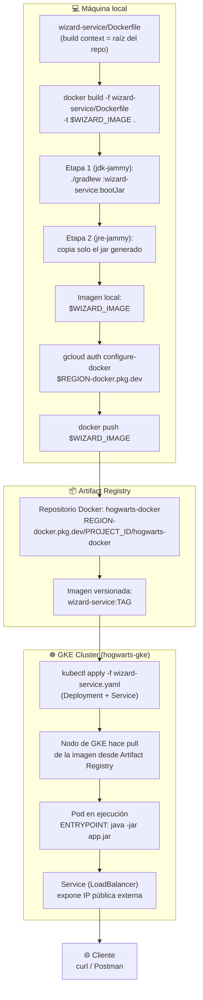

## 12 — Diagrama: de `Dockerfile` a GKE (pasando por Artifact Registry)

### Objetivo

Mostrar, en un solo diagrama, el flujo end-to-end de un microservicio cuando se construye la imagen **manualmente con `Dockerfile`** (en vez de buildpacks), se publica en **Artifact Registry**, y luego se ejecuta en **GKE**.

Esta guía es un **complemento visual** — no introduce comandos nuevos. Los comandos reales están en:

- `03_artifact_registry_y_builds.md` (sección 3-bis) — build con `Dockerfile` y push
- `04_microservicios_gke.md` — deploy en GKE

### Alcance (importante)

- Solo documentación/diagrama, no modifica código del repo.
- Usa `wizard-service` como ejemplo (es el único módulo con `Dockerfile` real hoy en el repo — ver `wizard-service/Dockerfile`); el mismo flujo aplica a `inventory-service`/`duel-service` si se crean sus `Dockerfile` análogos (ver `03_artifact_registry_y_builds.md`, sección 3-bis.4).

---

## 1) Diagrama completo

---

## 2) Paso a paso (referencia rápida)

| # | Fase | Comando / acción | Dónde ocurre | Guía detallada |
|---|------|-------------------|--------------|-----------------|
| 1 | Definir imagen | `wizard-service/Dockerfile` (multi-stage: build con JDK, runtime con JRE) | Repo local | `DOCUMENTACION_BUILD_DEPLOY/11_imagen_de_contenedor_local.md` |
| 2 | Construir imagen | `docker build -f wizard-service/Dockerfile -t "$WIZARD_IMAGE" .` (context = raíz del repo) | Docker local | `03_artifact_registry_y_builds.md` §3-bis.3 |
| 3 | Autenticar Docker contra GCP | `gcloud auth configure-docker "$REGION-docker.pkg.dev"` | Máquina local (una vez) | `03_artifact_registry_y_builds.md` §3-bis.2 |
| 4 | Publicar imagen | `docker push "$WIZARD_IMAGE"` | Local → Artifact Registry | `03_artifact_registry_y_builds.md` §3-bis.3 |
| 5 | Verificar publicación | `gcloud artifacts docker images list ...` | Artifact Registry | `03_artifact_registry_y_builds.md` §1-2 |
| 6 | Definir manifiesto K8s | `wizard-service.yaml` (`Deployment` apuntando a `$WIZARD_IMAGE` + `Service`) | Directorio local (`~/hogwarts-gcp/k8s`) | `04_microservicios_gke.md` §4.1 |
| 7 | Desplegar en el cluster | `kubectl apply -f wizard-service.yaml` | GKE | `04_microservicios_gke.md` §4.2 |
| 8 | GKE descarga la imagen | El nodo hace *pull* de la imagen desde Artifact Registry (mismo proyecto ⇒ sin config extra; ver permisos si es cross-project) | GKE (automático) | `04_microservicios_gke.md` §3 |
| 9 | Pod corriendo | Contenedor arranca con `ENTRYPOINT ["java","-jar","app.jar"]`, escucha en `:8080` | GKE | `04_microservicios_gke.md` §4.3 |
| 10 | Exponer servicio | `Service` tipo `LoadBalancer` asigna IP externa | GKE | `04_microservicios_gke.md` §4.4 |
| 11 | Validar | `curl "$WIZARD_URL/api/wizards"` | Cliente externo | `04_microservicios_gke.md` §4.5 |

---

## 3) Notas clave del flujo

- **El build context siempre es la raíz del repo**, no la carpeta del microservicio: el `Dockerfile` de cada módulo necesita `gradlew`, `settings.gradle` y las tres carpetas de servicios porque es un build Gradle multi-proyecto.
- **Versionado de la imagen**: el diagrama muestra `$WIZARD_IMAGE` sin tag para simplificar. En la práctica, cada imagen se publica con su **versión semántica** (`wizard-service:1.4.0`, tomada de `wizard-service/gradle.properties`) más el SHA del commit, y el `Deployment` de GKE referencia el tag semántico, nunca `:latest` (ver `03_artifact_registry_y_builds.md` §4).
- **Actualizar una versión ya desplegada**: seguir el flujo de release (`03_artifact_registry_y_builds.md` §4.6) y luego `kubectl set image deployment/wizard-service wizard-service="$WIZARD_IMAGE:$WIZARD_VERSION"` (ver `04_microservicios_gke.md` §9) en vez de reaplicar todo el manifiesto.
- **Arquitectura**: si construyes desde Apple Silicon, agrega `--platform linux/amd64` (con `docker buildx`) para que la imagen corra en los nodos de GKE (ver `03_artifact_registry_y_builds.md` §3-bis.5).
- Este mismo flujo aplica a `inventory-service` y `duel-service`, reemplazando el nombre del módulo, la imagen (`$INVENTORY_IMAGE`/`$DUEL_IMAGE`) y el manifiesto K8s correspondiente.
