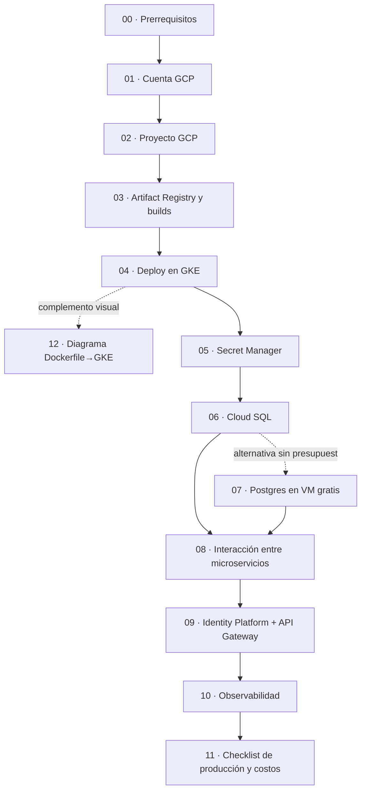

## DESPLIEGUE_GKE_GCP — Guías paso a paso

Este directorio contiene guías **paso a paso** para desplegar los microservicios de este repo en **Google Cloud Platform (GCP)** usando **Google Kubernetes Engine (GKE)**, migrar persistencia a **Cloud SQL (PostgreSQL)**, definir **interacción segura** entre microservicios, y **segurizar** APIs con **Identity Platform**.

### Alcance (importante)

- **Solo documentación**: estas guías describen qué hacer en GCP y qué ajustes serían necesarios en aplicaciones Spring Boot.
- **No se realiza ningún cambio en el código del repo**: no se agregan dependencias, no se cambian properties, no se crean `Dockerfile`, `cloudbuild.yaml`, Terraform, etc. (los manifiestos de Kubernetes se documentan como archivos de infraestructura fuera del repo).
- Donde el proceso requiere cambios de aplicación, se listan como **instrucciones** (qué archivo tocar y qué agregar) para que tú los apliques fuera de este trabajo.

### Microservicios del repo (referencia rápida)

- **wizard-service**: `/api/wizards` (+ `/api/wizards/attack`)
- **inventory-service**: `/api/inventory/wands`, `/api/inventory/potions`, `/api/inventory/brooms`
- **duel-service**: `/api/duels`

Los ejemplos de requests están en la colección Postman del repo: `Hogwarts_API.postman_collection.json`.

### Orden de lectura

El número de cada archivo refleja el orden real de lectura: cada guía solo asume pasos de archivos **anteriores**.

1. `00_prerequisitos_locales_y_herramientas.md`
2. `01_creacion_cuenta_gcp.md`
3. `02_creacion_proyecto_gcp.md`
4. `03_artifact_registry_y_builds.md`
5. `04_microservicios_gke.md`
6. `05_secret_manager_y_configuracion_por_ambiente.md`
7. `06_base_de_datos_cloud_sql.md` — o, como alternativa sin presupuesto, `07_alternativa_postgres_gratis_vm.md`
8. `08_interaccion_entre_microservicios_validacion_ids.md`
9. `09_segurizacion_apis_identity_platform.md`
10. `10_observabilidad_logging_monitoring.md`
11. `11_checklist_produccion_y_costos.md`

Diagrama complementario (opcional): `12_diagrama_flujo_dockerfile_artifact_registry_gke.md` — resume visualmente el camino `Dockerfile` → `docker push` a Artifact Registry → deploy en GKE.
