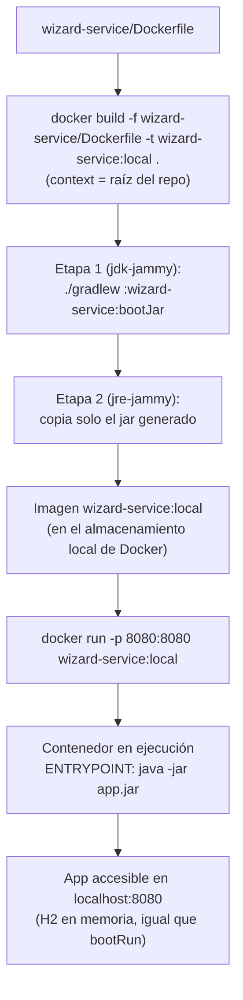

# Qué es una imagen de contenedor y cómo desplegarla en local

Archivos cubiertos:

- [`wizard-service/Dockerfile`](../wizard-service/Dockerfile)

Este documento complementa [`07_wizard_service.md`](07_wizard_service.md): explica el concepto de "imagen de contenedor" desde cero y detalla, paso a paso, cómo construirla y correrla en la máquina local usando el único `Dockerfile` real del repo. No cubre el flujo de despliegue a GKE (eso está en [`README.md`](README.md#5-fase-de-despliegue-gke) y en [`../DESPLIEGUE_GKE_GCP/`](../DESPLIEGUE_GKE_GCP/)) — aquí el alcance es exclusivamente **local**.

## 1. Qué es una imagen de contenedor

Una **imagen** es un paquete inmutable y autocontenido que incluye todo lo necesario para correr una aplicación: código ya compilado, el runtime (en este caso el JRE), librerías y configuración — pero **no** un proceso en ejecución. Se arma en **capas** apiladas (cada instrucción del `Dockerfile` agrega una capa), y esas capas se cachean: si una capa no cambió entre builds, Docker la reutiliza en vez de rehacerla.

Un **contenedor** es una *instancia en ejecución* de una imagen: el proceso vivo, con su propio filesystem (una capa de escritura sobre la imagen, descartable), su propia red aislada y sus propios recursos. La misma imagen puede levantar múltiples contenedores independientes.

Analogía rápida: la imagen es como una clase, el contenedor es como una instancia de esa clase.

| | Imagen | Contenedor |
|---|---|---|
| Naturaleza | Plantilla estática, inmutable | Proceso en ejecución |
| Se crea con | `docker build` | `docker run` |
| Cuántos por imagen | — | Muchos, cada uno independiente |
| Persiste al detenerse | Sí (queda en disco) | Se destruye salvo que se use un volumen |

## 2. Qué genera el `Dockerfile` de `wizard-service`

Es un build **multi-stage** (dos `FROM`, ver [`wizard-service/Dockerfile`](../wizard-service/Dockerfile)):

1. **Etapa `build`** (`eclipse-temurin:17-jdk-jammy`): copia el repo completo (necesita el wrapper y los tres módulos porque es un build multi-proyecto Gradle) y corre `./gradlew :wizard-service:bootJar` para generar el jar ejecutable.
2. **Etapa final** (`eclipse-temurin:17-jre-jammy`): copia **solo** el jar resultante desde la etapa anterior, descartando el JDK, Gradle y el código fuente. El resultado es una imagen final liviana, lista para correr con `java -jar app.jar`.

Como se explica en [`07_wizard_service.md`](07_wizard_service.md), este `Dockerfile` es **educativo**: replica manualmente lo que hace Cloud Native Buildpacks (el mecanismo real usado para desplegar a GKE), y `inventory-service` y `duel-service` tienen uno equivalente (ver [`08_inventory_service.md`](08_inventory_service.md) y [`09_duel_service.md`](09_duel_service.md)).

## 3. Paso a paso: construir y correr la imagen en local

### 3.1. Construir la imagen (`docker build`)

```bash
docker build -f wizard-service/Dockerfile -t wizard-service:local .
```

- `-f wizard-service/Dockerfile`: indica **qué** Dockerfile usar (no está en la raíz).
- `-t wizard-service:local`: le pone nombre (`wizard-service`) y etiqueta (`local`) a la imagen resultante, para poder referenciarla después.
- **El `.` final es el build context, y debe ser la raíz del repo** — no `wizard-service/`. El propio `Dockerfile` lo remarca en su comentario inicial: como es un proyecto Gradle multi-módulo, la etapa `build` necesita ver `gradlew`, `settings.gradle` y las tres carpetas de servicios, todo lo cual cuelga de la raíz.

Qué pasa internamente al correr esto: Docker arma la etapa `build` en un contenedor temporal (compila con Gradle dentro), después arma la etapa final copiando solo el jar, y descarta el contenedor temporal de la primera etapa. Al terminar, la imagen `wizard-service:local` queda guardada en el almacenamiento local de Docker (visible con `docker images`).

### 3.2. Correr un contenedor a partir de la imagen (`docker run`)

```bash
docker run -p 8080:8080 wizard-service:local
```

- `-p 8080:8080`: publica el puerto 8080 del contenedor (el que el `Dockerfile` declara con `EXPOSE 8080` y en el que Spring Boot escucha por defecto) en el puerto 8080 del host. Formato: `-p <puerto_host>:<puerto_contenedor>`.
- `wizard-service:local`: la imagen construida en el paso anterior.

El contenedor arranca `ENTRYPOINT ["java", "-jar", "app.jar"]`, levanta el contexto de Spring Boot con su base H2 en memoria (igual que corriendo `bootRun` en local, ver [`10_ejecucion_bootrun_vs_ide.md`](10_ejecucion_bootrun_vs_ide.md)), y queda escuchando en `localhost:8080`.

### 3.3. Verificar que responde

Con el contenedor corriendo (en otra terminal):

```bash
curl http://localhost:8080/api/wizards
```

O usando la colección Postman del repo (`Hogwarts_API.postman_collection.json`) apuntando a `localhost:8080`.

### 3.4. Detener y limpiar

```bash
# Ctrl+C si corriste docker run en foreground, o:
docker ps                     # ver el ID/nombre del contenedor
docker stop <container_id>    # detenerlo

docker rmi wizard-service:local   # borrar la imagen si ya no se necesita
```

## 4. Diagrama del flujo local



## 5. Notas

- Este flujo es **puramente local**: no publica la imagen en ningún registry ni la conecta con GCP. Para eso está la sección 4.a del [`README.md`](README.md#4-fase-de-empaquetado-dos-procesos-separados) (Cloud Native Buildpacks + Artifact Registry), que es el mecanismo real usado para desplegar.
- `inventory-service` y `duel-service` usan el mismo camino (mismo `docker build`/`docker run`, cambiando el nombre del módulo y el `-f`), con sus propios `Dockerfile` — ver [`08_inventory_service.md`](08_inventory_service.md) y [`09_duel_service.md`](09_duel_service.md).
- El tag `:local` es solo para pruebas en tu máquina. Para publicar en Artifact Registry, el tag es la versión semántica del servicio (de su `gradle.properties`), ver `DESPLIEGUE_GKE_GCP/03_artifact_registry_y_builds.md` §4.

Ver también: [`07_wizard_service.md`](07_wizard_service.md), [`10_ejecucion_bootrun_vs_ide.md`](10_ejecucion_bootrun_vs_ide.md).
