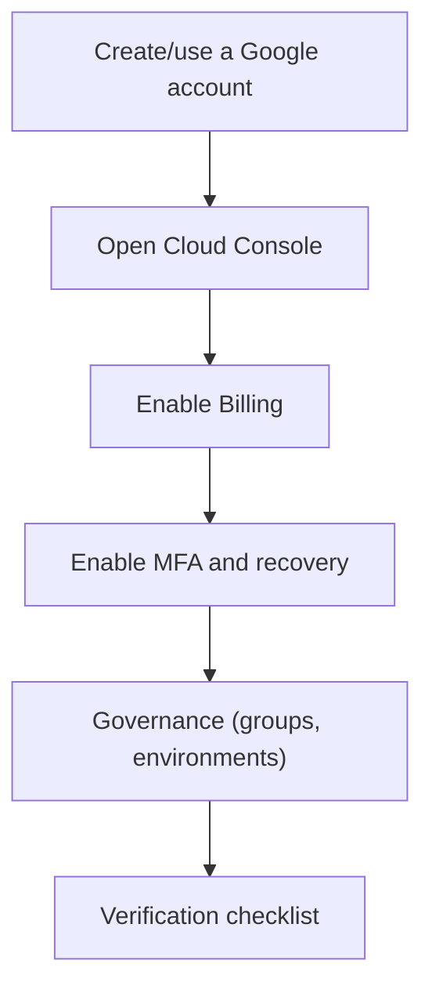

## 01 — GCP account setup

### Goal

Create a Google Cloud account ready to work with GKE, Cloud SQL, Artifact Registry, Secret Manager and Identity Platform, with a baseline security configuration (MFA) and active billing.

### Scope (important)

- This guide only describes steps in GCP (console).
- It does not modify the repository code.

### Visual summary of the flow

---

## 1) Create a Google account (if you don't have one)

1. Create a standard Google account (Gmail) or use a Google Workspace corporate account.
2. Make sure you can receive emails (verification and billing/security alerts).

---

## 2) Open Google Cloud Console

1. Go to Google Cloud Console (search for "Google Cloud Console").
2. Sign in with the account you will use to manage the project.

---

## 3) Enable Billing (mandatory)

GKE/Cloud SQL/Artifact Registry require active billing on the project.

### 3.1 New account (free trial)

1. Activate the Free Trial if applicable.
2. Add a payment method (card).
3. Confirm the correct billing region/country.

### 3.2 Organization/company

1. Confirm that a "Billing Account" is available.
2. Ask the finance team/administrator for access if you don't see it.

---

## 4) Secure the account (highly recommended)

### 4.1 Enable MFA (2FA)

1. Go to your Google account security settings.
2. Turn on "2-Step Verification".
3. Set up at least 2 methods:
   - Authenticator app (TOTP)
   - Security key (if your organization uses them) or SMS as a fallback

### 4.2 Recovery

1. Set up a recovery email and phone number.
2. Store the "backup codes" in a safe place.

---

## 5) Governance recommendations (if applicable)

If you work in a corporate context (Workspace/Organization):

- Prefer corporate identities (not personal accounts).
- Define an "admins" group (Google Groups) and grant roles to the group, not to individual users.
- Separate environments by project (dev/stg/prod) from the start if the goal is production.

---

## 6) Verification (checklist)

- You can open Cloud Console without errors.
- You have active billing or access to a Billing Account.
- Your account has MFA enabled.
