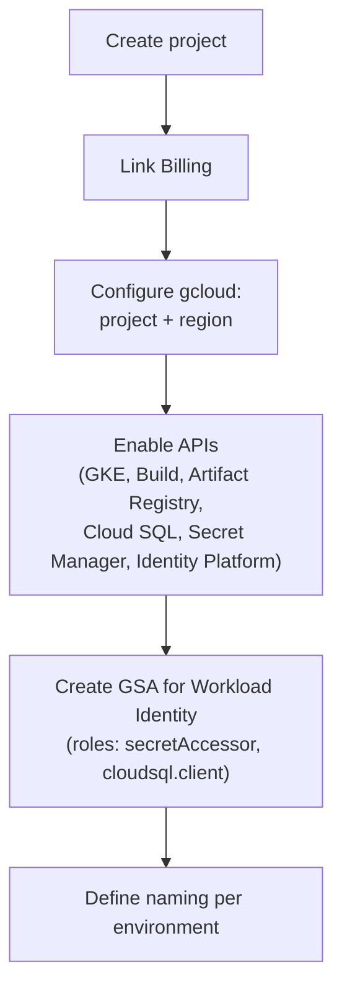

## 02 — GCP project setup

### Goal

Create a GCP project to deploy the repo's microservices, with the required APIs enabled and a consistent baseline configuration (region, naming, service accounts).

### Scope (important)

- This guide only describes steps in GCP and `gcloud` commands.
- It does not modify the repository code.

### Visual summary



---

## 0) Conventions and variables

Define values (examples):

- `PROJECT_ID`: `hogwarts-dev-123`
- `PROJECT_NAME`: `hogwarts-backend-dev`
- `REGION`: `us-central1` (pick a region close to your users)
- `LOCATION_ARTIFACT_REGISTRY`: usually the same as `REGION`

In the terminal (recommended):

```bash
export PROJECT_ID="hogwarts-dev-123"
export REGION="us-central1"
```

---

## 1) Create the project (Console)

1. In Cloud Console, open the project selector (top bar).
2. Click "New Project".
3. Fill in:
   - Name: `PROJECT_NAME`
   - Project ID: `PROJECT_ID` (if available; otherwise adjust it)
4. If applicable, select the correct "Organization" and "Location".
5. Create the project.

### Verification

- The new project shows up in the project selector.

---

## 2) Link Billing to the project (Console)

1. Go to Billing.
2. Select "Manage billing accounts".
3. Under "My projects" or "Projects linked", link your project to a Billing Account.

### Verification

- In the project's Billing page it should say "Billing account: <...> (Active)".

---

## 3) Configure `gcloud` for the project

### 3.1 Select the project

```bash
gcloud config set project "$PROJECT_ID"
```

Check:

```bash
gcloud config get-value project
```

### 3.2 Set the default region (GKE/Compute)

```bash
gcloud config set compute/region "$REGION"
```

Check:

```bash
gcloud config get-value compute/region
```

---

## 4) Enable the required APIs

Enable the minimum APIs for this path (GKE + Cloud Build + Artifact Registry + Cloud SQL + Secret Manager + Identity Platform).

```bash
gcloud services enable \
  container.googleapis.com \
  artifactregistry.googleapis.com \
  cloudbuild.googleapis.com \
  secretmanager.googleapis.com \
  sqladmin.googleapis.com \
  iam.googleapis.com \
  identitytoolkit.googleapis.com \
  serviceusage.googleapis.com
```

Optional (very useful in practice):

```bash
gcloud services enable \
  logging.googleapis.com \
  monitoring.googleapis.com \
  cloudtrace.googleapis.com \
  clouderrorreporting.googleapis.com \
  apigateway.googleapis.com
```

### Verification

List the enabled APIs (it may take a few seconds):

```bash
gcloud services list --enabled
```

---

## 5) Create base service accounts (recommended)

The idea is to separate identities:

- A Google service account (GSA) that the Pods will use via **Workload Identity** (one per microservice or a shared one).
- A service account for Cloud Build (if you want to separate permissions).

### 5.1 Service account for Workload Identity (example)

Later on (guide `04`), this GSA is bound via Workload Identity to the Kubernetes service accounts (KSA) of each Pod — that way the Pods get IAM permissions without static keys.

```bash
gcloud iam service-accounts create hogwarts-gke-sa \
  --display-name="Hogwarts GKE workload SA"
```

Save the email:

```bash
export GKE_SA="hogwarts-gke-sa@$PROJECT_ID.iam.gserviceaccount.com"
echo "$GKE_SA"
```

### 5.2 Typical permissions for the workload SA

For this project you will usually need to:

- Read secrets (Secret Manager) for the DB / configs
- Connect to Cloud SQL (if you use Cloud SQL)

Grant roles (recommended minimum):

```bash
gcloud projects add-iam-policy-binding "$PROJECT_ID" \
  --member="serviceAccount:$GKE_SA" \
  --role="roles/secretmanager.secretAccessor"

gcloud projects add-iam-policy-binding "$PROJECT_ID" \
  --member="serviceAccount:$GKE_SA" \
  --role="roles/cloudsql.client"
```

### Verification

```bash
gcloud iam service-accounts list
```

---

## 6) Key decision: naming and separation by environment

Simple recommendation:

- One project per environment: `hogwarts-dev`, `hogwarts-stg`, `hogwarts-prod`
- Consistent `Deployment`/`Service` names in GKE:
  - `wizard-service`
  - `inventory-service`
  - `duel-service`

This simplifies permissions, billing and deployments.
