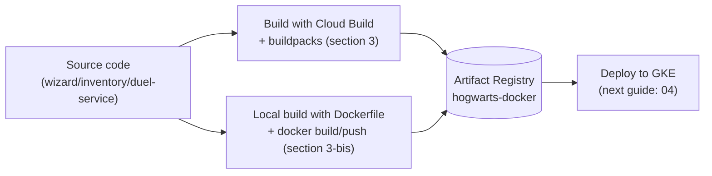

## 03 — Artifact Registry and builds (one image per microservice)

### Goal

Create a Docker repository in **Artifact Registry** and build container images for each microservice, using **Cloud Build + buildpacks** (no `Dockerfile` needed, section 3) or, as an alternative, a **`Dockerfile` + manual build/push with Docker** (section 3-bis).

### Scope (important)

- This guide describes commands and configuration in GCP.
- It **does not add** a `cloudbuild.yaml` to the repo (documentation only). `wizard-service/Dockerfile`, `inventory-service/Dockerfile` and `duel-service/Dockerfile` already exist in the repo for educational purposes and follow the same pattern (see section 3-bis).
- Where applicable, commands are run from subdirectories of the repo.

### Visual summary of the flow



| Path | Requires a Dockerfile | Where the build runs | When to use it |
|---|---|---|---|
| Buildpacks (section 3, recommended) | No | Remotely, on Cloud Build | General case, no fine-grained control over the image |
| Manual Dockerfile (section 3-bis) | Yes | Locally (`docker build`) | You need explicit control over layers/packages |

---

## What is Artifact Registry? What is Docker?

**Docker** is a tool that packages an application together with everything it needs to run (runtime, libraries, configuration) into a portable unit called a **container image**. An image runs as a **container**: an isolated process that behaves the same on your machine, on Cloud Build or on a GKE node. In this guide, Docker (or buildpacks, which do an equivalent job without a `Dockerfile`) is what turns each microservice's source code into an image.

**Artifact Registry** is the GCP service where those images (and other package types) are stored and versioned once built, privately for the project. It is the intermediate "registry" between the build (section 3) and the deploy to GKE (guide 04): GKE does not read your source code or your local machine, it **pulls the images from Artifact Registry**.

### Formats supported by Artifact Registry

An Artifact Registry repository is created with a fixed `--repository-format` (formats are not mixed). The most relevant ones:

- **`docker`**: the one used in this guide; stores Docker/OCI container images, addressable as `LOCATION-docker.pkg.dev/PROJECT_ID/REPO/IMAGE`.
- **`maven`**: Java artifact repository (`.jar`/`.pom`), useful if you want to publish internal libraries instead of (or in addition to) images.
- **`npm`**: Node.js packages, a private equivalent of npmjs.com.

There are other formats (Python/pip, Go, APT, YUM, etc.), but for this guide we only care about `docker`, which is the one we create in step 1.

---

## 0) Variables and naming convention

Recommendation:

- Artifact Registry repository: `hogwarts-docker`
- Images:
  - `wizard-service`
  - `inventory-service`
  - `duel-service`

Define variables:

```bash
export PROJECT_ID="hogwarts-dev-123"
export REGION="us-central1"
export AR_REPO="hogwarts-docker"
```

---

## 1) Create a Docker repository in Artifact Registry

Create the repository:

```bash
gcloud artifacts repositories create "$AR_REPO" \
  --repository-format=docker \
  --location="$REGION" \
  --description="Docker images for hogwarts microservices"
```

Check:

```bash
gcloud artifacts repositories list --location="$REGION"
```

Recommended: enable immutable tags so that a published version tag cannot be overwritten (see section 4.5).

---

## 2) Define the image URIs

Artifact Registry for Docker uses this format:

`LOCATION-docker.pkg.dev/PROJECT_ID/REPO/IMAGE`

Example:

```bash
export WIZARD_IMAGE="$REGION-docker.pkg.dev/$PROJECT_ID/$AR_REPO/wizard-service"
export INVENTORY_IMAGE="$REGION-docker.pkg.dev/$PROJECT_ID/$AR_REPO/inventory-service"
export DUEL_IMAGE="$REGION-docker.pkg.dev/$PROJECT_ID/$AR_REPO/duel-service"
```

These variables are the URI **without a tag**. For simplicity, the commands in sections 3 and 3-bis use them as-is, which publishes `:latest`. To publish a real version, add the semantic tag as described in section 4.

---

## 3) Remote build with Cloud Build + buildpacks (recommended)

### 3.1 Why buildpacks here

- They let you build images from source code without a Dockerfile.
- Cloud Build runs the build on managed infrastructure.

### 3.2 Important: this repo is multi-module

Each microservice lives in its own folder with its own `build.gradle`.

Therefore, the simplest approach is:

- Run the build from each subdirectory:
  - `wizard-service/`
  - `inventory-service/`
  - `duel-service/`

That way Cloud Build "sees" an isolated Gradle project and buildpacks detects it correctly.

### 3.3 Build `wizard-service`

From the repo root, go into the module:

```bash
cd wizard-service
```

Run the remote build with buildpacks:

```bash
gcloud builds submit --pack image="$WIZARD_IMAGE"
```

Check that the image was published:

```bash
gcloud artifacts docker images list "$REGION-docker.pkg.dev/$PROJECT_ID/$AR_REPO"
```

### 3.4 Build `inventory-service`

```bash
cd ../inventory-service
gcloud builds submit --pack image="$INVENTORY_IMAGE"
gcloud artifacts docker images list "$REGION-docker.pkg.dev/$PROJECT_ID/$AR_REPO"
```

### 3.5 Build `duel-service`

```bash
cd ../duel-service
gcloud builds submit --pack image="$DUEL_IMAGE"
gcloud artifacts docker images list "$REGION-docker.pkg.dev/$PROJECT_ID/$AR_REPO"
```

### 3.6 Back to the root

```bash
cd ..
```

---

## 3-bis) Build with a `Dockerfile` + manual publish (alternative to buildpacks)

### 3-bis.1 When to use this option

- Buildpacks (section 3) is the simplest path and the recommended default.
- Use a `Dockerfile` instead if you need explicit control over the base image, layers or extra system packages, or if buildpacks does not detect the project correctly.
- This path requires Docker installed and running on your local machine.

### 3-bis.2 Authenticate Docker against Artifact Registry

Once per machine:

```bash
gcloud auth configure-docker "$REGION-docker.pkg.dev"
```

### 3-bis.3 Build and push `wizard-service`

This module already has a real `Dockerfile` in the repo (`wizard-service/Dockerfile`), documented in `BUILD_DEPLOY_DOCS/11_local_container_image.md`. The build context must be the **repo root** (not `wizard-service/`), because it is a Gradle multi-module build and the compile stage needs the wrapper and all three modules:

```bash
docker build -f wizard-service/Dockerfile -t "$WIZARD_IMAGE" .
docker push "$WIZARD_IMAGE"
```

Check that it was published:

```bash
gcloud artifacts docker images list "$REGION-docker.pkg.dev/$PROJECT_ID/$AR_REPO"
```

### 3-bis.4 Build and push `inventory-service` and `duel-service`

These two modules **already have their own `Dockerfile`** in the repo (`inventory-service/Dockerfile` and `duel-service/Dockerfile`), following the same pattern as `wizard-service/Dockerfile` (see the conceptual reference in `BUILD_DEPLOY_DOCS/08_inventory_service.md` and `BUILD_DEPLOY_DOCS/09_duel_service.md`); only the `bootJar` module and the path of the jar copied into the runtime stage change.

The build and push are the same as for `wizard-service`:

```bash
docker build -f inventory-service/Dockerfile -t "$INVENTORY_IMAGE" .
docker push "$INVENTORY_IMAGE"

docker build -f duel-service/Dockerfile -t "$DUEL_IMAGE" .
docker push "$DUEL_IMAGE"
```

### 3-bis.5 Note on architecture (Apple Silicon / ARM)

GKE nodes on GCP run on `linux/amd64`. If you build from a Mac with an Apple Silicon chip, `docker build` may produce an `arm64` image by default, which does not run on GCP. Force the correct architecture with `buildx`:

```bash
docker buildx build --platform linux/amd64 -f wizard-service/Dockerfile -t "$WIZARD_IMAGE" --push .
```

(`--push` publishes directly without a separate `docker push`.)

---

## 4) Image tags/versioning: semantic versioning

### 4.1 What a tag is and why it matters

A **tag** is the suffix after `:` in an image URI (e.g. `wizard-service:1.4.0`). It identifies a specific version of the image content within the same repository/name.

In the commands of sections 3 and 3-bis, when no explicit tag is given, both `gcloud builds submit --pack image="$WIZARD_IMAGE"` and `docker build -t "$WIZARD_IMAGE" .` publish (or overwrite) the implicit **`:latest`** tag. That is convenient for testing, but risky for real operations:

- `:latest` is mutable: every new build overwrites it, so you cannot tell which code runs in a GKE Pod just by looking at `:latest`.
- If you need to roll back to a previous version, `:latest` gives you no way to reference it: it has already been overwritten.
- The Kubernetes manifest (guide 04) references an image by its full URI; if you always use `:latest`, Kubernetes may not notice that there is a new image and may not redeploy (depending on the `imagePullPolicy`).

That is why this project uses **semantic versioning** for image tags.

### 4.2 Semantic versioning per microservice

The format is `MAJOR.MINOR.PATCH` (full specification at [semver.org](https://semver.org/)). Each microservice has **its own version**, independent of the others: `wizard-service:1.4.0` can coexist in the cluster with `duel-service:0.7.2`. Only the service that changed gets a new version.

| Part | Incremented when… | Examples in this project |
|---|---|---|
| `MAJOR` | There is an **incompatible** change to the API contract: consumers of the service must adapt | Renaming or removing a DTO field, changing an endpoint's path or method, making an optional field required, changing the meaning of a status code |
| `MINOR` | Functionality is added in a **backward-compatible** way | A new endpoint, a new optional field in a response, a new filter on a listing |
| `PATCH` | Something is fixed **without changing the contract** | Fixing a bug, adjusting an internal validation, improving performance, updating a dependency |

Rules:

- When you increment a part, the parts to its right reset to `0`: `1.4.2` → `1.5.0` (MINOR) → `2.0.0` (MAJOR).
- While a service is at `0.y.z` (initial development), its API is not considered stable and an incompatible change may go into `MINOR`. It moves to `1.0.0` when the contract stabilizes, for example when another service or an external client starts depending on it.
- The services call each other (see guide `08_microservice_interaction_id_validation.md`). A `MAJOR` in `wizard-service` requires reviewing its consumers (`inventory-service`, `duel-service`) before deploying it.

### 4.3 Where the version lives: each service's `gradle.properties`

The **single source of truth** for the version is each module's `gradle.properties`:

```properties
# wizard-service/gradle.properties
version=1.4.0
```

That same value names the jar (`wizard-service-1.4.0.jar`) and is the image tag. Do not type the version by hand in commands: read it from the file (run from the repo root):

```bash
export WIZARD_VERSION=$(grep '^version=' wizard-service/gradle.properties | cut -d= -f2)
export INVENTORY_VERSION=$(grep '^version=' inventory-service/gradle.properties | cut -d= -f2)
export DUEL_VERSION=$(grep '^version=' duel-service/gradle.properties | cut -d= -f2)
```

If a module had no `gradle.properties`, it would inherit the version from the root `build.gradle`. To publish images, each service must have its own.

Between releases, the version carries the `-SNAPSHOT` suffix (e.g. `1.5.0-SNAPSHOT`): it indicates in-development code heading towards the next, not yet published, version.

### 4.4 Which tags each image gets

| Tag | Example | When it is published | What it is for |
|---|---|---|---|
| `MAJOR.MINOR.PATCH` | `1.4.0` | On every release | The tag GKE references |
| Short Git SHA | `a1b2c3d` | On every release, on the same image | Traceability: from the image to the exact commit |
| `MAJOR.MINOR.PATCH-SNAPSHOT.<sha>` | `1.5.0-SNAPSHOT.a1b2c3d` | Development builds, to test before the release | Testing in a dev environment without "spending" a version number |

Rules:

- **No `v` prefix** in the image tag: the tag is exactly the `version` from `gradle.properties` (`1.4.0`, not `v1.4.0`). The `v` prefix is only used in git tags (section 4.6).
- **A version tag is never reused.** If `1.4.0` shipped with a bug, it gets fixed and `1.4.1` is published; `1.4.0` is never published again.
- **A bare `-SNAPSHOT` is not published** (e.g. `1.5.0-SNAPSHOT`), because every build would overwrite it and traceability would be lost. Development builds always carry the SHA.
- **`latest` is not published.** With the immutable tags of section 4.5 it could not be moved anyway.
- Docker tags do not allow `+`, so semver "build metadata" (`1.4.0+a1b2c3d`) is not valid as a tag. That is why the SHA goes as a separate tag, or separated by `.` in development builds.

### 4.5 Make tags immutable in Artifact Registry

So that nobody can overwrite an already published tag (not even by mistake), enable immutable tags on the repository:

```bash
gcloud artifacts repositories update "$AR_REPO" \
  --location="$REGION" \
  --immutable-tags
```

Check:

```bash
gcloud artifacts repositories describe "$AR_REPO" \
  --location="$REGION" \
  --format='value(dockerConfig.immutableTags)'
```

It should return `True`. From then on, trying to publish `wizard-service:1.4.0` again fails, which is exactly the goal. The untagged commands of sections 3 and 3-bis (which publish `:latest`) also fail from the second attempt on: use them only for the first test, or always add a tag as described in section 4.7.

### 4.6 Release flow for a service

Example: release `wizard-service` `1.4.0`, starting from `version=1.4.0-SNAPSHOT`.

1. **Decide the number.** Review what changed since the last release using the table in section 4.2. If the change turns out to be `MAJOR` or `MINOR` and the SNAPSHOT does not reflect it, adjust the number.

2. **Pin the version.** In `wizard-service/gradle.properties`, remove the suffix: `version=1.4.0`. Check that everything passes and commit:

   ```bash
   ./gradlew :wizard-service:check
   git commit -am "release: wizard-service 1.4.0"
   ```

3. **Create the git tag.** Since this is a monorepo, the tag carries the service name; a plain `v1.4.0` would not say which service it refers to:

   ```bash
   git tag -a wizard-service/v1.4.0 -m "wizard-service 1.4.0"
   git push origin main wizard-service/v1.4.0
   ```

4. **Build and publish the image** with the tags from section 4.7.

5. **Deploy** the new version to GKE (guide `04_gke_microservices.md` §9):

   ```bash
   kubectl set image deployment/wizard-service wizard-service="$WIZARD_IMAGE:$WIZARD_VERSION"
   kubectl rollout status deployment/wizard-service
   ```

6. **Open the next cycle.** Put `-SNAPSHOT` back with the next planned version (usually the next `PATCH`) and commit:

   ```bash
   # wizard-service/gradle.properties → version=1.4.1-SNAPSHOT
   git commit -am "chore: wizard-service 1.4.1-SNAPSHOT"
   ```

### 4.7 Build and push with the tags

Prepare the variables (from the repo root). The build must come from a clean working tree; otherwise the SHA would not describe the code that actually goes into the image:

```bash
test -z "$(git status --porcelain)" || echo "WARNING: there are uncommitted changes; the SHA does not represent the image's code"

export GIT_SHA=$(git rev-parse --short HEAD)
export WIZARD_VERSION=$(grep '^version=' wizard-service/gradle.properties | cut -d= -f2)

[[ "$WIZARD_VERSION" == *-SNAPSHOT ]] && echo "WARNING: $WIZARD_VERSION is a SNAPSHOT; use the development build, not the release build"
```

**Release via buildpacks (section 3).** `gcloud builds submit --pack` publishes a single tag per build; the SHA tag is added afterwards on the same image:

```bash
cd wizard-service
gcloud builds submit --pack image="$WIZARD_IMAGE:$WIZARD_VERSION"
cd ..
gcloud artifacts docker tags add "$WIZARD_IMAGE:$WIZARD_VERSION" "$WIZARD_IMAGE:$GIT_SHA"
```

**Release via Dockerfile (section 3-bis).** `buildx` publishes both tags in a single step (and forces `linux/amd64`, see section 3-bis.5):

```bash
docker buildx build --platform linux/amd64 \
  -f wizard-service/Dockerfile \
  -t "$WIZARD_IMAGE:$WIZARD_VERSION" \
  -t "$WIZARD_IMAGE:$GIT_SHA" \
  --push .
```

**Development build (`-SNAPSHOT` version).** A single tag, with the SHA included:

```bash
# E.g.: wizard-service:1.5.0-SNAPSHOT.a1b2c3d
cd wizard-service
gcloud builds submit --pack image="$WIZARD_IMAGE:$WIZARD_VERSION.$GIT_SHA"
cd ..
```

For `inventory-service` and `duel-service` the pattern is the same, with `$INVENTORY_IMAGE`/`$INVENTORY_VERSION` and `$DUEL_IMAGE`/`$DUEL_VERSION`. Only publish the services that have a new release.

Check the published tags of an image:

```bash
gcloud artifacts docker tags list "$WIZARD_IMAGE"
```

### 4.8 See which version is running and roll back

Which image (and therefore which version) the `Deployment` uses:

```bash
kubectl get deployment wizard-service \
  -o jsonpath='{.spec.template.spec.containers[0].image}{"\n"}'
```

Rolling back to a previous version means pointing the `Deployment` at its tag, which still exists in Artifact Registry:

```bash
kubectl set image deployment/wizard-service wizard-service="$WIZARD_IMAGE:1.3.2"
kubectl rollout status deployment/wizard-service
```

To go back to the immediately previous revision, `kubectl rollout undo deployment/wizard-service` also works.

### 4.9 If this gets automated later

This flow is manual on purpose. If a Cloud Build trigger is added later, the natural approach is to fire it on the **push of a git tag** matching the service's pattern (e.g. `^wizard-service/v.*$`). The trigger exposes `$TAG_NAME` and `$SHORT_SHA`, which replace the `git tag` and `git rev-parse` of the previous steps. The pipeline should check that the git tag's version matches the one in `gradle.properties` before publishing.

---

## 5) Common troubleshooting

### 5.1 "API not enabled"

Enable the APIs:

```bash
gcloud services enable cloudbuild.googleapis.com artifactregistry.googleapis.com
```

### 5.2 "Permission denied" when building or publishing an image

Make sure that:

- You are on the correct project (`gcloud config get-value project`)
- You have permissions for Cloud Build and Artifact Registry

### 5.3 Buildpacks does not detect Java/Gradle

Confirm that you are running `gcloud builds submit` **inside the module** (e.g. `wizard-service/`) where the service's `build.gradle` exists.
