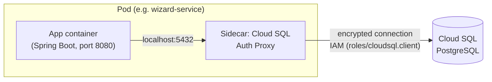

## 06 — Database on GCP (Cloud SQL PostgreSQL)

### Goal

Create a **Cloud SQL for PostgreSQL** instance and define how to move the microservices onto it (configuration in GCP + the changes the app would need), including connectivity checks and production considerations (backups, HA, security).

### Scope (important)

- This guide describes steps in GCP and the configuration of the GKE Pods.
- It **does not modify the repository code**.
- The "code changes" are described as **instructions** for you to apply if appropriate.

### Visual summary: how each Pod connects to Cloud SQL



---

## 0) Repo context

The microservices use `spring-boot-starter-data-jpa` and currently include `runtimeOnly 'com.h2database:h2'`. There is no `spring.datasource.*` in `application.properties`, so the datasource is the default one (in-memory H2 at runtime).

Moving to Cloud SQL involves:

- Provisioning Cloud SQL (PostgreSQL)
- Defining the DB(s) and users
- Connecting the GKE Pods to Cloud SQL (Cloud SQL Auth Proxy as a sidecar)
- Configuring credentials with Secret Manager
- (Recommended) adding migrations (Flyway/Liquibase) for a reproducible schema

---

## 1) Variables and decisions

Define:

```bash
export PROJECT_ID="hogwarts-dev-123"
export REGION="us-central1"
export GKE_SA="hogwarts-gke-sa@$PROJECT_ID.iam.gserviceaccount.com"
```

### 1.1 One instance vs multiple instances

Common options:

- **Option A (simple)**: 1 Cloud SQL instance and **3 databases** (one per microservice)
  - `wizard_db`, `inventory_db`, `duel_db`
- **Option B (isolation)**: 1 instance per microservice

For a dev/stg environment, **Option A** is usually enough.

---

## 2) Create the Cloud SQL (PostgreSQL) instance

### 2.1 Enable the API (if you haven't already)

```bash
gcloud services enable sqladmin.googleapis.com
```

### 2.2 Create the instance (example)

Choose:

- `INSTANCE_ID`: `hogwarts-postgres`
- Version: PostgreSQL (pick one supported by your standards)
- Region: ideally the same as the GKE cluster (`REGION`)

Cloud SQL cost depends mainly on: `--tier` (vCPU/RAM), `--storage-size`, `--storage-type` and `--availability-type` (a standby in another zone roughly doubles the cost). Below are three example configurations by budget — **they are starting points, not fixed values**: adjust them to your real load and the current prices in your region.

#### Basic option (minimum cost — dev/testing)

*Shared-core* machine type (vCPU shared among several instances on the host), no HA. Enough for development, demos or environments that are turned on and off. **Not recommended for production**: no guarantee of consistent performance and no resilience to a zone outage.

```bash
export INSTANCE_ID="hogwarts-postgres"

gcloud sql instances create "$INSTANCE_ID" \
  --database-version=POSTGRES_15 \
  --region="$REGION" \
  --tier=db-f1-micro \
  --storage-size=10GB \
  --storage-type=HDD \
  --availability-type=ZONAL \
  --backup-start-time=03:00
```

#### Medium option (cost/performance balance — staging or production with low/medium traffic)

*Dedicated-core* machine type (dedicated vCPU, predictable performance), zonal (no standby). It is the reasonable next step when the instance already serves real traffic but does not yet justify the cost of HA.

```bash
export INSTANCE_ID="hogwarts-postgres"

gcloud sql instances create "$INSTANCE_ID" \
  --database-version=POSTGRES_15 \
  --region="$REGION" \
  --tier=db-custom-2-8192 \
  --storage-size=50GB \
  --storage-type=SSD \
  --storage-auto-increase \
  --availability-type=ZONAL \
  --backup-start-time=03:00
```

#### Advanced option (critical production — generous budget)

Dedicated-core with more vCPU/RAM, SSD, **regional high availability** (`--availability-type=REGIONAL`: keeps a standby replica in another zone with automatic failover — this has the largest cost impact) and point-in-time recovery enabled, so you can restore to any moment within the transaction log retention window.

```bash
export INSTANCE_ID="hogwarts-postgres"

gcloud sql instances create "$INSTANCE_ID" \
  --database-version=POSTGRES_15 \
  --region="$REGION" \
  --tier=db-custom-4-16384 \
  --storage-size=100GB \
  --storage-type=SSD \
  --storage-auto-increase \
  --availability-type=REGIONAL \
  --backup-start-time=03:00 \
  --enable-point-in-time-recovery
```

#### Comparison

| | Basic | Medium | Advanced |
|---|---|---|---|
| `--tier` | `db-f1-micro` (shared-core) | `db-custom-2-8192` (2 vCPU / 8 GB) | `db-custom-4-16384` (4 vCPU / 16 GB) |
| Storage | 10 GB HDD | 50 GB SSD + auto-increase | 100 GB SSD + auto-increase |
| Availability | Zonal (no standby) | Zonal (no standby) | **Regional** (standby + automatic failover) |
| Point-in-time recovery | No | No (optional) | Yes |
| **Estimated price** | **~US$10–15/month** | **~US$110–120/month** | **~US$430–450/month** |
| Recommended use | Dev/demos, ephemeral environments | Staging, prod with low/medium traffic | Critical prod, demanding availability SLA |

**How each estimate was calculated** (Enterprise edition, `us-central1`, on-demand — no commitment discounts):

- **Basic**: `db-f1-micro` is shared-core and is billed at a flat rate (~US$8–10/month) instead of per vCPU/RAM, plus 10 GB of zonal HDD (~US$0.12/GB-month) ≈ US$1.2/month. Total ≈ **US$10–15/month**.
- **Medium**: dedicated-core is billed per resource: ~US$0.0413/vCPU-hour and ~US$0.007/GB RAM-hour (≈ US$30/vCPU-month and US$5/GB-month). For 2 vCPU + 8 GB → (2×30) + (8×5) ≈ US$100/month of compute, plus 50 GB of zonal SSD (~US$0.22/GB-month) ≈ US$11/month. Total ≈ **US$110–120/month**.
- **Advanced**: same per-resource prices but with `--availability-type=REGIONAL`, which **roughly doubles the compute cost** (you pay for the primary instance + the standby in another zone). For 4 vCPU + 16 GB → (4×30 + 16×5) × 2 ≈ US$400/month of compute, plus 100 GB of SSD with HA (~US$0.34/GB-month) ≈ US$34/month. Total ≈ **US$430–450/month**.

⚠️ **These are rough estimates**, not a quote: they exclude backups (backup storage is billed separately), network egress, Secret Manager and the GKE cluster cost, and they may vary with changes to Google's price list or by region. For an exact number use the [official GCP calculator](https://cloud.google.com/products/calculator) or `gcloud sql instances describe`. Committed Use Discounts (1- or 3-year commitment) can reduce the compute cost by 25% to 55%, but do not apply to `db-f1-micro`.

Notes:

- Adjust `--tier` to your load and budget — these are example values, not a formal sizing recommendation.
- Configure backups from the start (at least in non-ephemeral environments), whichever option you choose.
- `--availability-type=REGIONAL` is the single change with the largest cost impact; assess whether the project's SLA really requires it before enabling it.
- You can move from one option to another later (`gcloud sql instances patch`), although changing `--tier` or `--availability-type` causes a brief instance restart.

#### Is there a free option?

**There is no permanent "always free" tier for Cloud SQL** (unlike other GCP services such as Compute Engine `e2-micro`, 5 GB of Cloud Storage or the BigQuery/Firestore free tier). There are two ways to try it at no cost, both **temporary**:

- **Cloud SQL free trial instance**: a free instance for **30 days** (with an additional 90-day grace period at no cost if not upgraded, before it is scheduled for deletion). It comes with a fixed configuration — Enterprise Plus, N2 with **8 vCPU / 64 GB RAM**, 100 GB of storage — that is, **more powerful than any of the three options above**, but meant only to evaluate the product: one instance per project, no SLA, no full backups (only a final one when it is deleted), no read replicas, no way to change the configuration or scale, and it requires a payment method on the project (although nothing is charged during the trial). ([Official guide](https://docs.cloud.google.com/sql/docs/postgres/free-trial-instance))
- **GCP welcome credit**: new accounts receive US$300 of credit valid for 90 days, usable on Cloud SQL (and any other service) — it is general account credit, not something specific to Cloud SQL, and it is used up like any normal spending.

For local development at no cost and with no time limit, the alternative within the scope of this repo is the one the project already uses: **in-memory H2** (see section "0) Repo context" above) or running Postgres in a local Docker container — neither goes through Cloud SQL or GCP.

### 2.3 Verify the instance

```bash
gcloud sql instances describe "$INSTANCE_ID"
```

---

## 3) Create databases and users

### 3.1 Create the databases (one per service)

```bash
gcloud sql databases create wizard_db --instance="$INSTANCE_ID"
gcloud sql databases create inventory_db --instance="$INSTANCE_ID"
gcloud sql databases create duel_db --instance="$INSTANCE_ID"
```

Check:

```bash
gcloud sql databases list --instance="$INSTANCE_ID"
```

### 3.2 Create the users

Recommendation: one user per service.

```bash
gcloud sql users create wizard_user --instance="$INSTANCE_ID" --password="$WIZARD_DB_PASSWORD"
gcloud sql users create inventory_user --instance="$INSTANCE_ID" --password="$INVENTORY_DB_PASSWORD"
gcloud sql users create duel_user --instance="$INSTANCE_ID" --password="$DUEL_DB_PASSWORD"
```

**Important**: instead of typing passwords in the terminal, use Secret Manager (see guide `05`) and rotation procedures in real environments.

---

## 4) Connecting from GKE to Cloud SQL (Cloud SQL Auth Proxy as a sidecar)

On GKE, the standard pattern to connect to Cloud SQL is to run the **Cloud SQL Auth Proxy** as an extra container (sidecar) in the same Pod as the app. The proxy opens a local socket (`127.0.0.1:5432`) that the app uses as if it were a local Postgres; the proxy handles the encrypted, authenticated connection to Cloud SQL.

### 4.1 Get `INSTANCE_CONNECTION_NAME`

It is the identifier the proxy uses to attach to the Cloud SQL instance.

```bash
export INSTANCE_CONNECTION_NAME="$(gcloud sql instances describe "$INSTANCE_ID" --format='value(connectionName)')"
echo "$INSTANCE_CONNECTION_NAME"
```

### 4.2 Grant connection permissions to the Workload Identity service account

The GSA used by the Pods must have `roles/cloudsql.client`:

```bash
gcloud projects add-iam-policy-binding "$PROJECT_ID" \
  --member="serviceAccount:$GKE_SA" \
  --role="roles/cloudsql.client"
```

### 4.3 Add the sidecar to each `Deployment` manifest

In each microservice's `Deployment` (see guide `04`), add a second container next to the app's:

```yaml
containers:
  - name: wizard-service
    image: REGION-docker.pkg.dev/PROJECT_ID/hogwarts-docker/wizard-service:VERSION
    # ...app container, unchanged...
  - name: cloud-sql-proxy
    image: gcr.io/cloud-sql-connectors/cloud-sql-proxy:2.x
    args:
      - "--structured-logs"
      - "--port=5432"
      - "$(INSTANCE_CONNECTION_NAME)"
    env:
      - name: INSTANCE_CONNECTION_NAME
        value: "hogwarts-dev-123:us-central1:hogwarts-postgres"
    securityContext:
      runAsNonRoot: true
```

The Pod must use a Kubernetes `ServiceAccount` bound via Workload Identity to `$GKE_SA`, just like for Secret Manager (guide `05`). The app points its `spring.datasource.url` to `jdbc:postgresql://127.0.0.1:5432/<DB_NAME>` (a configuration change, not a code change — see section 6).

Repeat the same sidecar pattern for `inventory-service` and `duel-service`.

---

## 5) Secret Manager: store the DB credentials

Store (per microservice):

- DB name
- user
- password
- (if applicable) connection URL/properties

Example (conceptual; see guide `05` for the exact commands):

- `wizard-db-name` = `wizard_db`
- `wizard-db-user` = `wizard_user`
- `wizard-db-password` = `...`

Then inject them into the Pod with the Secret Manager CSI driver or a Kubernetes `Secret` (see guide `05`, section 4).

---

## 6) Required application changes (instructions only, without modifying this repo)

For Spring Boot to use Postgres instead of H2, you typically need to:

### 6.1 Change the runtime driver

- Remove H2 from the runtime and use the Postgres driver.

### 6.2 Configure the datasource

Depending on the approach, there are 2 common ways:

#### Approach A (recommended on GKE): TCP to the Cloud SQL Auth Proxy sidecar

- A JDBC URL like `jdbc:postgresql://127.0.0.1:5432/<DB_NAME>` (the sidecar proxy from section 4 listens there).
- No socket factory configuration in the app and no VPC Access needed: the proxy already handles the encrypted/authenticated connection to Cloud SQL.
- User and password are provided via env/secrets (see guide `05`).

#### Approach B (alternative): Cloud SQL Java Connector (socket factory in the app)

- Use a JDBC URL like `jdbc:postgresql:///<DB_NAME>` with the Cloud SQL socket factory for Postgres embedded in the app (no sidecar).
- Requires adding the connector dependency to the project and providing `INSTANCE_CONNECTION_NAME`, user and password via env/secrets.
- It makes sense if you prefer not to run a sidecar per Pod; it means more code coupling in exchange for one less container.

### 6.3 Migrations (recommended)

In production, relying on `spring.jpa.hibernate.ddl-auto=create` is not recommended.

Options:

- Flyway
- Liquibase

With the goal of:

- recreating the DB from scratch with versioned scripts
- controlling indexes/constraints
- avoiding drift between environments

---

## 7) Connectivity check (hands-on)

### 7.1 Check that the proxy sidecar is running

```bash
kubectl get pod <wizard-pod-name> -o jsonpath='{.status.containerStatuses[*].name}'
```

You should see both `wizard-service` and `cloud-sql-proxy` in the `Running` state.

### 7.2 Check the startup logs

If the app tries to connect to the DB on startup, you will see clear errors (auth/URL/timeout) in the logs of either of the Pod's two containers:

```bash
kubectl logs <wizard-pod-name> -c wizard-service --tail=100
kubectl logs <wizard-pod-name> -c cloud-sql-proxy --tail=100
```

---

## 8) Production recommendations (summary)

- **Backups** enabled and tested (restore).
- **High availability** (HA) in production environments (if the budget allows).
- **Credential rotation**.
- Prefer a **private IP** when operating in environments with strict requirements (it involves VPC Access and more configuration).
