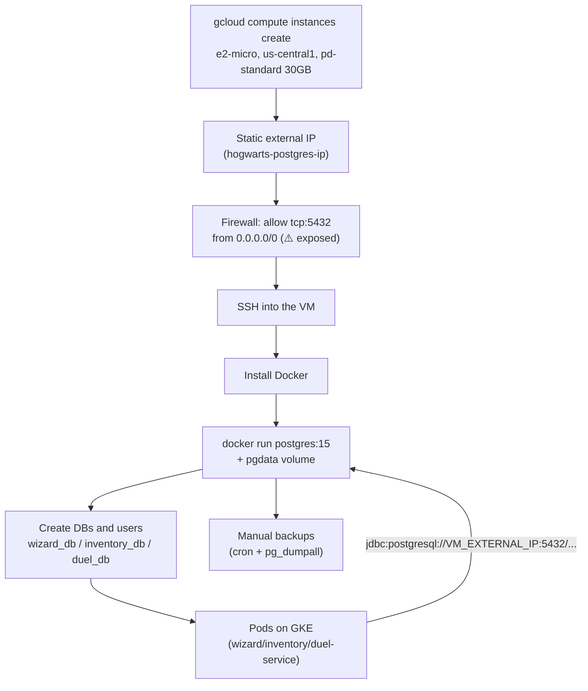

## 07 — Free alternative to Cloud SQL: self-hosted PostgreSQL on an Always Free VM

### Goal

Document how to run a "real" PostgreSQL database (not in-memory H2) **at no cost**, on a Compute Engine `e2-micro` VM within GCP's **Always Free tier** — as an alternative to [`06_cloud_sql_database.md`](06_cloud_sql_database.md) for when the budget is literally zero, not just low.

### Scope (important)

- This guide describes steps in GCP and the VM configuration. **It does not modify the repository code.**
- The "code changes" (section 7) are described as **instructions** for you to apply if appropriate — same criterion as the rest of `GKE_GCP_DEPLOYMENT/` (see [`README.md`](README.md)).
- **This option is not suitable for real production.** It is the "no budget" counterpart of Cloud SQL's Basic Option: no SLA, no high availability, no automatic backups, and you are responsible for maintaining the operating system and PostgreSQL. Use it for personal dev/testing/demos, not for real user data.

---

## 0) Why it is free, and the limits of the Always Free tier

Compute Engine includes, permanently (it is not a 30/90-day trial like Cloud SQL's):

- **1 non-preemptible `e2-micro` instance per month**, only if it runs in one of these regions: `us-west1` (Oregon), `us-central1` (Iowa) or `us-east1` (South Carolina). We will use `us-central1`, which is already the region (`REGION`) used in the rest of this guide and by the GKE cluster.
- **2 shared vCPUs** (1/8 of a physical core) and **1 GB of RAM** — enough for Postgres + a couple of lightweight microservices in dev, not for real load.
- **30 GB-month of standard persistent disk (HDD, `pd-standard`)** for free — an SSD disk (`pd-ssd`) would incur charges.
- **1 GB of network egress per month** from North America. This quota is very small: real traffic between the GKE Pods and this VM will probably exceed it quickly, generating small egress charges (not for the instance itself).

**What it does NOT include** (unlike Cloud SQL, even in its most basic option):

- Automatic backups — you have to script them yourself (section 5).
- High availability / failover — if the VM goes down, the database goes down with it.
- OS and PostgreSQL security patches — you apply them.
- Any kind of SLA.

In other words: it is free because **you take on the role that Cloud SQL normally plays as a managed service**.

---

## 1) Variables

```bash
export PROJECT_ID="hogwarts-backend-dev"
export REGION="us-central1"
export ZONE="us-central1-a"
export VM_NAME="hogwarts-postgres-vm"
export DB_PASSWORD_SUPERUSER="REPLACE_THIS_PASSWORD"
```

---

## 2) Create the `e2-micro` VM

### 2.1 Enable the Compute Engine API (if you haven't already)

```bash
gcloud services enable compute.googleapis.com
```

### 2.2 Create the instance

```bash
gcloud compute instances create "$VM_NAME" \
  --project="$PROJECT_ID" \
  --zone="$ZONE" \
  --machine-type=e2-micro \
  --image-family=debian-12 \
  --image-project=debian-cloud \
  --boot-disk-size=30GB \
  --boot-disk-type=pd-standard \
  --tags=hogwarts-postgres
```

Key points to stay **within the Always Free tier**:

- `--machine-type=e2-micro` — it is the only eligible family/size.
- `--zone` must be in `us-west1`, `us-central1` or `us-east1`.
- `--boot-disk-type=pd-standard` (HDD) — not `pd-ssd`/`pd-balanced`, which are charged.
- `--boot-disk-size=30GB` — it is the exact free disk limit; if you go higher, the excess is charged.

### 2.3 Reserve a static external IP

By default, the external IP is **ephemeral**: it changes if the VM is stopped and started again, which would break the connection string (`spring.datasource.url`) every time. Reserving it as static **costs nothing extra while it is attached to a running instance**:

```bash
gcloud compute addresses create hogwarts-postgres-ip \
  --project="$PROJECT_ID" \
  --region="$REGION"

gcloud compute instances add-access-config "$VM_NAME" \
  --zone="$ZONE" \
  --access-config-name="External NAT" \
  --address="$(gcloud compute addresses describe hogwarts-postgres-ip --region="$REGION" --format='value(address)')"

export VM_EXTERNAL_IP="$(gcloud compute addresses describe hogwarts-postgres-ip --region="$REGION" --format='value(address)')"
echo "$VM_EXTERNAL_IP"
```

⚠️ If you later **delete the VM without releasing the reserved IP**, that IP starts being charged for being "reserved but not in use". Release it with `gcloud compute addresses delete hogwarts-postgres-ip --region="$REGION"` if you stop using this option.

---

## 3) Firewall: expose port 5432

GKE Pods have no fixed egress IP by default (unless you configure Cloud NAT with a reserved IP), so the simplest way (and the only truly free one, without a VPC connector) for the Pods to reach this VM is to expose PostgreSQL to the Internet, protected by strong authentication and SSL:

```bash
gcloud compute firewall-rules create allow-postgres-hogwarts \
  --project="$PROJECT_ID" \
  --network=default \
  --direction=INGRESS \
  --action=ALLOW \
  --rules=tcp:5432 \
  --source-ranges=0.0.0.0/0 \
  --target-tags=hogwarts-postgres
```

⚠️ **This is the main security trade-off of this guide.** `--source-ranges=0.0.0.0/0` means port 5432 is reachable from any IP on the Internet, not only from the cluster's Pods. See section 10 (minimum recommendations) before using this with data you care about. The secure alternative — a **shared VPC / peering** between the GKE cluster's VPC and the VM's, to connect over a private IP — involves more network configuration, which is why it is not part of this "no budget" guide.

---

## 4) Install Docker and run PostgreSQL on the VM

### 4.1 Connect over SSH

```bash
gcloud compute ssh "$VM_NAME" --zone="$ZONE"
```

### 4.2 Install Docker (inside the VM)

```bash
sudo apt-get update
sudo apt-get install -y docker.io
sudo systemctl enable --now docker
```

### 4.3 Start the PostgreSQL container

```bash
sudo docker run -d \
  --name hogwarts-postgres \
  --restart unless-stopped \
  -e POSTGRES_PASSWORD="REPLACE_THIS_PASSWORD" \
  -p 5432:5432 \
  -v pgdata:/var/lib/postgresql/data \
  postgres:15
```

- `--restart unless-stopped`: if the VM restarts (for Google maintenance or manually), the container comes back up by itself.
- `-v pgdata:/var/lib/postgresql/data`: a named Docker volume — the data survives the container being recreated, and it lives on the VM's persistent disk (the same 30 GB from step 2.2).

### 4.4 Create the databases and users (one per microservice)

Same criterion as Option A in [`06_cloud_sql_database.md`](06_cloud_sql_database.md#11-one-instance-vs-multiple-instances): one instance, three databases.

```bash
sudo docker exec -it hogwarts-postgres psql -U postgres -c "
CREATE DATABASE wizard_db;
CREATE DATABASE inventory_db;
CREATE DATABASE duel_db;

CREATE USER wizard_user WITH ENCRYPTED PASSWORD 'REPLACE_THIS_PASSWORD';
CREATE USER inventory_user WITH ENCRYPTED PASSWORD 'REPLACE_THIS_PASSWORD';
CREATE USER duel_user WITH ENCRYPTED PASSWORD 'REPLACE_THIS_PASSWORD';

GRANT ALL PRIVILEGES ON DATABASE wizard_db TO wizard_user;
GRANT ALL PRIVILEGES ON DATABASE inventory_db TO inventory_user;
GRANT ALL PRIVILEGES ON DATABASE duel_db TO duel_user;
"
```

Exit the SSH session when you are done (`exit`).

---

## 5) Manual backups (there are no automatic backups here)

Since there is no equivalent to Cloud SQL's managed backups, you have to script them. A simple example with `cron` inside the VM:

```bash
# Inside the VM: add to crontab (crontab -e)
0 3 * * * docker exec hogwarts-postgres pg_dumpall -U postgres > /home/$USER/backups/hogwarts-$(date +\%F).sql
```

Infrastructure-level alternative (optional, with a small cost beyond the free disk): take snapshots of the VM's disk with `gcloud compute disks snapshot`.

---

## 6) Check connectivity from outside

```bash
# Requires the psql client installed on your local machine
psql "host=$VM_EXTERNAL_IP port=5432 dbname=wizard_db user=wizard_user sslmode=prefer"
```

If you get the `psql` prompt, the VM is accepting external connections.

---

## 7) Required application changes (instructions only, without modifying this repo)

Similar to section 6 of [`06_cloud_sql_database.md`](06_cloud_sql_database.md#6-required-application-changes-instructions-only-without-modifying-this-repo), but with a direct TCP JDBC connection to the VM's public IP — neither the Cloud SQL Auth Proxy nor the Java Connector applies here because there is no Cloud SQL instance; it is Postgres running on an ordinary VM.

### 7.1 Change the runtime driver

In each module's `build.gradle` (`wizard-service`, `inventory-service`, `duel-service`):

- Remove (or keep only for tests) `runtimeOnly 'com.h2database:h2'`.
- Add `runtimeOnly 'org.postgresql:postgresql'`.

### 7.2 Configure the datasource

In each service's `application.properties` (example for `wizard-service`):

```properties
spring.datasource.url=jdbc:postgresql://${VM_EXTERNAL_IP}:5432/wizard_db?sslmode=prefer
spring.datasource.username=wizard_user
spring.datasource.password=${WIZARD_DB_PASSWORD}
spring.jpa.hibernate.ddl-auto=validate
```

Repeat with `inventory_db`/`inventory_user` and `duel_db`/`duel_user` in the other two modules. The sensitive values (`${VM_EXTERNAL_IP}`, `${WIZARD_DB_PASSWORD}`) are injected into the GKE Pod as environment variables or via Secret Manager — the same mechanism as sections 5 and 8 of [`06_cloud_sql_database.md`](06_cloud_sql_database.md) and [`05_secret_manager_and_environment_config.md`](05_secret_manager_and_environment_config.md).

**A real simplification compared to Cloud SQL**: neither the Cloud SQL Auth Proxy sidecar nor the Java Connector is needed — the Pod reaches the VM through its public IP just like it would reach any other host on the Internet. That simplicity is precisely the flip side of exposing port 5432 publicly (section 3).

### 7.3 Migrations (same recommendation as for Cloud SQL)

Don't rely on `ddl-auto=create`/`update` in the long run — use Flyway or Liquibase for a versioned, reproducible schema (see section 6.3 of [`06_cloud_sql_database.md`](06_cloud_sql_database.md)).

---

## 8) Flow diagram



---

## 9) Comparison with Cloud SQL

| | Cloud SQL (Basic Option, `06`) | Self-hosted VM (Always Free) |
|---|---|---|
| Estimated monthly cost | ~US$10–15/month | **US$0** (within the free tier limits) |
| Who handles patches/HA/backups | Google | You |
| Backups | Automatic (configurable) | Manual (cron / snapshots) |
| Connection from the GKE Pods | Cloud SQL Auth Proxy (encrypted, no exposed port) | Public IP + open port 5432 |
| SLA | Yes (depending on edition) | None |
| Resource limit | Whatever you choose (you pay for more) | Fixed: 2 shared vCPUs / 1 GB RAM / 30 GB HDD |
| Recommended use | Dev/staging with some budget | Personal dev/testing with no budget, accepting the security risk |

---

## 10) Minimum security recommendations if you use this option

- A long, random password for the superuser and for each service user — never this guide's example value.
- Enforce SSL: `sslmode=require` (or `verify-full`) in the JDBC URL, and enable `ssl = on` in the PostgreSQL configuration.
- Keep the OS up to date (`sudo apt-get upgrade`, or `unattended-upgrades` on Debian) — nobody else will do it for you with this option.
- If the budget ever allows it, move to Cloud SQL (guide `06`) or configure VPC peering to stop exposing port 5432 to the Internet.
- Do not use this configuration with real user data — it is meant for development and demos.

See also: [`06_cloud_sql_database.md`](06_cloud_sql_database.md), [`05_secret_manager_and_environment_config.md`](05_secret_manager_and_environment_config.md).
