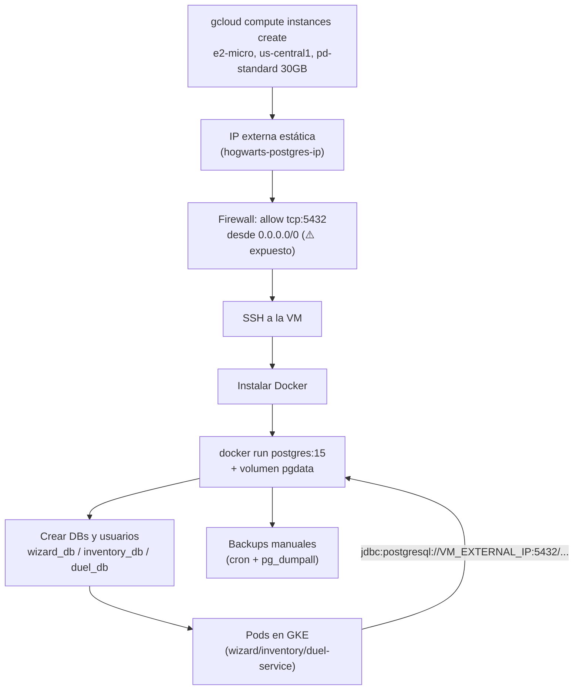

## 07 — Alternativa gratuita a Cloud SQL: PostgreSQL self-hosted en una VM Always Free

### Objetivo

Documentar cómo tener una base de datos PostgreSQL "real" (no H2 en memoria) **sin costo**, corriendo en una VM `e2-micro` de Compute Engine dentro del **Always Free tier** de GCP — como alternativa a [`06_cloud_sql_database.md`](06_cloud_sql_database.md) para cuando el presupuesto es literalmente cero, no solo bajo.

### Alcance (importante)

- Esta guía describe pasos en GCP y configuración de la VM. **No modifica el código del repositorio.**
- Los "ajustes en código" (sección 7) se describen como **instrucciones** para que tú los apliques si corresponde — mismo criterio que el resto de `GKE_GCP_DEPLOYMENT/` (ver [`README.md`](README.md)).
- **Esta opción no es apta para producción real.** Es la contraparte "sin presupuesto" de la Opción Básica de Cloud SQL: sin SLA, sin alta disponibilidad, sin backups automáticos, con mantenimiento del sistema operativo y de PostgreSQL a tu cargo. Úsala para dev/pruebas/demos personales, no para datos reales de usuarios.

---

## 0) Por qué es gratis, y qué límites tiene el Always Free tier

Compute Engine incluye, de forma permanente (no es una prueba de 30/90 días como la de Cloud SQL):

- **1 instancia `e2-micro` no-preemptible por mes**, únicamente si corre en una de estas regiones: `us-west1` (Oregon), `us-central1` (Iowa) o `us-east1` (Carolina del Sur). Usaremos `us-central1`, que ya es la región (`REGION`) usada en el resto de esta guía y en el cluster GKE.
- **2 vCPU compartidas** (1/8 de un core físico) y **1 GB de RAM** — suficiente para Postgres + un par de microservicios livianos en dev, no para carga real.
- **30 GB-mes de disco persistente estándar (HDD, `pd-standard`)** gratis — un disco SSD (`pd-ssd`) sí generaría costo.
- **1 GB de salida de red (egress) por mes** desde Norteamérica. Esta cuota es muy chica: el tráfico real entre los Pods de GKE y esta VM probablemente la supere rápido, generando cargos pequeños de egress (no de la instancia en sí).

**Lo que NO incluye** (a diferencia de Cloud SQL, incluso en su opción más básica):

- Backups automáticos — hay que scriptearlos vos mismo (sección 5).
- Alta disponibilidad / failover — si la VM se cae, la base cae con ella.
- Parches de seguridad del SO y de PostgreSQL — los aplicás vos.
- SLA de ningún tipo.

En otras palabras: es gratis porque **vos asumís el rol que normalmente cumple Cloud SQL como servicio administrado**.

---

## 1) Variables

```bash
export PROJECT_ID="hogwarts-backend-dev"
export REGION="us-central1"
export ZONE="us-central1-a"
export VM_NAME="hogwarts-postgres-vm"
export DB_PASSWORD_SUPERUSER="REEMPLAZA_ESTE_PASSWORD"
```

---

## 2) Crear la VM `e2-micro`

### 2.1 Habilitar la API de Compute Engine (si no lo hiciste)

```bash
gcloud services enable compute.googleapis.com
```

### 2.2 Crear la instancia

```bash
gcloud compute instances create "$VM_NAME" \
  --project="$PROJECT_ID" \
  --zone="$ZONE" \
  --machine-type=e2-micro \
  --image-family=debian-12 \
  --image-project=debian-cloud \
  --boot-disk-size=30GB \
  --boot-disk-type=pd-standard \
  --tags=hogwarts-postgres
```

Puntos clave para que se mantenga **dentro del Always Free tier**:

- `--machine-type=e2-micro` — es la única familia/tamaño elegible.
- `--zone` debe caer en `us-west1`, `us-central1` o `us-east1`.
- `--boot-disk-type=pd-standard` (HDD) — no `pd-ssd`/`pd-balanced`, que sí cobran.
- `--boot-disk-size=30GB` — es el tope exacto del disco gratis; si lo subís, la porción excedente se cobra.

### 2.3 Reservar una IP externa estática

Por defecto, la IP externa es **efímera**: cambia si la VM se detiene y se vuelve a iniciar, lo que rompería la cadena de conexión (`spring.datasource.url`) cada vez. Reservarla como estática **no tiene costo adicional mientras esté asociada a una instancia en ejecución**:

```bash
gcloud compute addresses create hogwarts-postgres-ip \
  --project="$PROJECT_ID" \
  --region="$REGION"

gcloud compute instances add-access-config "$VM_NAME" \
  --zone="$ZONE" \
  --access-config-name="External NAT" \
  --address="$(gcloud compute addresses describe hogwarts-postgres-ip --region="$REGION" --format='value(address)')"

export VM_EXTERNAL_IP="$(gcloud compute addresses describe hogwarts-postgres-ip --region="$REGION" --format='value(address)')"
echo "$VM_EXTERNAL_IP"
```

⚠️ Si más adelante **eliminás la VM sin liberar la IP reservada**, esa IP sí empieza a cobrarse por estar "reservada pero no en uso". Liberala con `gcloud compute addresses delete hogwarts-postgres-ip --region="$REGION"` si dejás de usar esta opción.

---

## 3) Firewall: exponer el puerto 5432

Los Pods de GKE no tienen una IP de salida fija por defecto (salvo que configures Cloud NAT con una IP reservada), así que la forma más simple (y la única realmente gratis, sin un conector VPC) de que los Pods lleguen a esta VM es exponer PostgreSQL a Internet, protegido por autenticación fuerte y SSL:

```bash
gcloud compute firewall-rules create allow-postgres-hogwarts \
  --project="$PROJECT_ID" \
  --network=default \
  --direction=INGRESS \
  --action=ALLOW \
  --rules=tcp:5432 \
  --source-ranges=0.0.0.0/0 \
  --target-tags=hogwarts-postgres
```

⚠️ **Esta es la principal concesión de seguridad de esta guía.** `--source-ranges=0.0.0.0/0` significa que el puerto 5432 queda alcanzable desde cualquier IP de Internet, no solo desde los Pods del cluster. Ver sección 9 (recomendaciones mínimas) antes de usar esto con datos que te importen. La alternativa segura —una **VPC compartida / peering** entre la VPC del cluster GKE y la de la VM, para llegar por IP privada— implica más configuración de red, por eso no forma parte de esta guía "sin presupuesto".

---

## 4) Instalar Docker y correr PostgreSQL dentro de la VM

### 4.1 Conectarse por SSH

```bash
gcloud compute ssh "$VM_NAME" --zone="$ZONE"
```

### 4.2 Instalar Docker (dentro de la VM)

```bash
sudo apt-get update
sudo apt-get install -y docker.io
sudo systemctl enable --now docker
```

### 4.3 Levantar el contenedor de PostgreSQL

```bash
sudo docker run -d \
  --name hogwarts-postgres \
  --restart unless-stopped \
  -e POSTGRES_PASSWORD="REEMPLAZA_ESTE_PASSWORD" \
  -p 5432:5432 \
  -v pgdata:/var/lib/postgresql/data \
  postgres:15
```

- `--restart unless-stopped`: si la VM se reinicia (por mantenimiento de Google o manualmente), el contenedor vuelve a levantarse solo.
- `-v pgdata:/var/lib/postgresql/data`: volumen nombrado de Docker — los datos sobreviven a que el contenedor se recree, y quedan sobre el disco persistente de la VM (los mismos 30 GB del paso 2.2).

### 4.4 Crear las bases y usuarios (uno por microservicio)

Mismo criterio que la Opción A de [`06_cloud_sql_database.md`](06_cloud_sql_database.md#11-una-instancia-vs-varias-instancias): una instancia, tres bases.

```bash
sudo docker exec -it hogwarts-postgres psql -U postgres -c "
CREATE DATABASE wizard_db;
CREATE DATABASE inventory_db;
CREATE DATABASE duel_db;

CREATE USER wizard_user WITH ENCRYPTED PASSWORD 'REEMPLAZA_ESTE_PASSWORD';
CREATE USER inventory_user WITH ENCRYPTED PASSWORD 'REEMPLAZA_ESTE_PASSWORD';
CREATE USER duel_user WITH ENCRYPTED PASSWORD 'REEMPLAZA_ESTE_PASSWORD';

GRANT ALL PRIVILEGES ON DATABASE wizard_db TO wizard_user;
GRANT ALL PRIVILEGES ON DATABASE inventory_db TO inventory_user;
GRANT ALL PRIVILEGES ON DATABASE duel_db TO duel_user;
"
```

Salí de la sesión SSH cuando termines (`exit`).

---

## 5) Backups manuales (acá no hay backups automáticos)

Como no existe el equivalente a los backups administrados de Cloud SQL, hay que scriptearlo. Ejemplo simple con `cron` dentro de la VM:

```bash
# Dentro de la VM: agregar a crontab (crontab -e)
0 3 * * * docker exec hogwarts-postgres pg_dumpall -U postgres > /home/$USER/backups/hogwarts-$(date +\%F).sql
```

Alternativa a nivel de infraestructura (opcional, tiene un costo pequeño más allá del disco gratis): tomar snapshots del disco de la VM con `gcloud compute disks snapshot`.

---

## 6) Verificar conectividad desde afuera

```bash
# Requiere el cliente psql instalado en tu máquina local
psql "host=$VM_EXTERNAL_IP port=5432 dbname=wizard_db user=wizard_user sslmode=prefer"
```

Si responde el prompt de `psql`, la VM está aceptando conexiones externas.

---

## 7) Ajustes necesarios en la aplicación (solo instrucciones, sin modificar este repo)

Similar a la sección 6 de [`06_cloud_sql_database.md`](06_cloud_sql_database.md#6-ajustes-necesarios-en-la-aplicación-solo-instrucciones-sin-modificar-este-repo), pero con conexión JDBC TCP directa a la IP pública de la VM — acá no aplica el Cloud SQL Auth Proxy ni el Java Connector porque no hay una instancia de Cloud SQL, es un Postgres corriendo en una VM cualquiera.

### 7.1 Cambiar el driver runtime

En el `build.gradle` de cada módulo (`wizard-service`, `inventory-service`, `duel-service`):

- Remover (o dejar solo para tests) `runtimeOnly 'com.h2database:h2'`.
- Agregar `runtimeOnly 'org.postgresql:postgresql'`.

### 7.2 Configurar el datasource

En `application.properties` de cada servicio (ejemplo para `wizard-service`):

```properties
spring.datasource.url=jdbc:postgresql://${VM_EXTERNAL_IP}:5432/wizard_db?sslmode=prefer
spring.datasource.username=wizard_user
spring.datasource.password=${WIZARD_DB_PASSWORD}
spring.jpa.hibernate.ddl-auto=validate
```

Repetir con `inventory_db`/`inventory_user` y `duel_db`/`duel_user` en los otros dos módulos. Los valores sensibles (`${VM_EXTERNAL_IP}`, `${WIZARD_DB_PASSWORD}`) se inyectan como variables de entorno o Secret Manager en el Pod de GKE — mismo mecanismo que la sección 5 y 8 de [`06_cloud_sql_database.md`](06_cloud_sql_database.md) y [`05_secret_manager_and_environment_config.md`](05_secret_manager_and_environment_config.md).

**Simplificación real respecto a Cloud SQL**: no hace falta el sidecar Cloud SQL Auth Proxy ni el Java Connector — el Pod llega a la VM por su IP pública igual que llegaría a cualquier otro host de Internet. Esa simplicidad es, justamente, la otra cara de exponer el puerto 5432 públicamente (sección 3).

### 7.3 Migraciones (igual recomendación que en Cloud SQL)

No depender de `ddl-auto=create`/`update` a largo plazo — usar Flyway o Liquibase para un esquema versionado y reproducible (ver sección 6.3 de [`06_cloud_sql_database.md`](06_cloud_sql_database.md)).

---

## 8) Diagrama del flujo



---

## 9) Comparación con Cloud SQL

| | Cloud SQL (Opción Básica, `06`) | VM self-hosted (Always Free) |
|---|---|---|
| Costo mensual estimado | ~US$10–15/mes | **US$0** (dentro de los límites del free tier) |
| Quién administra parches/HA/backups | Google | Vos |
| Backups | Automáticos (configurables) | Manuales (cron / snapshots) |
| Conexión desde los Pods de GKE | Cloud SQL Auth Proxy (cifrado, sin exponer puerto) | IP pública + puerto 5432 abierto |
| SLA | Sí (según edición) | Ninguno |
| Límite de recursos | El que elijas (pagás por más) | Fijo: 2 vCPU compartidas / 1 GB RAM / 30 GB HDD |
| Uso recomendado | Dev/staging con algo de presupuesto | Dev/pruebas personales sin presupuesto, asumiendo el riesgo de seguridad |

---

## 10) Recomendaciones mínimas de seguridad si usás esta opción

- Password largo y aleatorio para el superusuario y para cada usuario de servicio — nunca el valor de ejemplo de esta guía.
- Forzar SSL: `sslmode=require` (o `verify-full`) en el JDBC URL, y habilitar `ssl = on` en la configuración de PostgreSQL.
- Mantener el SO actualizado (`sudo apt-get upgrade`, o `unattended-upgrades` en Debian) — nadie más lo va a hacer por vos en esta opción.
- Si en algún momento el presupuesto lo permite, migrar a Cloud SQL (sección 6) o configurar peering de VPC para dejar de exponer el puerto 5432 a Internet.
- No usar esta configuración con datos reales de usuarios — está pensada para desarrollo y demos.

Ver también: [`06_cloud_sql_database.md`](06_cloud_sql_database.md), [`05_secret_manager_and_environment_config.md`](05_secret_manager_and_environment_config.md).
