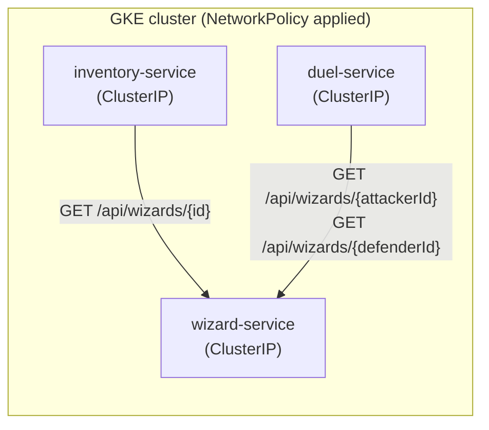

## 08 — Interaction between microservices and ID validation

### Goal

Define a clear path to:

1. Configure **communication between microservices** deployed on GKE.
2. Implement (at the design and instruction level) validations such as: "if a `wizardId` reaches `inventory-service`, it must be checked against `wizard-service`".

### Scope (important)

- This guide describes configuration in GCP/GKE and the recommended approach.
- It **does not modify the repository code**.
- Where application changes are needed, they are described as **instructions**.

### Visual summary: internal calls and the `NetworkPolicy` boundary



| Case | Caller | Callee | What it validates |
|---|---|---|---|
| A | `inventory-service` | `wizard-service` | `wizardId` exists when assigning a wand |
| B | `duel-service` | `wizard-service` | `attackerId`/`defenderId` exist when creating a duel |

---

## 0) Repo context (cross-service IDs)

Relevant cases in this repo:

- `inventory-service` has the endpoint `POST /api/inventory/wands/{wandId}/assign`, which receives `wizardId`.
  - Today it assigns the ID without checking that the wizard exists.
- `duel-service` receives `attackerId` and `defenderId` (wizards).
  - Today it checks that they are not the same, but does not check that the wizards actually exist.
- `X-Correlation-Id` exists as a standard header (`CorrelationIdFilter` filter in each service).

---

## 1) Communication strategies between microservices on GKE

### Strategy A (recommended): `ClusterIP` `Service` + `NetworkPolicy`

- Each microservice is exposed inside the cluster with a `ClusterIP` `Service` (not public; see guide `04`, section 10 "Minimum hardening"). It is only reachable through internal DNS (`http://wizard-service.default.svc.cluster.local`) from inside the cluster.
- One `NetworkPolicy` per microservice explicitly restricts which Pods (identified by label) can open a connection to it — for example, only `inventory-service` and `duel-service` can call `wizard-service`; nothing else.
- There are no tokens to generate and no IAM to manage per call: access control lives at the network level (layer 3/4), just like an internal firewall.

Pros:
- Simple to operate, no per-request token management.
- `NetworkPolicy` is native to Kubernetes, with no external dependencies.

Cons:
- It is network-level control, not identity-based: any Pod allowed by the policy can call without authenticating at the application level.

### Strategy B (optional, advanced hardening): application-level authentication

If, in addition to restricting by network, you want every call to be authenticated (defense in depth), there are two paths, both outside the base scope of this guide:

- **Service-to-service JWT**: the caller obtains/signs a JWT (reusing, for example, the Identity Platform JWKS from guide `09`) and the target service validates it with Spring Security Resource Server.
- **mTLS between Pods**: through a service mesh (Anthos Service Mesh / Istio) combined with Workload Identity, it encrypts and authenticates pod-to-pod traffic automatically, with no code changes.

Both require more infrastructure/code than Strategy A; use them only if the network perimeter is not enough for your security requirements.

---

## 2) Recommended configuration on GKE (Strategy A)

### 2.1 Check that each microservice has its `ClusterIP` `Service`

Following guide `04`, each microservice must have a `Service`. For internal communication, the recommended type is `ClusterIP` (not `LoadBalancer`):

```yaml
apiVersion: v1
kind: Service
metadata:
  name: wizard-service
spec:
  type: ClusterIP
  selector:
    app: wizard-service
  ports:
    - port: 80
      targetPort: 8080
```

Repeat the pattern for `inventory-service` and `duel-service`.

### 2.2 Label the Pods so `NetworkPolicy` can identify them

In each microservice's `Deployment`, make sure the Pod has an `app: <service-name>` label (it should already exist from guide `04`, because the `Service` uses it as its `selector`).

### 2.3 Restrict inbound traffic to `wizard-service` with a `NetworkPolicy`

Only allow traffic from `inventory-service` and `duel-service` Pods:

```yaml
apiVersion: networking.k8s.io/v1
kind: NetworkPolicy
metadata:
  name: wizard-service-allow-internal
spec:
  podSelector:
    matchLabels:
      app: wizard-service
  policyTypes:
    - Ingress
  ingress:
    - from:
        - podSelector:
            matchLabels:
              app: inventory-service
        - podSelector:
            matchLabels:
              app: duel-service
      ports:
        - protocol: TCP
          port: 8080
```

```bash
kubectl apply -f wizard-service-networkpolicy.yaml
```

> Note: the cluster's network plugin must support `NetworkPolicy` (GKE supports it natively if it is enabled when the cluster is created — Autopilot has it enabled by default).

---

## 3) How to find each microservice's internal URL

Unlike a public URL, Kubernetes internal DNS follows a predictable pattern — there is no need to "discover" it with a command; it is built like this:

```
http://<service-name>.<namespace>.svc.cluster.local
```

Example (`default` namespace):

```bash
export WIZARD_URL="http://wizard-service.default.svc.cluster.local"
export INVENTORY_URL="http://inventory-service.default.svc.cluster.local"
export DUEL_URL="http://duel-service.default.svc.cluster.local"
```

Recommendation: store each dependency's URL as an env var in the calling service's `Deployment` (see guide `04`):

```yaml
env:
  - name: WIZARD_SERVICE_URL
    value: "http://wizard-service.default.svc.cluster.local"
```

---

## 4) Manual tests (verify the `NetworkPolicy`)

### 4.1 Test from an allowed Pod (e.g. `inventory-service`)

```bash
kubectl exec -it deploy/inventory-service -- curl -sS "$WIZARD_URL/api/wizards?page=0&size=20&sort=id,desc"
```

It should respond normally: `inventory-service` is in the list of Pods allowed by `wizard-service`'s `NetworkPolicy`.

### 4.2 Test from a non-allowed debug Pod (to confirm that the policy blocks it)

```bash
kubectl run debug-pod --rm -it --image=curlimages/curl -- curl -sS --max-time 5 "$WIZARD_URL/api/wizards/1"
```

This Pod has neither the `app: inventory-service` nor the `app: duel-service` label, so the connection should hang/fail with a timeout — confirming that the `NetworkPolicy` is correctly blocking unauthorized traffic.

---

## 5) ID validation (implementation instructions)

### Case A: `inventory-service` validates `wizardId` when assigning a wand

**Functional goal**

When this is called:

- `POST /api/inventory/wands/{wandId}/assign` with `{ "wizardId": 123 }`

The service must:

1. Call `wizard-service` to check that the wizard exists.
2. If it does not exist, return a clear error (e.g. 404 or 400, depending on your criteria).

**Endpoint available today for the check**

- `GET /api/wizards/{id}` on `wizard-service`

**Instructions (high level)**

- In `inventory-service`, before persisting `assignedWizardId`:
  - Make an HTTP call to `GET {WIZARD_SERVICE_URL}/api/wizards/{wizardId}`
  - Handle the cases:
    - 200: the wizard exists → continue
    - 404: the wizard does not exist → return an error to the client
    - 401/403: IAM/token problem → configuration/infrastructure error
    - timeout: degrade/retry according to the policy (see resilience)

**Technical recommendations**

- HTTP client: `RestClient`/`WebClient` (or `RestTemplate` for legacy code).
- Explicit timeouts.
- Propagate `X-Correlation-Id`:
  - if the incoming request carries `X-Correlation-Id`, forward it on the internal call.

### Case B: `duel-service` validates `attackerId/defenderId`

**Functional goal**

When creating a duel:

- `POST /api/duels` with `{ "attackerId": 1, "defenderId": 2 }`

The service must:

1. Check that both wizards exist in `wizard-service`.
2. If either does not exist, reject it with an error.

**Instructions (high level)**

- Call `wizard-service` twice:
  - `GET /api/wizards/{attackerId}`
  - `GET /api/wizards/{defenderId}`
- On a 404, return a consistent error.

---

## 6) Recommended resilience (for internal calls)

At a minimum:

- **Timeouts** (never leave requests hanging)
- **Retries** only on transient errors (5xx, timeouts), with backoff
- **Circuit breaker** (as the system grows)

**Important**: avoid blind retries on non-idempotent operations.

---

## 7) Common troubleshooting

### 7.1 Timeout/connection refused between Pods

- Check that the target service's `NetworkPolicy` includes the `app: <calling-service>` label in its `from` list.
- Review the applied `NetworkPolicy` objects:

```bash
kubectl get networkpolicy
kubectl describe networkpolicy wizard-service-allow-internal
```

### 7.2 "Name does not resolve" (internal DNS)

- Confirm the correct namespace in the DNS name (`<service>.<namespace>.svc.cluster.local`).
- Check that the `Service` exists and has `Ready` Pods behind it:

```bash
kubectl get svc wizard-service
kubectl get endpoints wizard-service
```

### 7.3 Timeouts under load

- Review the CPU and memory `requests`/`limits` of the target `Deployment`, and whether the `HorizontalPodAutoscaler` (if any) is scaling in time.
