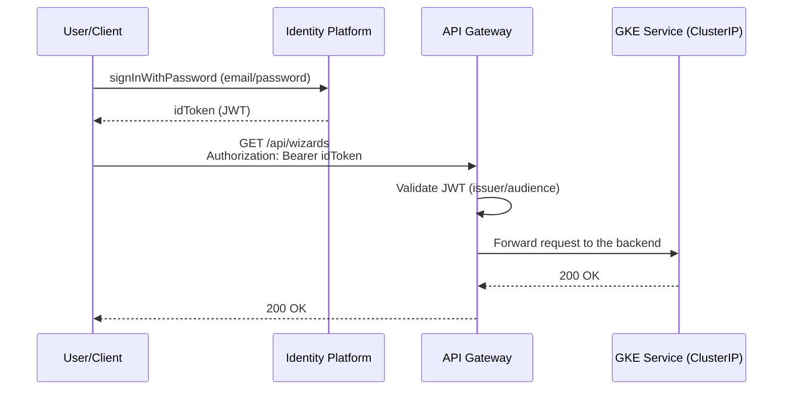

## 09 — Securing the APIs with Identity Platform (login → token → APIs)

### Goal

Secure the microservices' endpoints so that:

1. The user signs in and gets a **token** (JWT).
2. With that token, they can call the APIs.

### Scope (important)

- This guide describes configuration in GCP (Identity Platform + optionally API Gateway) and tests with `curl`.
- It **does not modify the repository code**.
- Where token validation is needed in the microservices, it is described as **instructions**.

---

## 1) Recommended architecture (without building an auth microservice)

Since you chose **Identity Platform**, the recommendation for a clean solution is:

- **Identity Platform**: manages users and issues tokens (JWT).
- **API Gateway** (optional but recommended): validates the JWT at the edge and routes to the GKE Services.
- **GKE**: internal `ClusterIP` Services (no direct public access). Only the gateway calls them.

Alternative:

- Without API Gateway: each microservice validates the JWT directly (Spring Security Resource Server). This is documented as well.

### Visual summary: login → token → Gateway → backend



---

## 2) Enable and configure Identity Platform

### 2.1 Enable the API

```bash
export PROJECT_ID="hogwarts-dev-123"
gcloud config set project "$PROJECT_ID"

gcloud services enable identitytoolkit.googleapis.com
```

### 2.2 Activate Identity Platform in the console

1. In Cloud Console, search for "Identity Platform".
2. Click "Enable Identity Platform" (if applicable).

### 2.3 Enable the Email/Password provider

1. Identity Platform → Providers
2. Enable **Email/Password**
3. Save the changes

---

## 3) Create a test user

You can do it from the console or via the API.

### 3.1 From the console (simple)

1. Identity Platform → Users
2. "Add user"
3. Set an email and password

### 3.2 (Optional) Via the API (Identity Toolkit)

You need a project **API key**:

1. APIs & Services → Credentials
2. "Create credentials" → "API key"
3. Copy the value as `API_KEY`

```bash
export API_KEY="YOUR_API_KEY"
```

Create a user (sign up):

```bash
curl -sS -X POST \
  "https://identitytoolkit.googleapis.com/v1/accounts:signUp?key=$API_KEY" \
  -H "Content-Type: application/json" \
  -d '{"email":"user@example.com","password":"Str0ngPass!","returnSecureToken":true}'
```

---

## 4) Login and getting the token (idToken)

Identity Platform (email/password) lets you get a JWT (`idToken`) using:
`accounts:signInWithPassword`.

```bash
export API_KEY="YOUR_API_KEY"
export EMAIL="user@example.com"
export PASSWORD="Str0ngPass!"

export ID_TOKEN="$(
  curl -sS -X POST \
    "https://identitytoolkit.googleapis.com/v1/accounts:signInWithPassword?key=$API_KEY" \
    -H "Content-Type: application/json" \
    -d "{\"email\":\"$EMAIL\",\"password\":\"$PASSWORD\",\"returnSecureToken\":true}" \
  | python -c 'import sys, json; print(json.load(sys.stdin)["idToken"])'
)"

echo "$ID_TOKEN" | head -c 30 && echo "..."
```

> Note: the command uses Python only to extract `idToken`. You can use `jq` if you prefer.

---

## 5) Recommended option: API Gateway validating the JWT + restricted GKE backend

### 5.1 What this option achieves

- The client only sees 1 endpoint (the Gateway).
- The gateway:
  - validates the JWT
  - routes to the backends (GKE Services)
- The GKE Services receive no direct public traffic: they are only reachable through the Ingress/IP used by the Gateway (see section 5.8).

### 5.2 Enable the API Gateway APIs

```bash
gcloud services enable \
  apigateway.googleapis.com \
  servicemanagement.googleapis.com \
  servicecontrol.googleapis.com
```

### 5.3 Get the backend endpoints on GKE

API Gateway needs a reachable HTTPS address for each backend. The recommended way on GKE is to expose a single `Ingress` (with a static external IP) that routes by path to each internal `Service` — that way the Gateway points to a single host, and the individual Services remain `ClusterIP` (not directly exposed).

```bash
export REGION="us-central1"

gcloud compute addresses create hogwarts-ingress-ip --global
export INGRESS_IP="$(gcloud compute addresses describe hogwarts-ingress-ip --global --format='value(address)')"
echo "$INGRESS_IP"
```

Define the `Ingress` (outside the repo, next to the other manifests from guide `04`), routing by path to each `Service`:

```yaml
apiVersion: networking.k8s.io/v1
kind: Ingress
metadata:
  name: hogwarts-ingress
  annotations:
    kubernetes.io/ingress.global-static-ip-name: hogwarts-ingress-ip
spec:
  rules:
    - http:
        paths:
          - path: /api/wizards*
            pathType: ImplementationSpecific
            backend:
              service:
                name: wizard-service
                port: { number: 80 }
          - path: /api/inventory/*
            pathType: ImplementationSpecific
            backend:
              service:
                name: inventory-service
                port: { number: 80 }
          - path: /api/duels*
            pathType: ImplementationSpecific
            backend:
              service:
                name: duel-service
                port: { number: 80 }
```

```bash
kubectl apply -f hogwarts-ingress.yaml
export BACKEND_URL="https://$INGRESS_IP"
```

> Use `$BACKEND_URL` in the OpenAPI spec of the next section: since the `Ingress` already routes by path to each microservice, all operations point to the same host.

### 5.4 Create the OpenAPI specification for the gateway (external file)

Since this work is documentation only, create this file **outside the repo** (for example `~/hogwarts-gcp/openapi-hogwarts.yaml`).

Base content (adjust `PROJECT_ID` and the URLs):

```yaml
swagger: "2.0"
info:
  title: "hogwarts-api"
  version: "1.0.0"

schemes:
  - https

produces:
  - application/json

# Security: validate the JWT issued by Identity Platform/Firebase Secure Token.
securityDefinitions:
  firebase:
    authorizationUrl: ""
    flow: "implicit"
    type: "oauth2"
    x-google-issuer: "https://securetoken.google.com/PROJECT_ID"
    x-google-jwks_uri: "https://www.googleapis.com/service_accounts/v1/metadata/x509/securetoken@system.gserviceaccount.com"
    x-google-audiences: "PROJECT_ID"

security:
  - firebase: []

paths:
  /api/wizards:
    get:
      operationId: listWizards
      x-google-backend:
        address: BACKEND_URL
      responses:
        "200":
          description: "OK"
    post:
      operationId: createWizard
      x-google-backend:
        address: BACKEND_URL
      responses:
        "200":
          description: "OK"

  /api/wizards/{id}:
    get:
      operationId: getWizardById
      parameters:
        - name: id
          in: path
          required: true
          type: string
      x-google-backend:
        address: BACKEND_URL
      responses:
        "200":
          description: "OK"

  /api/wizards/attack:
    post:
      operationId: attack
      x-google-backend:
        address: BACKEND_URL
      responses:
        "200":
          description: "OK"

  /api/inventory/wands:
    get:
      operationId: listWands
      x-google-backend:
        address: BACKEND_URL
      responses:
        "200":
          description: "OK"
    post:
      operationId: createWand
      x-google-backend:
        address: BACKEND_URL
      responses:
        "200":
          description: "OK"

  /api/inventory/wands/{wandId}/assign:
    post:
      operationId: assignWand
      parameters:
        - name: wandId
          in: path
          required: true
          type: string
      x-google-backend:
        address: BACKEND_URL
      responses:
        "200":
          description: "OK"

  /api/inventory/potions:
    get:
      operationId: listPotions
      x-google-backend:
        address: BACKEND_URL
      responses:
        "200":
          description: "OK"
    post:
      operationId: createPotion
      x-google-backend:
        address: BACKEND_URL
      responses:
        "200":
          description: "OK"

  /api/inventory/brooms:
    get:
      operationId: listBrooms
      x-google-backend:
        address: BACKEND_URL
      responses:
        "200":
          description: "OK"
    post:
      operationId: createBroom
      x-google-backend:
        address: BACKEND_URL
      responses:
        "200":
          description: "OK"

  /api/duels:
    post:
      operationId: createDuel
      x-google-backend:
        address: BACKEND_URL
      responses:
        "200":
          description: "OK"

  /api/duels/{id}:
    get:
      operationId: getDuelById
      parameters:
        - name: id
          in: path
          required: true
          type: string
      x-google-backend:
        address: BACKEND_URL
      responses:
        "200":
          description: "OK"
```

Replace the placeholders:

- `PROJECT_ID` with your real Project ID (two places: issuer and audiences)
- `BACKEND_URL` with the real value of `$BACKEND_URL` (the `Ingress` IP from section 5.3)

Note: since the `Ingress` already routes by path to the right `Service` inside the cluster, all operations point to the same `BACKEND_URL` — fine-grained routing happens in GKE, not in the Gateway. `jwt_audience` is not used because the `Ingress` is a regular HTTPS endpoint, with no invocation identity mechanism to negotiate.

### 5.5 Create the API Gateway resources (CLI)

Define:

```bash
export API_ID="hogwarts-api"
export API_CONFIG_ID="hogwarts-api-config-v1"
export GATEWAY_ID="hogwarts-gateway"
export REGION="us-central1"
export OPENAPI_SPEC_PATH="$HOME/hogwarts-gcp/openapi-hogwarts.yaml"
```

Create the API:

```bash
gcloud api-gateway apis create "$API_ID"
```

Create the API config:

```bash
gcloud api-gateway api-configs create "$API_CONFIG_ID" \
  --api="$API_ID" \
  --openapi-spec="$OPENAPI_SPEC_PATH" \
  --project="$PROJECT_ID"
```

Create the gateway:

```bash
gcloud api-gateway gateways create "$GATEWAY_ID" \
  --api="$API_ID" \
  --api-config="$API_CONFIG_ID" \
  --location="$REGION"
```

### 5.6 Get the Gateway URL

```bash
gcloud api-gateway gateways describe "$GATEWAY_ID" \
  --location="$REGION" \
  --format="value(defaultHostname)"
```

Define:

```bash
export GATEWAY_HOSTNAME="$(gcloud api-gateway gateways describe "$GATEWAY_ID" --location="$REGION" --format="value(defaultHostname)")"
export GATEWAY_URL="https://$GATEWAY_HOSTNAME"
echo "$GATEWAY_URL"
```

### 5.7 Test the APIs through the Gateway (with a token)

List wizards:

```bash
curl -sS "$GATEWAY_URL/api/wizards?page=0&size=20&sort=id,desc" \
  -H "Authorization: Bearer $ID_TOKEN"
```

If you don't send a token, you should get an error (401/403) from the gateway.

### 5.8 Restrict the GKE backend so that only the Gateway can reach it

GKE offers no IAM role that authorizes "who can invoke this backend" per individual invocation. On GKE, the equivalent control is achieved at the **network** level, with one of these two options:

**Option A (recommended): `NetworkPolicy` + Ingress with a reserved IP**

Since the `Service`s stay as `ClusterIP` (section 5.3) and only the `Ingress` exposes them, external traffic can only arrive through that `Ingress`. If you also want no other Pod in the cluster to talk to them directly beyond what is needed (see guide `08`), combine this with that guide's `NetworkPolicy` objects.

**Option B (if you use Cloud Armor): restrict the `Ingress` to API Gateway's IP ranges**

If you want *only* traffic that goes through API Gateway to reach the `Ingress` (and not any client that discovers the `Ingress` IP), add a Cloud Armor policy to the `Ingress` that only allows API Gateway's documented egress ranges and blocks everything else.

> There is no managed API Gateway service account to authorize via IAM on the backend — access control is done at the network/firewall level, not by invocation identity.

---

## 6) Alternative: validate the JWT in each microservice (instructions only)

If you don't want API Gateway, each microservice must validate the `Authorization: Bearer <JWT>` header:

### 6.1 High-level instructions (Spring Security)

- Add the dependencies:
  - `spring-boot-starter-security`
  - `spring-boot-starter-oauth2-resource-server`
- Configure the JWT Resource Server with:
  - issuer: `https://securetoken.google.com/PROJECT_ID`
  - JWKS: `https://www.googleapis.com/service_accounts/v1/metadata/x509/securetoken@system.gserviceaccount.com`
- Protect the routes (for example all of `/api/**`) except the health endpoints if you add them.

### 6.2 Tests

- Without a token: 401/403
- With a valid token: 200

---

## 7) Separating "user auth" from "service-to-service auth"

Don't mix the concepts:

- **User auth (Identity Platform)**: for external clients (frontend, Postman, etc.).
- **Service-to-service (`ClusterIP` + `NetworkPolicy`)**: for internal calls between microservices (see guide `08`).

You can have both:

- Externally: the Gateway validates the user's JWT.
- Internally: the services call each other through internal DNS, restricted by `NetworkPolicy` (without exposing internal endpoints outside the cluster).
