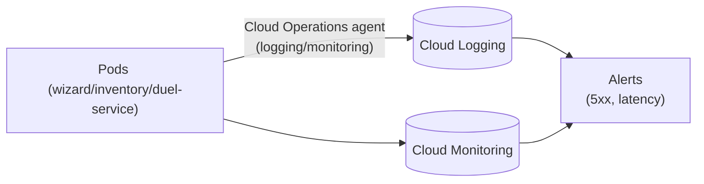

## 10 — Observability (Logging, Monitoring and tracing)

### Goal

Get the minimum operational visibility needed to run the microservices on GKE:

- Logs per service (errors, latency, requests)
- Basic metrics (traffic, errors, latency)
- Simple alerts (errors, outages)
- Per-request tracing (Correlation ID)

### Scope (important)

- This guide describes configuration in GCP and how to query the data.
- It does not modify the repository code.

### Visual summary of the flow



---

## 1) Logging on GKE

GKE sends container logs to **Cloud Logging** automatically through the **Cloud Operations for GKE** agent (enabled by default on Autopilot; on Standard it is enabled with `--logging=SYSTEM,WORKLOAD` when creating the cluster, which is what `create-auto`/Autopilot does anyway).

### 1.0 Quick variables

```bash
export REGION="us-central1"
export CLUSTER_NAME="hogwarts-cluster-gke"
```

### 1.1 Read logs from the CLI

```bash
kubectl logs deploy/wizard-service --tail=100
kubectl logs deploy/inventory-service --tail=100
kubectl logs deploy/duel-service --tail=100
```

### 1.2 View logs in the console (Logs Explorer)

1. Cloud Console → Logging → Logs Explorer
2. Filter by `resource.type="k8s_container"` and `resource.labels.cluster_name="hogwarts-cluster-gke"`
3. Narrow down by `resource.labels.container_name="wizard-service"` (or the relevant service) and severity (ERROR)

---

## 2) Correlation ID (per-request tracing)

This repo already includes a filter that:

- Reads the `X-Correlation-Id` header if present, or generates one.
- Also returns it in the response.
- Puts it in the MDC under the `traceId` key.

### 2.1 How to use it in tests

Generate a correlation id and pass it in `curl` (use the external IP of the `wizard-service` `Service`, obtained as in guide `04`, section 4.4):

```bash
export WIZARD_IP="$(kubectl get service wizard-service -o jsonpath='{.status.loadBalancer.ingress[0].ip}')"
export CID="$(uuidgen)"
curl -sS "http://$WIZARD_IP/api/wizards?page=0&size=20&sort=id,desc" \
  -H "X-Correlation-Id: $CID"
```

Then search for that `CID` in the logs.

### 2.2 Best practices

- Propagate `X-Correlation-Id` from the client (Postman/Frontend).
- On internal (service-to-service) calls, forward the same header.

---

## 3) Metrics in Cloud Monitoring

GKE exposes infrastructure metrics (CPU, memory, restarts) with no extra configuration, through Cloud Operations for GKE. HTTP-level metrics (request count, latencies, 4xx/5xx) require an extra piece: the `Ingress`/Load Balancer (guide `09`) or **Google Cloud Managed Service for Prometheus** (recommended if you want more detailed application metrics).

### 3.1 Infrastructure metrics (no extra configuration)

In Cloud Console:

1. Monitoring → Metrics Explorer
2. Resource type: "Kubernetes Container" (`k8s_container`)
3. Useful metrics:
   - CPU/memory utilization per container
   - Restart count
   - Pod/Node count

### 3.2 Load Balancer HTTP metrics (if you expose via `Ingress`)

If you use the `Ingress` from guide `09`, the managed Load Balancer exposes its own metrics:

1. Monitoring → Metrics Explorer
2. Resource type: "HTTP(S) Load Balancer Rule"
3. Useful metrics: request count, latencies, response codes (4xx/5xx)

---

## 4) Recommended alerts (minimum)

### 4.1 Alert on 5xx errors

Create a Policy:

- Signal: the Load Balancer's (`Ingress`) 5xx response code class, or a log-based metric on the Pod logs (section 5) if you don't use an `Ingress`
- Threshold (example):
  - "> 5 5xx errors in 5 minutes"
- Notification: email / Slack / PagerDuty (depending on your environment)

### 4.2 Alert on high latency

Threshold (example):

- p95 latency > 2s for 10 min

### 4.3 Alert on outages

If you use a health endpoint (if one exists), you can create uptime checks.

> This repo does not document specific health endpoints; if you add Actuator later, use `/actuator/health` with proper security.

---

## 5) Log-based metrics (optional)

If you want metrics based on log patterns (e.g. "Wizard not found"):

1. Logging → Logs Explorer
2. Define a filter (text or jsonPayload)
3. "Create metric" → Counter
4. Use that metric in alerts

---

## 6) Operational best practices on GKE

- **CPU and memory `requests`/`limits`**: tune them to the app's profile to avoid OOM and throttling; on Autopilot they directly determine the Pod's cost.
- **`HorizontalPodAutoscaler`**: scales replicas based on CPU/memory or another metric if the load is variable.
- **Liveness/Readiness probes**: so Kubernetes detects unhealthy Pods and stops routing traffic to them (readiness) or restarts them (liveness).
- **`PodDisruptionBudget`**: prevents too many Pods from going down at the same time during cluster maintenance/upgrades.
- **Timeouts**: define client and server timeouts (to avoid hanging requests).
