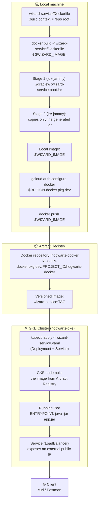

## 12 — Diagram: from `Dockerfile` to GKE (through Artifact Registry)

### Goal

Show, in a single diagram, the end-to-end flow of a microservice when the image is built **manually with a `Dockerfile`** (instead of buildpacks), published to **Artifact Registry**, and then run on **GKE**.

This guide is a **visual companion** — it introduces no new commands. The actual commands are in:

- `03_artifact_registry_and_builds.md` (section 3-bis) — build with a `Dockerfile` and push
- `04_gke_microservices.md` — deploy to GKE

### Scope (important)

- Documentation/diagram only; it does not modify the repo code.
- It uses `wizard-service` as the example; the same flow applies to `inventory-service`/`duel-service`, which have equivalent `Dockerfile`s (see `03_artifact_registry_and_builds.md`, section 3-bis.4).

---

## 1) Full diagram

---

## 2) Step by step (quick reference)

| # | Phase | Command / action | Where it happens | Detailed guide |
|---|------|-------------------|--------------|-----------------|
| 1 | Define the image | `wizard-service/Dockerfile` (multi-stage: build with JDK, runtime with JRE) | Local repo | `BUILD_DEPLOY_DOCS/11_local_container_image.md` |
| 2 | Build the image | `docker build -f wizard-service/Dockerfile -t "$WIZARD_IMAGE" .` (context = repo root) | Local Docker | `03_artifact_registry_and_builds.md` §3-bis.3 |
| 3 | Authenticate Docker against GCP | `gcloud auth configure-docker "$REGION-docker.pkg.dev"` | Local machine (once) | `03_artifact_registry_and_builds.md` §3-bis.2 |
| 4 | Publish the image | `docker push "$WIZARD_IMAGE"` | Local → Artifact Registry | `03_artifact_registry_and_builds.md` §3-bis.3 |
| 5 | Verify the publish | `gcloud artifacts docker images list ...` | Artifact Registry | `03_artifact_registry_and_builds.md` §1-2 |
| 6 | Define the K8s manifest | `wizard-service.yaml` (`Deployment` pointing to `$WIZARD_IMAGE` + `Service`) | Local directory (`~/hogwarts-gcp/k8s`) | `04_gke_microservices.md` §4.1 |
| 7 | Deploy to the cluster | `kubectl apply -f wizard-service.yaml` | GKE | `04_gke_microservices.md` §4.2 |
| 8 | GKE downloads the image | The node *pulls* the image from Artifact Registry (same project ⇒ no extra config; check permissions if cross-project) | GKE (automatic) | `04_gke_microservices.md` §3 |
| 9 | Pod running | The container starts with `ENTRYPOINT ["java","-jar","app.jar"]` and listens on `:8080` | GKE | `04_gke_microservices.md` §4.3 |
| 10 | Expose the service | A `LoadBalancer` `Service` assigns an external IP | GKE | `04_gke_microservices.md` §4.4 |
| 11 | Validate | `curl "$WIZARD_URL/api/wizards"` | External client | `04_gke_microservices.md` §4.5 |

---

## 3) Key notes about the flow

- **The build context is always the repo root**, not the microservice folder: each module's `Dockerfile` needs `gradlew`, `settings.gradle` and the three service folders, because it is a Gradle multi-project build.
- **Image versioning**: the diagram shows `$WIZARD_IMAGE` without a tag for simplicity. In practice, each image is published with its **semantic version** (`wizard-service:1.4.0`, taken from `wizard-service/gradle.properties`) plus the commit SHA, and the GKE `Deployment` references the semantic tag, never `:latest` (see `03_artifact_registry_and_builds.md` §4).
- **Updating an already deployed version**: follow the release flow (`03_artifact_registry_and_builds.md` §4.6) and then run `kubectl set image deployment/wizard-service wizard-service="$WIZARD_IMAGE:$WIZARD_VERSION"` (see `04_gke_microservices.md` §9) instead of reapplying the whole manifest.
- **Architecture**: if you build on Apple Silicon, add `--platform linux/amd64` (with `docker buildx`) so the image runs on the GKE nodes (see `03_artifact_registry_and_builds.md` §3-bis.5).
- This same flow applies to `inventory-service` and `duel-service`, replacing the module name, the image (`$INVENTORY_IMAGE`/`$DUEL_IMAGE`) and the corresponding K8s manifest.
