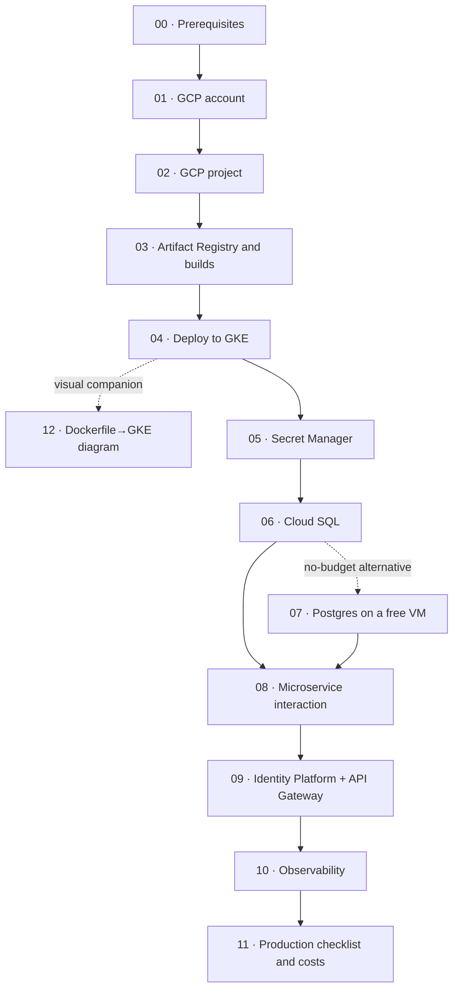

## GKE_GCP_DEPLOYMENT — Step-by-step guides

This directory contains **step-by-step** guides to deploy this repo's microservices to **Google Cloud Platform (GCP)** using **Google Kubernetes Engine (GKE)**, move persistence to **Cloud SQL (PostgreSQL)**, define **secure interaction** between microservices, and **secure** the APIs with **Identity Platform**.

### Scope (important)

- **Documentation only**: these guides describe what to do in GCP and which changes Spring Boot applications would need.
- **No changes are made to the repo code**: no dependencies are added, no properties are changed, and no `Dockerfile`, `cloudbuild.yaml`, Terraform, etc. are created (Kubernetes manifests are documented as infrastructure files outside the repo).
- Where the process requires application changes, they are listed as **instructions** (which file to touch and what to add) for you to apply outside this work.

### Microservices in the repo (quick reference)

- **wizard-service**: `/api/wizards` (+ `/api/wizards/attack`)
- **inventory-service**: `/api/inventory/wands`, `/api/inventory/potions`, `/api/inventory/brooms`
- **duel-service**: `/api/duels`

Request examples are in the repo's Postman collection: `Hogwarts_API.postman_collection.json`.

### Reading order

Each file's number reflects the actual reading order: every guide only assumes steps from **previous** files.

1. `00_local_prerequisites_and_tools.md`
2. `01_gcp_account_setup.md`
3. `02_gcp_project_setup.md`
4. `03_artifact_registry_and_builds.md`
5. `04_gke_microservices.md`
6. `05_secret_manager_and_environment_config.md`
7. `06_cloud_sql_database.md` — or, as a no-budget alternative, `07_free_postgres_vm_alternative.md`
8. `08_microservice_interaction_id_validation.md`
9. `09_api_security_identity_platform.md`
10. `10_observability_logging_monitoring.md`
11. `11_production_checklist_and_costs.md`

Companion diagram (optional): `12_flow_diagram_dockerfile_artifact_registry_gke.md` — a visual summary of the path `Dockerfile` → `docker push` to Artifact Registry → deploy to GKE.
